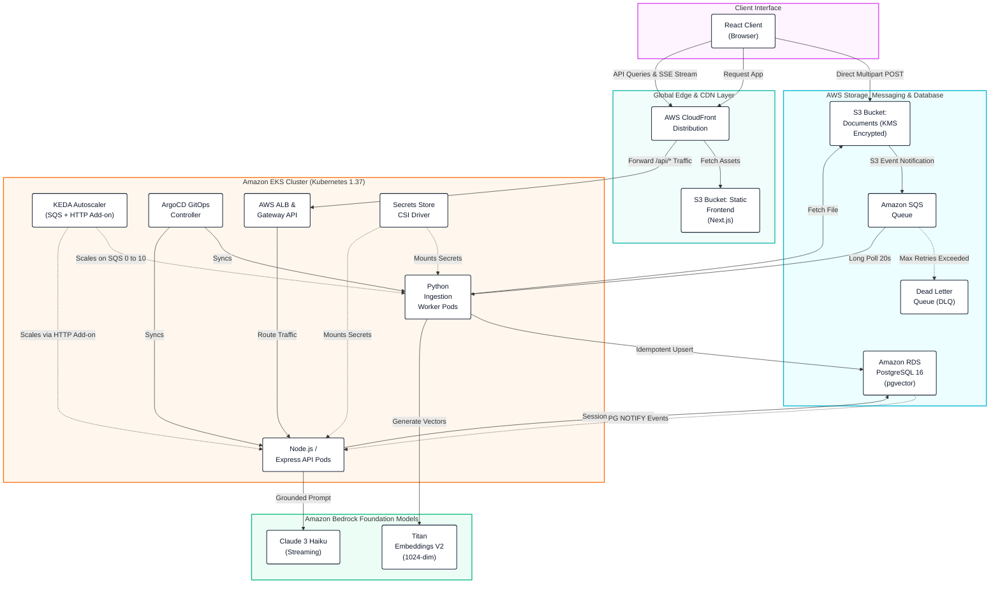

<p align="center">
  
</p>

<h1 align="center">AI Document Intelligence Platform</h1>

<p align="center">
  <strong>A production-grade, multi-tenant Retrieval-Augmented Generation (RAG) platform on AWS EKS.</strong>
</p>

<p align="center">
  
  
  
  
  
  
  
  
  
  
</p>

<p align="center">
  <a href="#system-architecture"><strong>Architecture</strong></a> &bull;
  <a href="#architectural-qualities"><strong>Engineering Highlights</strong></a> &bull;
  <a href="#services-overview"><strong>Services</strong></a> &bull;
  <a href="#deployment--cicd-lifecycle"><strong>CI/CD & GitOps</strong></a> &bull;
  <a href="#quick-start"><strong>Quick Start</strong></a> &bull;
  <a href="https://parth9218.github.io/Document-Intelligence-Platform/"><strong>📖 Full Documentation</strong></a>
</p>

---

## Overview

The **AI Document Intelligence Platform** is an enterprise-grade, cloud-native Retrieval-Augmented Generation (RAG) system engineered to ingest unstructured enterprise documents (PDF and plaintext), extract and transform content into high-dimensional vector embeddings, and serve conversational Q&A sessions with real-time token streaming and verified, page-level citation attribution.

Designed and implemented as a portfolio flagship, the project demonstrates production competencies across the senior cloud, DevOps, and platform engineering domains:

* **AWS DevOps Engineer Professional (AWS-DOP)**: Multi-environment infrastructure via modular Terraform, EKS cluster management, EKS Pod Identity Associations (the AWS-recommended successor to IRSA), Amazon RDS PostgreSQL with `pgvector`, IAM Database Authentication, asynchronous SQS/DLQ messaging, KMS customer-managed key encryption, AWS Secrets Manager integrated via CSI, and Amazon CloudFront unified edge routing.
* **Certified Kubernetes Administrator (CKA)**: Modern Kubernetes Gateway API (`GatewayClass`, `Gateway`, `HTTPRoute`) backed by the AWS Load Balancer Controller, KEDA event-driven autoscaling with scale-to-zero capabilities, External Secrets Operator (ESO) for automated credential rotation, non-root least-privilege container workloads, and declarative resource definitions via custom Helm charts.
* **GitOps Continuous Delivery**: ArgoCD Multi-Source ApplicationSets synchronizing private AWS ECR OCI Helm charts and GitOps environment configuration repositories, pinned strictly to immutable Git commit SHAs and audited container digests.

---

## Architectural Qualities

| Quality | Implementation Architecture | Production Rationale |
| :--- | :--- | :--- |
| **🔄 Event-Driven Scaling** | KEDA HTTP Add-on for API concurrency; KEDA SQS scaler (0→10) for background workers | Automatically scales ingestion compute to zero during idle periods, eliminating idle EC2 costs while absorbing burst uploads. |
| **🔒 Zero Static Credentials** | IAM Database Authentication, EKS Pod Identity Associations, AWS Secrets Store CSI Driver | Eliminates long-lived database passwords and static AWS IAM access keys from Kubernetes manifests and running container pods. |
| **🌐 Modern Ingress Routing** | Kubernetes Gateway API + AWS Load Balancer Controller (`HTTPRoute`) | Adopts the modern, expressive Kubernetes Gateway standard over legacy Ingress controllers for role-oriented traffic management. |
| **🔑 Dynamic Secret Rotation** | External Secrets Operator (ESO) generating 12-hour AWS ECR tokens on an hourly schedule | Resolves private OCI Helm chart pull authentication in ArgoCD dynamically without human intervention or cluster restarts. |
| **♻️ Resilient Ingestion & Idempotency** | PostgreSQL `ON CONFLICT DO UPDATE`, SQS 600s visibility timeouts, batch checkpoint resumption | Guarantees that worker failures or SQS retries resume seamlessly from the last committed batch without duplicating chunks or re-embedding. |
| **📦 Strict Artifact Immutability** | "Build once in dev, promote identical immutable artifacts to stg/prod" across containers, Helm OCI packages, and frontend bundles | Guarantees that production deploys the exact, tested binaries verified in lower environments, eliminating drift and rebuild anti-patterns. |
| **☁️ Direct S3 Upload Acceleration** | AWS SDK v3 S3 Presigned POST with embedded policy conditions (`content-length-range`, `Content-Type`) | Offloads multi-megabyte document uploads from API pods directly to S3 while enforcing file size and MIME constraints at the storage layer. |
| **🔌 Strategy/Plugin Providers** | Decoupled provider strategy pattern for Embeddings and LLMs with runtime environment switching | Enables zero-cost local development using containerized models (Sentence-Transformers & Ollama) while binding AWS Bedrock (Titan V2 & Claude) in the cloud. |
| **🚀 Commit-Pinned GitOps** | ArgoCD ApplicationSet Matrix generator combining private OCI Helm charts with Git environment values | Eliminates deployment drift from tracking mutable branches or floating tags by pinning releases to exact, audited commit SHAs. |
| **🔀 Serialized CI/CD Governance** | Concurrency groups (`git-commit-dev`, `git-commit-${env}-app`) with non-destructive selective checkouts | Prevents Git ref locking collisions across parallel deployment pipelines and protects sibling microservices on shared environment release branches. |

---

## System Architecture

<p align="center">
  
</p>

<details>
<summary><strong>View Architecture Component Details & Flow Specifications</strong></summary>


</details>

> **Note on Unified Edge Routing**: To prevent browser mixed-content rejections (HTTPS frontend calling an HTTP ALB) without incurring the cost of custom domain certificates, Amazon CloudFront acts as the single unified ingress. CloudFront routes static asset requests to S3 and forwards `/api/*` paths directly to the ALB origin.
>
> **Note on Real-Time Ingestion Progress**: Document processing state changes are broadcast via session-scoped PostgreSQL `LISTEN/NOTIFY` channels (`progress_{sessionId}`) and pushed to the client via Server-Sent Events (SSE). *Architectural Caveat: Suitable for designed concurrent session limits; at massive multi-thousand tenant scale, a dedicated distributed broker (such as Redis Pub/Sub) would decouple database transactions from active client SSE connections.*

---

## Services Overview

The platform is designed around a polyglot microservices topology that aligns runtime characteristics with workload demands:

| Service | Runtime / Stack | Core Responsibilities | Entry Point |
| :--- | :--- | :--- | :--- |
| **API Service** | Node.js 24 / TypeScript Express / Prisma ORM | Fast asynchronous I/O, session HMAC verification, S3 presigned POST generation, vector similarity search via `pgvector`, Bedrock Claude streaming, Server-Sent Events (SSE) progress push. | [`apps/api`](apps/api) |
| **Worker Service** | Python 3.12 / boto3 / SQLAlchemy ORM / PyMuPDF | Async daemon polling SQS, PDF magic-byte validation, text extraction, sliding-window chunking, Titan V2 embeddings, batch upserts, and DLQ monitoring. | [`apps/worker`](apps/worker) |
| **Frontend Client** | Next.js 16 (App Router) / React 19 / Tailwind CSS v4 | Static SPA compiled via `output: 'export'`, drag-and-drop batch upload orchestrator, real-time ingestion feed, interactive citation badges, and runtime `config.js` decoupling. | [`apps/frontend`](apps/frontend) |
| **AWS Infrastructure** | Terraform (Modular) | Provisions VPC, EKS cluster, RDS PostgreSQL with pgvector, S3 buckets, SQS queues, ECR repositories, KMS keys, and Secrets Manager. | [`infra/terraform/aws`](infra/terraform/aws) |
| **Kubernetes Platform** | Terraform & Kubernetes Gateway API | Deploys AWS Load Balancer Controller, Gateway API manifests, ArgoCD, Secrets Store CSI Driver, External Secrets Operator, and KEDA scalers. | [`infra/terraform/k8s`](infra/terraform/k8s) |
| **Remote State Query** | Terraform (Zero-Provider Module) | Lightweight state inspection module that queries S3 remote state directly without downloading heavy cloud provider plugins. | [`infra/terraform/query`](infra/terraform/query) |

---

## End-to-End Processing & Retrieval Flows

### 1. Ingestion Pipeline
1. **Presigned Authorization**: The browser requests upload credentials via `POST /api/documents`. The API validates session concurrency (max 5 active uploads) and cumulative quota (max 50 MB), then generates an S3 Presigned POST payload embedded with byte-range and MIME policies.
2. **Direct Storage Ingestion**: The browser uploads directly to Amazon S3 via multipart POST. Upon receiving HTTP 204 from S3, the browser notifies the API via `POST /api/documents/:id/confirm-upload`.
3. **Event Notification**: S3 publishes an `s3:ObjectCreated:*` event directly to Amazon SQS.
4. **Worker Processing**: Background worker pods poll SQS (`WaitTimeSeconds=20`), transition document status to `downloading`, fetch the object, sniff magic bytes (`%PDF`), and parse text page-by-page using PyMuPDF.
5. **Chunking & Vectorization**: Extracted text is segmented using a sliding window (~500 tokens, 75-token overlap). Vectors are generated via Amazon Bedrock Titan Embeddings V2 (1024 dimensions) or local Sentence-Transformers.
6. **Idempotent Upsert & Progress Checkpointing**: Chunks are committed to PostgreSQL using `ON CONFLICT (document_id, chunk_index) DO UPDATE`. Progress counters are updated in batches of 50, triggering PostgreSQL NOTIFY events to update active browser SSE sessions.

### 2. Retrieval & Grounded Q&A Flow
1. **Query Embedding**: The user submits a question via `POST /api/query/search`. The API embeds the question into a 1024-dimensional query vector.
2. **Tenancy-Partitioned Similarity Search**: The query executes against `document_chunks` using cosine distance (`<=>`), strictly partitioned by the caller's authenticated session:
   ```sql
   SELECT c.content, c.page_number, d.filename
   FROM document_chunks c
   JOIN documents d ON c.document_id = d.id
   WHERE c.session_id = $1::uuid AND (c.embedding <=> $2::vector) <= 0.5
   ORDER BY c.embedding <=> $2::vector ASC LIMIT 5;
   ```
3. **Grounded Generation & Citation Verification**: Retrieved passages are assembled into a structured system prompt with bracketed indices (`[1]...[5]`). As Claude 3 Haiku streams response tokens back, an inline citation validator extracts bracket tokens, verifies them against retrieved context IDs, filters out hallucinated references, and streams verified citation metadata to the browser via SSE.

---

## Deployment & CI/CD Lifecycle

The platform enforces a multi-environment delivery model (`dev` &rarr; `stg` &rarr; `prod`) governed by strict architectural principles:

```mermaid
flowchart LR
    subgraph DevBranch ["Trunk Development (dev)"]
        Commit["Push to dev"] --> BuildDev["Build & Package Once<br/>(Docker / Helm OCI / Next.js)"]
        BuildDev --> PushDev["Publish to Dev Registries<br/>(ECR / S3 Artifacts)"]
        PushDev --> DeployDev["Auto GitOps Commit<br/>(dev branch)"]
    end

    subgraph StagingRelease ["Staging Verification (stg)"]
        TagStg["Tag: stg-*-v*"] --> VerifyDev["Verify Prerequisite in Dev"]
        VerifyDev --> PromoteStg["Promote Immutable Artifact<br/>(Zero Rebuilding)"]
        PromoteStg --> GateStg["Manual Approval Gate"]
        GateStg --> DeployStg["2-Commit GitOps Dance<br/>(stg/app branch)"]
    end

    subgraph ProdRelease ["Production Promotion (prod)"]
        TagProd["Tag: prod-*-v*"] --> VerifyStg["Verify Prerequisite in Staging"]
        VerifyStg --> PromoteProd["Promote Immutable Artifact<br/>(Zero Rebuilding)"]
        PromoteProd --> GateProd["Manual Approval Gate"]
        GateProd --> DeployProd["2-Commit GitOps Dance<br/>(prod/app branch)"]
    end

    DeployDev --> TagStg
    DeployStg --> TagProd

    style DevBranch fill:#f8fafc,stroke:#64748b,stroke-width:1.5px;
    style StagingRelease fill:#f0fdf4,stroke:#22c55e,stroke-width:1.5px;
    style ProdRelease fill:#fef2f2,stroke:#ef4444,stroke-width:1.5px;
```



* **Build Once in Dev, Promote Immutably**: Containers and assets are compiled strictly on `dev`. Releases to staging and production never rebuild from source; they verify lower-environment digests and promote identical, tested binaries.
* **Dual Container Variants (API)**: In `dev`, the pipeline compiles both a `full` variant with Swagger documentation UI (`${SHORT_SHA}`) and an optimized `slim` variant (`${SHORT_SHA}-slim`). Promotion to higher environments promotes only the hardened `slim` image.
* **ArgoCD Multi-Source ApplicationSet**: Combines private AWS ECR OCI Helm charts with Git-managed environment configuration values (`values.yaml`), pinned to audited commit SHAs in `config.json`.
* **Serialized Concurrency Governance**: GitOps commit jobs acquire concurrency locks (`git-commit-dev`, `git-commit-${env}-app`) with non-destructive selective checkouts, preventing Git ref locking collisions across parallel workflows.

---

## Quick Start

### Prerequisites
* Docker & Docker Compose v2+
* Node.js 20+ and Python 3.11+ (for standalone local development)
* AWS CLI v2 (for cloud operations)

### 1. Local Full-Stack Parity (LocalStack & Containerized pgvector)
Run the complete decoupled platform locally without cloud API dependencies:

```bash
# Clone the repository
git clone https://github.com/your-org/document-intelligence-platform.git
cd document-intelligence-platform

# Boot local PostgreSQL (with pgvector), LocalStack (S3 + SQS), and Ollama
docker compose up -d

# Verify infrastructure health
curl http://localhost:4566/_localstack/health
```

### 2. Standalone Service Execution

#### API Service (Node.js / Express)
```bash
cd apps/api
cp .env.example .env
npm install
npx prisma migrate dev
npm run dev
# API listening at http://localhost:3000 (Swagger docs at /api-docs in non-prod)
```

#### Ingestion Worker (Python Daemon)
```bash
cd apps/worker
cp .env.example .env
python3 -m venv .venv && source .venv/bin/activate
pip install -r requirements.txt
python main.py
# Worker long-polling SQS queue
```

#### Frontend Client (Next.js)
```bash
cd apps/frontend
cp .env.example .env.development
npm install
npm run dev:local
# Application available at http://localhost:3001
```

---

## 🚧 Planned Enhancements

The following roadmap items represent designed architectural enhancements scheduled for subsequent development phases:

* 🚧 **Vendor-Neutral OpenTelemetry Instrumentation**: Full distributed tracing across the React client, Express API, Python worker, and database layers using the OpenTelemetry standard to avoid vendor lock-in.
* 🚧 **PR Validation Testing Gates**: Pre-merge GitHub Actions pull request validation pipeline enforcing unit test passes and linting checks before merges to `dev`.
* 🚧 **Cryptographically Signed GitOps Commits**: Automated GPG/SSH commit signing for automated pipeline updates on protected release tracking branches (`{env}/app`).
* 🚧 **Cluster Hardening with Kyverno & NetworkPolicies**: Zero-trust namespace isolation, ingress/egress restriction policies, and admission control compliance checks.
* 🚧 **Live CI/CD Workflow Status Badges**: Dynamic test execution and deployment status reporting directly within repository headers.

---

## Technical Documentation Website

A comprehensive technical documentation website built with **Material for MkDocs** is published to GitHub Pages at:

👉 **[https://parth9218.github.io/Document-Intelligence-Platform/](https://parth9218.github.io/Document-Intelligence-Platform/)**

It covers detailed architectural specifications, interactive pan-zoom sequence diagrams, and 14 engineering challenge post-mortems:

* **[System Architecture](https://parth9218.github.io/Document-Intelligence-Platform/architecture/overview/)** &bull; **[Data Flows](https://parth9218.github.io/Document-Intelligence-Platform/architecture/data-flow/)** &bull; **[Technology Stack](https://parth9218.github.io/Document-Intelligence-Platform/architecture/technology-stack/)**
* **[Design Decision Records (ADRs)](https://parth9218.github.io/Document-Intelligence-Platform/design-decisions/)** &bull; **[Engineering Challenges](https://parth9218.github.io/Document-Intelligence-Platform/challenges/)**
* **[Database Schema & pgvector](https://parth9218.github.io/Document-Intelligence-Platform/database/schema/)** &bull; **[Dual ORM Architecture](https://parth9218.github.io/Document-Intelligence-Platform/database/dual-orm-strategy/)**
* **[Terraform AWS Modules](https://parth9218.github.io/Document-Intelligence-Platform/infrastructure/aws/overview/)** &bull; **[Kubernetes Platform & Gateway API](https://parth9218.github.io/Document-Intelligence-Platform/infrastructure/kubernetes/overview/)**
* **[CI/CD Pipelines & Immutable Promotion](https://parth9218.github.io/Document-Intelligence-Platform/deployment/overview/)** &bull; **[Security Architecture](https://parth9218.github.io/Document-Intelligence-Platform/security/overview/)**

### Running Documentation Locally
```bash
# Run local MkDocs development server
docs-site/.venv-docs/bin/mkdocs serve -f docs-site/mkdocs.yml
# Visit http://127.0.0.1:8000
```

---

## License & Attribution

This project is licensed under the [MIT License](LICENSE). Designed and developed as a portfolio demonstration of enterprise cloud architecture, DevOps, and cloud-native Kubernetes platform engineering.
