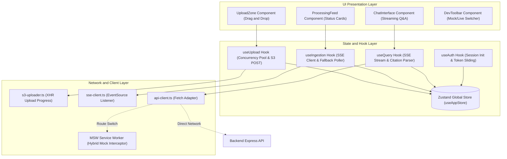
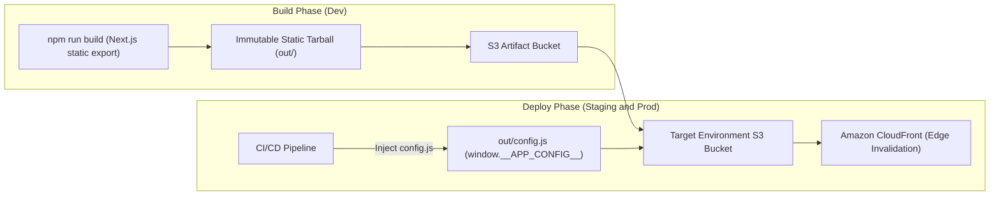

# Frontend Application Client

<p align="center">
  <strong>Client-side Single Page Application built with Next.js 16 App Router, React 19, and Tailwind CSS v4. Statically exported to Amazon S3 and served globally via Amazon CloudFront with decoupled runtime configuration and hybrid MSW mocking.</strong>
</p>

<p align="center">
  
  
  
  
  
  
</p>

<p align="center">
  <a href="#overview">Overview</a> &bull;
  <a href="#core-technologies--dependencies">Dependencies</a> &bull;
  <a href="#architecture--component-topology">Architecture</a> &bull;
  <a href="#decoupled-runtime-configuration-configjs">Runtime Config</a> &bull;
  <a href="#hybrid-api-routing--msw-engine">MSW Engine</a> &bull;
  <a href="#local-development">Local Setup</a> &bull;
  <a href="#static-export--s3cloudfront-deployment">Deployment</a> &bull;
  <a href="https://parth9218.github.io/Document-Intelligence-Platform/">📖 Full Documentation</a>
</p>

---

## Overview

The **Frontend Application** is a responsive web client for the AI Document Intelligence Platform. Designed with modern glassmorphic UI components, dynamic HSL-based light/dark theme variables, and accessible W3C contrast standards, it delivers an interactive document ingestion and retrieval experience.

The client orchestrates drag-and-drop batch document uploads directly to Amazon S3 via presigned multipart POST policies, listens to real-time ingestion progress over session-scoped Server-Sent Events (SSE) with an automatic 3-second polling fallback, and provides an interactive conversational chat interface that streams grounded AI answers from Claude while parsing page-level citation popovers.

---

## Core Technologies & Dependencies

| Dependency                  | Purpose                           | Production Implementation                                                               |
| :-------------------------- | :-------------------------------- | :-------------------------------------------------------------------------------------- |
| `next` (v16.2)              | React framework & SSG compiler    | Configured with `output: 'export'` for purely static HTML/CSS/JS export                 |
| `react` & `react-dom` (v19) | Modern UI library                 | Client-side reactive rendering, optimistic updates, and component lifecycle             |
| `zustand` (v5.0)            | Global state management           | Centralized store for session state, upload queues, document registry, and chat history |
| `tailwindcss` (v4)          | Utility-first CSS framework       | Modern CSS styling using CSS variables, theme switching, and glassmorphism              |
| `msw` (Mock Service Worker) | API mocking & offline development | Intercepts browser HTTP/SSE requests in development via Service Workers                 |
| `lucide-react`              | Semantic icon library             | UI iconography across dashboard feeds, cards, status tags, and citation popovers        |
| `clsx` & `tailwind-merge`   | Conditional class resolution      | Safely merges conditional Tailwind CSS classes without style conflicts                  |

---

## Architecture & Component Topology

The client is structured around decoupled hooks that encapsulate networking, queue management, and streaming protocols away from presentation components:



### Core User Experiences

1. **Direct S3 Multipart Upload (`s3-uploader.ts`)**: Files selected in `<UploadZone />` are uploaded directly to Amazon S3 via `XMLHttpRequest` to capture real-time byte upload progress (0–100%). On completion (`204 No Content`), the client invokes `POST /api/documents/:id/confirm-upload`.
2. **Session-Scoped Ingestion Feed (`useIngestion.ts`)**: Subscribes to `GET /api/documents/progress` using a single browser `EventSource`. Renders stage tags (`Validating`, `Extracting`, `Chunking`, `Embedding`, `Completed`) and progress percentages. Automatically falls back to polling `GET /api/documents/status` every 3 seconds if the SSE socket disconnects.
3. **Conversational Citations (`useQuery.ts`)**: Streams response tokens from `POST /api/query/search` using `ReadableStream`. Identifies inline `[1]...[n]` brackets and dynamically transforms them into interactive `<CitationBadge />` components that display filename, page number, relevance score, and source passage text on hover.

---

## Decoupled Runtime Configuration (`config.js`)

In traditional Single Page Applications, environment variables prefixed with `NEXT_PUBLIC_*` are statically evaluated and inlined into JavaScript bundles at compile time. This creates a severe anti-pattern: deploying to multiple environments requires rebuilding the application from scratch, violating artifact immutability.

This platform resolves this challenge using the **Runtime `config.js` Injection Pattern**:



### Runtime Priority Chain

When making API calls, `api-client.ts` resolves endpoints through an explicit priority order:

1. **Runtime Injected Configuration**: `window.__APP_CONFIG__.API_URL` (injected into S3 bucket root by CI/CD pipeline).
2. **Compile-Time Build Fallback**: `process.env.NEXT_PUBLIC_API_URL` (used during local development).
3. **Relative Path Fallback**: `""` (relies on CloudFront reverse-proxy forwarding `/api/*` to the ALB origin).

```html
<!-- Injected in apps/frontend/src/app/layout.tsx -->
<script src="/config.js" strategy="beforeInteractive" />
```

---

## Hybrid API Routing & MSW Engine

To allow frontend development completely independent of AWS services or backend API availability, the client features a **Mock Service Worker (MSW)** hybrid routing engine:

- **Granular Route Toggles**: Individual endpoints can be routed to `'api'` (live backend) or `'mock'` (browser Service Worker emulation) independently via `src/config/api-routing.ts`.
- **Interactive Floating DevToolbar**: In development mode (`NODE_ENV !=='prod'`), a floating dev widget (`<DevToolbar />`) appears in the bottom right corner, allowing developers to toggle between Live API and Mock modes on the fly.
- **Realistic Emulation**: The mock handlers emulate S3 upload latencies, quota validation rejections (HTTP 400/429), and readable SSE streams with simulated tokens and citation payloads.

---

## Local Development

### Prerequisites

- **Node.js**: `v20.x` or higher
- **Backend API** (optional): Running on `http://localhost:3000` (can be omitted if using MSW mock mode)

### Setup Instructions

1. **Configure Environment Variables**:

   ```bash
   cp .env.example .env.development
   ```

2. **Install Dependencies**:

   ```bash
   npm install
   ```

3. **Start Development Server**:
   ```bash
   # Start with local environment settings on port 3001
   npm run dev:local
   ```
   Open `http://localhost:3001` in your browser. The application loads with MSW active and `<DevToolbar />` enabled.

### Key Environment Variables

| Variable               | Default (Local)         | Purpose                                           |
| :--------------------- | :---------------------- | :------------------------------------------------ |
| `NEXT_PUBLIC_API_URL`  | `http://localhost:3000` | Backend API base URL for live requests            |
| `NEXT_PUBLIC_API_MODE` | `hybrid`                | Default routing mode (`api`, `mock`, or `hybrid`) |

---

## Static Export & S3/CloudFront Deployment

The frontend does **not** run inside a Docker container or Kubernetes cluster. Following cloud-native best practices (ADR-003), it is compiled into pure static HTML/CSS/JavaScript assets and distributed via Amazon S3 and Amazon CloudFront.

### Export Pipeline

```bash
# Compiles the Next.js application into static files under out/
npm run build
```

`next.config.ts` enforces static generation:

```typescript
const nextConfig: NextConfig = {
  output: "export",
  trailingSlash: true,
  images: { unoptimized: true },
};
```

---

## Key Scripts

| Command             | Description                                                                    |
| :------------------ | :----------------------------------------------------------------------------- |
| `npm run dev:local` | Starts Next.js development server with `.env.development` on port 3001         |
| `npm run dev:prod`  | Starts Next.js development server with `.env.production` on port 3001          |
| `npm run build`     | Builds and statically exports the client application into the `out/` directory |
| `npm run lint`      | Runs ESLint verification across TypeScript components                          |

---

## Documentation Links

- [Frontend Architecture & Next.js Setup](https://parth9218.github.io/Document-Intelligence-Platform/services/frontend/overview/)
- [Session Authentication & Auth Shell](https://parth9218.github.io/Document-Intelligence-Platform/services/frontend/session-auth-flow/)
- [Direct Multipart S3 Upload Engine](https://parth9218.github.io/Document-Intelligence-Platform/services/frontend/batch-upload-s3/)
- [Real-Time SSE & Ingestion Visualizer](https://parth9218.github.io/Document-Intelligence-Platform/services/frontend/realtime-progress/)
- [Streaming Q&A Chat & Citation Popovers](https://parth9218.github.io/Document-Intelligence-Platform/services/frontend/chat-streaming/)
- [MSW Hybrid Mock Engine & DevToolbar](https://parth9218.github.io/Document-Intelligence-Platform/services/frontend/msw-mock-system/)
- [Decoupled Runtime Configuration (`config.js`)](https://parth9218.github.io/Document-Intelligence-Platform/services/frontend/runtime-config/)
