# Cloud Cost Optimization & Scaling Economics

The platform applies cloud financial engineering principles to eliminate idle resource consumption, minimize API gateway bandwidth amplification, and ensure predictable infrastructure billing.

---

## Architectural Cost Optimization Strategies

```mermaid
flowchart TD
    subgraph zero_idle ["Zero-Idle Compute"]
        KEDA["KEDA Autoscaler"] -->|0 Queued Messages| Worker0["Python Worker Pods: 0<br/>(Zero Compute Cost)"]
        KEDA -->|Messages Detected| WorkerScale["Scale up to 10 Pods<br/>(Only when active)"]
    end

    subgraph serverless_edge ["Serverless Edge"]
        CF["CloudFront + S3 Bucket"] -->|Static React Assets| ZeroEKS["0 EKS Pods or RAM for frontend<br/>(Fraction of a cent / month)"]
    end

    subgraph storage_ingress ["Direct Storage Ingress"]
        Browser["React Client"] -->|Presigned POST| S3Bucket["Direct S3 Multipart"]
        S3Bucket -.->|Bypasses API Gateway| SavedBandwidth["Zero API Network / Memory buffering cost"]
    end

    subgraph offline_dev ["Offline Dev Parity"]
        Docker["Local Docker Compose"] -->|LocalStack + pgvector + E5| ZeroAWS["Zero Cloud Bill during local development & testing"]
    end
```

### 1. Scale-to-Zero Worker Daemon (KEDA)

- **Problem**: Document ingestion is inherently bursty. Running permanent EC2/Fargate worker instances wastes money during quiet hours.
- **Solution**: KEDA monitors SQS queue depth via `ApproximateNumberOfMessagesVisible`. When the queue is empty, worker deployment scales to **0 replicas**. Pods are spun up only when files are waiting to be processed.

### 2. Edge-Cached Static Frontend

- **Problem**: Running a containerized Next.js Node.js server inside Kubernetes requires minimum 2 replicas (~0.5 vCPU, 1GB RAM) behind an internal load balancer (~$35–$50/month).
- **Solution**: The Next.js frontend is compiled as a static HTML/JS export (`output: 'export'`) and hosted in an S3 bucket fronted by CloudFront. Hosting costs drop to **under $3.00/month** while providing global sub-50ms edge delivery.

### 3. Direct Multipart S3 Ingestion

- **Problem**: Proxying 5MB PDF uploads through an API container multiplies network transfer costs (Client → ALB → API Pod → S3) and exhausts pod memory under concurrent loads.
- **Solution**: The API only issues presigned POST credentials. The browser streams bytes directly to S3, reducing API pod resource requirements to lightweight 0.1 vCPU / 128MB RAM configurations.

### 4. Single Multi-Tenant Relational & Vector Persistence

- **Problem**: Dedicated vector databases (e.g. Pinecone standard tiers starting at $70+/month) add independent billing overhead and operational complexity.
- **Solution**: PostgreSQL with `pgvector` co-locates relational application data (`sessions`, `documents`, `processing_jobs`) and vector embeddings in a single managed RDS instance, protected by parameterized session filters (`WHERE session_id = $1`).

### 5. Local Emulation for Speculative Development

- **Problem**: Running integration and regression test suites against AWS Bedrock, SQS, and RDS accrues developer API fees.
- **Solution**: Full local environment parity via Docker Compose using `LocalStack` (emulating S3 and SQS), containerized `pgvector`, and CPU-native embedding models (`intfloat/e5-large-v2` via `sentence-transformers`) eliminates speculative development costs.

---

## Estimated Monthly AWS Infrastructure Run-Rate

The following breakdown models a standard small-to-medium enterprise production deployment on AWS (`us-east-1`):

| Infrastructure Component         | AWS Service & Sizing Specification                                                        | Monthly Cost (USD)   |
| :------------------------------- | :---------------------------------------------------------------------------------------- | :------------------- |
| **EKS Control Plane**            | Amazon EKS Managed Cluster (`v1.37`)                                                      | $73.00               |
| **Cluster Worker Compute**       | EKS Auto Mode / Karpenter managed nodes (Average 1–2 `t4g.medium` Graviton instances)     | ~$45.00              |
| **Relational & Vector Database** | Amazon RDS PostgreSQL `db.t4g.medium` (Single-AZ, 50GB gp3 storage)                       | ~$52.00              |
| **Storage & Ingestion**          | Amazon S3 Standard (Storage, Presigned PUT/POST API requests, lifecycle rules)            | ~$2.50               |
| **Asynchronous Messaging**       | Amazon SQS (Standard Queue + DLQ, ~1,000,000 polling requests)                            | ~$0.50               |
| **Edge Distribution & CDN**      | Amazon CloudFront (Global transfer out, API reverse proxying, TLS termination)            | ~$3.00               |
| **Secrets & Encryption**         | AWS Secrets Manager (4 managed secrets) + AWS KMS customer-managed keys                   | ~$2.00               |
| **AI Foundation Models**         | Amazon Bedrock (Pay-per-token: Titan Embeddings V2 + Claude 3.5 Sonnet, ~100k tokens/day) | ~$7.00               |
| **Total Base Monthly Run-Rate**  |                                                                                           | **~$185.00 / month** |

---

## Architecture Cost Comparison

| Architectural Aspect    | Traditional RAG Architecture        | AI Document Intelligence Platform        | Cost Impact                              |
| :---------------------- | :---------------------------------- | :--------------------------------------- | :--------------------------------------- |
| **Worker Scaling**      | 2–4 Always-on worker pods           | KEDA event-driven scale-to-zero (0→10)   | **~65% compute reduction**               |
| **Frontend Serving**    | 2 Containerized SSR pods in EKS     | Static export on S3 + CloudFront CDN     | **~90% frontend hosting reduction**      |
| **File Ingestion Path** | Proxied through API pods to storage | Direct browser-to-S3 presigned POST      | **Zero API bandwidth amplification**     |
| **Vector Storage**      | Dedicated SaaS vector database      | Native PostgreSQL extension (`pgvector`) | **Consolidated single-database billing** |
| **Development Testing** | Live cloud staging environments     | LocalStack + pgvector + local E5 models  | **$0 local testing expenditure**         |
