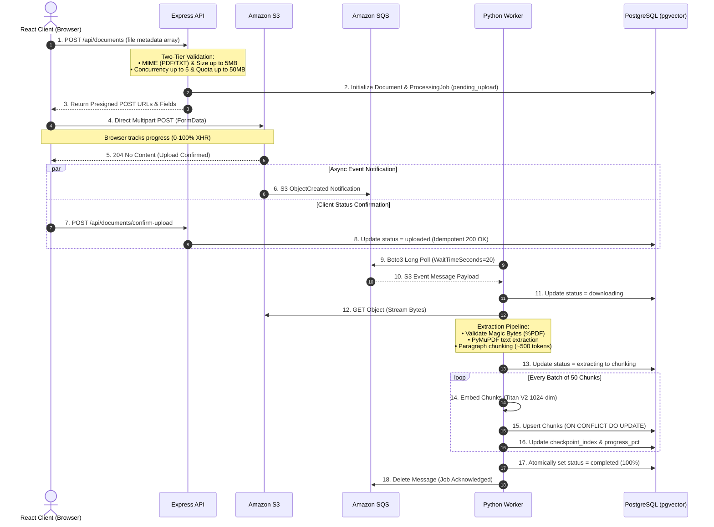
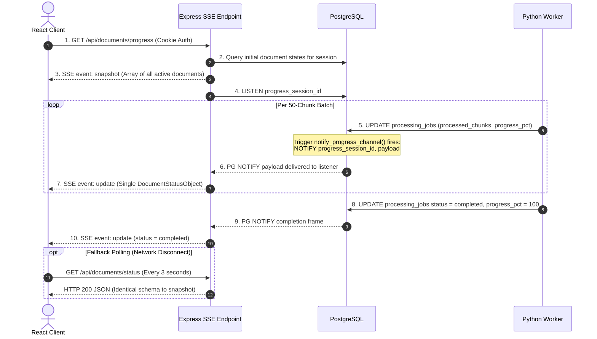
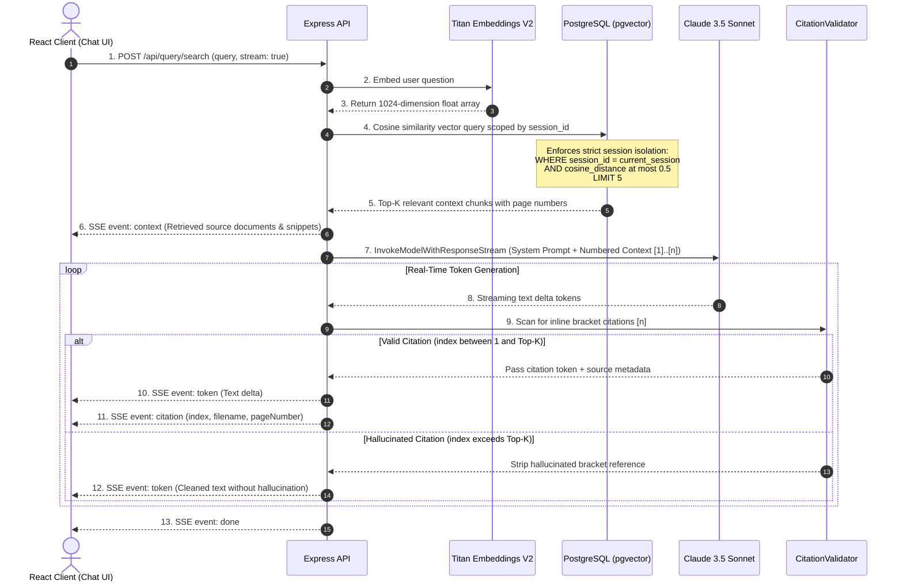

# End-to-End Data Flows

The platform implements three decoupled, asynchronous data lifecycles to balance high I/O throughput, compute-intensive document extraction, and low-latency grounded retrieval.

---

## 1. Direct S3 Ingestion & Extraction Lifecycle

Files are never proxied through the API server. The browser uploads directly to S3 via presigned POST policies, triggering an event notification chain through Amazon SQS to the Python worker daemon.

### Key Ingestion Invariants
- **Presigned POST vs PUT**: Uses AWS SDK v3 `createPresignedPost()` to embed strict infrastructure-level policy conditions (`content-length-range` [1B, 5MB] and `Content-Type`), preventing unauthorized storage tampering at S3.
- **Confirm-Upload Idempotency**: If the SQS consumer picks up the message and transitions the job to `downloading` before the client's `confirm-upload` HTTP call arrives, the API logs the event and safely returns `200 OK` rather than a `409 Conflict`.
- **Checkpoint Resumption**: Batch upserts commit to `document_chunks` using `ON CONFLICT (document_id, chunk_index) DO UPDATE`. If a worker crashes mid-document, the replacement worker resumes from `checkpoint_index + 1`.

---

## 2. Real-Time Progress Notification Lifecycle

Real-time processing updates are pushed to the frontend via a single session-scoped Server-Sent Events (SSE) stream backed by PostgreSQL `LISTEN/NOTIFY`.

### Architectural Scalability Caveat
- **Current Topology**: PostgreSQL `LISTEN/NOTIFY` routes events directly to session-scoped channels (`progress_{sessionId}`) with zero Express-side filtering overhead.
- **Enterprise Trade-off**: Maintaining persistent database connections for SSE listeners consumes database connection headroom. For massive enterprise multi-tenancy (>10,000 concurrent sessions), a dedicated distributed pub/sub broker (such as Redis Pub/Sub) would decouple the database listener pool from the client-facing API tier.

---

## 3. Grounded RAG Retrieval & Streaming Answer Lifecycle

The query engine implements a strict Retrieval-Augmented Generation loop that verifies citations inline to prevent hallucinated references.

### Grounding & Citation Validation Rules
1. **Numbered Context Injection**: Chunks are provided to Claude using sequential bracket indices: `[1] (Source: doc_a.pdf, Page: 4): "..."`.
2. **Deterministic Validation**: The `CitationValidator` uses regex matching (`/\[(\d+)\]/g`) against incoming text streams. Any referenced index greater than the number of retrieved context snippets is stripped before reaching the client.
3. **Interactive Popover UI**: The client parses verified `[n]` bracket badges into interactive hover/click cards displaying the exact page number, document name, and text excerpt.
