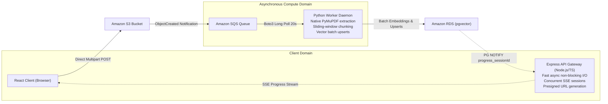
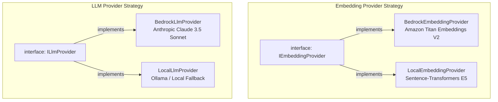

# System Architecture Overview

The **AI Document Intelligence Platform** is a cloud-native, multi-tenant Retrieval-Augmented Generation (RAG) system running on Amazon Elastic Kubernetes Service (EKS). It is engineered for asynchronous, high-throughput document ingestion, dimensional vector indexing, and low-latency grounded question-answering with verifiable citations.

---

## Production System Topology

<div class="architecture-diagram">
  
</div>
---

## Component Boundaries & Responsibilities

The architecture decouples responsibilities across edge routing, client presentation, transactional API serving, asynchronous processing, and managed cloud persistence:

| Component                     | Technology                                 | Core Boundary & Operational Responsibility                                                                                                                                             |
| :---------------------------- | :----------------------------------------- | :------------------------------------------------------------------------------------------------------------------------------------------------------------------------------------- |
| **Edge & CDN**                | Amazon CloudFront                          | Serves static assets globally, enforces TLS, and reverse-proxies `/api/*` traffic to the internal Application Load Balancer (ALB).                                                     |
| **Frontend Client**           | Next.js 16 (React 19, Tailwind v4)         | Single Page Application (SPA) statically exported to S3. Orchestrates direct S3 multipart uploads, listens to SSE progress streams, and renders streaming chat with citation popovers. |
| **API Gateway**               | Node.js 24 / Express (TypeScript)          | Manages signed session state, generates presigned S3 POST credentials, streams SSE ingestion progress via PostgreSQL `LISTEN/NOTIFY`, and coordinates Bedrock RAG retrieval.           |
| **Ingestion Worker**          | Python 3.11 / Boto3 / PyMuPDF              | Asynchronous daemon polling SQS. Validates magic bytes, extracts text page-by-page, generates sliding-window paragraph chunks, computes vector embeddings, and commits batch upserts.  |
| **Messaging Broker**          | Amazon SQS + DLQ                           | Decouples S3 upload events from worker consumption. DLQ captures poison-pill files after 3 failed attempts (`VisibilityTimeout=600s`).                                                 |
| **Relational & Vector Store** | Amazon RDS PostgreSQL + `pgvector`         | Houses transactional tables (`sessions`, `documents`, `processing_jobs`) and 1024-dimensional vector embeddings with HNSW cosine similarity indexes.                                   |
| **AI Foundation Models**      | Amazon Bedrock (Titan V2 & Claude 3.5)     | Computes 1024-dimension text embeddings (`amazon.titan-embed-text-v2:0`) and generates grounded streaming responses (`anthropic.claude-3-5-sonnet-20241022-v2:0`).                     |
| **Workload Autoscaling**      | KEDA (Kubernetes Event-driven Autoscaling) | Scales worker pods 0→10 based on SQS queue depth (`aws-sqs-queue`), and scales Express API pods via the KEDA HTTP Add-on based on connection rate.                                     |

---

## Polyglot Decoupled Strategy

A core architectural tenet is the deliberate separation of client-facing I/O from heavy compute:



### Why Node.js for the API?

- **High Concurrency & Low Latency**: Event-driven non-blocking I/O efficiently maintains hundreds of persistent Server-Sent Events (SSE) connections with minimal memory footprint.
- **Strict Web Contracts**: TypeScript interfaces guarantee typed session validations and OpenAPI schema generation.

### Why Python for the Worker?

- **Specialized Extraction Ecosystem**: PyMuPDF (`fitz`) delivers C-native performance for parsing text and formatting streams from multi-page PDFs without heavy JVM or OCR overhead.
- **Native ML Tooling**: Clean integration with scientific libraries (`numpy`, `sentence-transformers`) for local development fallback.

---

## Provider Strategy Architecture

Both services use the **Strategy Pattern** with factory functions, allowing dynamic switching between cloud Foundation Models and local containerized models via environment variables (`EMBEDDING_PROVIDER` and `LLM_PROVIDER`):



### The Asymmetric E5 Model Prefix Invariant

When running offline with `EMBEDDING_PROVIDER=local` using `intfloat/e5-large-v2`, the system strictly adheres to the E5 model's asymmetric embedding contract:

- **Indexing (Worker)**: Prepends `"passage: "` to each chunk before embedding (`app/services/embeddings.py`):
  ```python
  input_text = f"passage: {text}"
  embedding = model.encode(input_text)
  ```
- **Retrieval (API)**: Prepends `"query: "` to search questions before vector comparison (`src/services/embedding.service.ts`):
  ```typescript
  const formattedInput = `query: ${text}`;
  const output = await extractor(formattedInput, {
    pooling: "mean",
    normalize: true,
  });
  ```

---

## Multi-Tenant Security & Tenant Isolation

Multi-tenancy is enforced through a strict defense-in-depth model across transport, application, and persistence layers:

- **HMAC-SHA256 Session Signing**: Session tokens are cryptographically signed and stored in `HttpOnly`, `SameSite=Lax`, `Secure` cookies. Requests are validated via constant-time comparison (`crypto.timingSafeEqual`).
- **Query-Level Partitioning**: Every relational record (`documents`, `processing_jobs`, `document_chunks`) maintains a foreign key to `sessions.id`. Similarity searches enforce tenant boundaries directly at the SQL level:
  ```sql
  SELECT c.id, c.content, c.page_number, c.embedding <=> $1::vector AS distance
  FROM document_chunks c
  WHERE c.session_id = $2::uuid AND c.embedding <=> $1::vector <= $3
  ORDER BY distance ASC LIMIT 5;
  ```
- **Automatic Cascading Deletions**: When a session expires, PostgreSQL foreign key constraints (`ON DELETE CASCADE`) atomically purge all associated documents, jobs, and vector embeddings.
