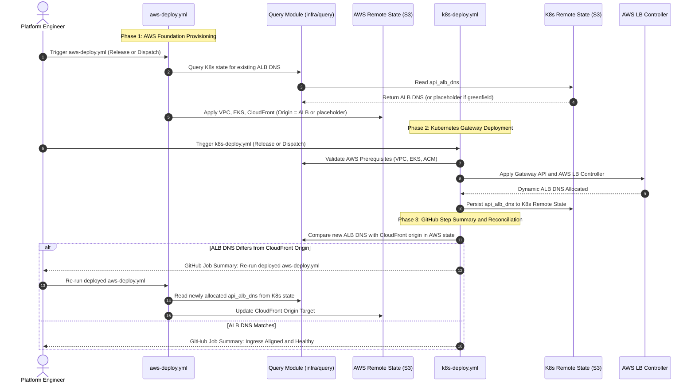

# Challenge 01: ALB DNS Circular Dependency

> How a cyclic dependency between AWS edge routing and Kubernetes ingress was resolved through modular decoupling and automated state synchronization.

---

## Problem Statement

To prevent mixed-content browser rejections without purchasing a custom domain, the platform routes API requests through Amazon CloudFront to an internal Application Load Balancer (ALB). This creates an architectural cyclic dependency across infrastructure provisioning layers:

- **Separate Infrastructure Stacks by Concern**: The cloud foundation (`infra/terraform/aws` for VPC, EKS, RDS, S3, CloudFront) and Kubernetes platform layer (`infra/terraform/k8s` for Gateway API, AWS Load Balancer Controller, ArgoCD, KEDA) are maintained as decoupled Terraform stacks. They address separate operational concerns and blast radiuses, designed to be owned and released independently by different teams via distinct pipelines (`aws-deploy.yml` vs `k8s-deploy.yml`).
- **CloudFront Origin Requirement**: The AWS stack requires the ALB DNS hostname (`api_alb_dns_name`) as an origin target during provisioning.
- **ALB Ingress Dynamic Lifecycle**: The ALB is provisioned dynamically by the AWS Load Balancer Controller inside Kubernetes only after the EKS cluster and `Gateway` CRD are applied.
- **Underlying Compute Platform**: The EKS cluster and VPC must already exist before the Kubernetes Gateway API, AWS Load Balancer Controller, or physical ALB can be provisioned.

Attempting to provision all resources in a single monolithic Terraform apply triggers a deadlock: CloudFront cannot be configured without the ALB DNS, but the ALB cannot exist without the underlying AWS compute platform.

---

## Investigation & Root Cause

Terraform resolves dependencies via a Directed Acyclic Graph (DAG). When two resources reside in separate layers where each depends on outputs from the other, DAG resolution halts:

- **Cyclic Dependency Chain**: `aws_cloudfront_distribution` requires `api_alb_dns_name`, which requires `kubernetes_gateway`, which in turn requires `aws_eks_cluster` and `aws_vpc`.
- **Monolithic Coupling Anti-Pattern**: Combining AWS and Kubernetes providers in one root module couples foundational cloud provisioning to Kubernetes API responsiveness, causing provider initialization timeouts during cluster bootstrap and collapsing distinct team ownership boundaries into a single high-risk blast radius.
- **Manual Hardcoding Anti-Pattern**: Manually applying Kubernetes first, copying the generated ALB DNS, and hardcoding it into configuration files introduces human error and breaks automated continuous delivery.

---

## Architectural Solution

We implemented a **decoupled pipeline handshake and automated drift detection protocol** orchestrated between `aws-deploy.yml` and `k8s-deploy.yml` using the zero-provider query module:

1. **Independent Pipeline Handshake (`aws-deploy.yml`)**:
    - When deploying AWS infrastructure, GitHub Actions queries `infra/terraform/query` against the K8s remote state for the target environment.
    - **Existing Ingress**: If K8s has already deployed the Gateway, the query module extracts the live `api_alb_dns` and passes it directly to `TF_VAR_api_alb_dns_name`.
    - **Greenfield / Bootstrap**: If K8s has not yet been deployed, the query module supplies a fallback placeholder (`placeholder-alb.internal`), allowing CloudFront to deploy edge routing rules without deadlock.
2. **Kubernetes Gateway Deployment (`k8s-deploy.yml`)**:
    - The K8s pipeline pre-validates AWS outputs (`vpc_id`, `eks_cluster_name`, `acm_cert_arn`) from remote state via `infra/terraform/query`.
    - Deploys Gateway API manifests and polls the Gateway resource until the AWS Load Balancer Controller provisions the physical ALB and allocates the dynamic AWS DNS.
    - The dynamic ALB DNS is saved into the K8s remote state output `api_alb_dns`.
3. **Blast-Radius Isolation & GitHub Job Summary Guidance**:
    - **Strict Stack Separation**: The K8s pipeline **never** performs targeted applies on AWS storage or CloudFront modules, preserving team ownership boundaries and blast-radius isolation.
    - **Drift Comparison**: Instead, `k8s-deploy.yml` automatically queries the AWS remote state via `infra/terraform/query` and compares the live Gateway ALB DNS against the CloudFront distribution origin.
    - **Reconciliation via Re-run**: If the ALB DNS is unaligned (e.g. initial greenfield bootstrap or after an ALB recreation), the pipeline does not send external alerts or require cutting an anti-pattern release tag. Instead, it generates a structured **GitHub Job Summary** (`$GITHUB_STEP_SUMMARY`) instructing operators to simply **re-run the currently deployed AWS Infrastructure workflow** (`aws-deploy.yml`).
    - **Automatic Convergence**: When re-run, `aws-deploy.yml` queries the K8s remote state, discovers the active `api_alb_dns`, and updates CloudFront's origin target directly without modifying any other AWS resources.

---

## Measurable Outcome & Production Invariants

- **Strict Blast-Radius Isolation**: Neither pipeline crosses architectural boundaries; AWS resources are managed exclusively by `aws-deploy.yml` and Kubernetes resources by `k8s-deploy.yml`.
- **Zero Monolithic Deadlocks**: Greenfield environments bootstrap cleanly without cyclic dependency timeouts or manual DNS copy-pasting.
- **Sub-3s Cross-Stack Queries**: The zero-provider query module queries remote states without checking out foreign code or downloading heavy provider plugins.
- **Actionable GitHub Step Summaries**: Replaced external notification overhead with contextual `$GITHUB_STEP_SUMMARY` reports, guiding operators to re-run the existing AWS workflow to reconcile edge routing rather than polluting git history with redundant releases.
