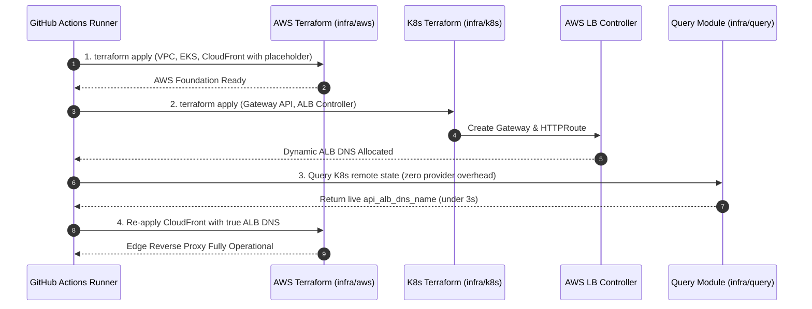

# Challenge 01: ALB DNS Circular Dependency

> How a cyclic dependency between AWS edge routing and Kubernetes ingress was resolved through modular decoupling and automated state synchronization.

---

## Problem Statement

To prevent mixed-content browser rejections without purchasing a custom domain, the platform routes API requests through Amazon CloudFront to an internal Application Load Balancer (ALB). This creates an architectural cyclic dependency across infrastructure provisioning layers:

- **CloudFront (`infra/terraform/aws`)** requires the ALB DNS hostname (`api_alb_dns_name`) as an origin target during provisioning.
- **Application Load Balancer (`infra/terraform/k8s`)** is provisioned dynamically by the AWS Load Balancer Controller when the Kubernetes `Gateway` manifest is applied.
- **EKS & VPC (`infra/terraform/aws`)** must already exist before the Kubernetes Gateway API, AWS Load Balancer Controller, or ALB can be created.

Attempting to provision all resources in a single monolithic Terraform apply triggers a deadlock: CloudFront cannot be configured without the ALB DNS, but the ALB cannot be created without the underlying AWS compute platform.

---

## Investigation & Root Cause

Terraform resolves dependencies via a Directed Acyclic Graph (DAG). When two resources reside in separate layers where each depends on outputs from the other, DAG resolution halts:

- **Cyclic Dependency Chain**: `aws_cloudfront_distribution` requires `api_alb_dns_name`, which requires `kubernetes_gateway`, which in turn requires `aws_eks_cluster` and `aws_vpc`.
- **Monolithic Anti-Pattern**: Combining AWS and Kubernetes providers in one root module couples cluster provisioning to Kubernetes API responsiveness, leading to provider initialization timeouts during cluster creation.
- **Manual Hardcoding Anti-Pattern**: Manually applying Kubernetes first, copying the generated ALB DNS, and pasting it into configuration files introduces human error and breaks automated continuous delivery.

---

## Architectural Solution

We implemented a **two-stage automated reconciliation loop** orchestrated by GitHub Actions and decoupled via the zero-provider query module:

1. **Stage 1 (Initial AWS Provisioning)**:
   - AWS infrastructure is provisioned with a temporary placeholder ALB DNS (`placeholder-alb.internal`).
   - CloudFront distribution is deployed with default caching and edge routing rules intact.
2. **Stage 2 (Kubernetes Gateway Deployment)**:
   - Kubernetes platform layer is applied (`infra/terraform/k8s`).
   - The AWS Load Balancer Controller provisions the physical ALB and assigns a dynamic AWS DNS name.
   - Workflow waits for the Gateway resource to report healthy status and extracts the live ALB DNS.
3. **Stage 3 (Automated Edge Origin Synchronization)**:
   - The deployment workflow queries the K8s state using `infra/terraform/query`.
   - A targeted update to the AWS CloudFront module updates the origin target with the true ALB DNS without modifying any other AWS resources.

---

## Measurable Outcome & Production Invariants

- **Zero Manual DNS Management**: Ingress endpoints are dynamically discovered, validated, and bound at deployment time.
- **Sub-3s State Synchronization**: The zero-provider query module resolves dynamic ALB hostnames without downloading heavy provider binaries.
- **Automated Drift Detection**: The `k8s-deploy.yml` pipeline compares the live Gateway ALB DNS against the CloudFront origin target on every run, emitting actionable alerts if drift is detected.
- **Zero Downtime Updates**: CloudFront seamlessly transitions from the previous origin to the updated ALB DNS with zero user interruption.
