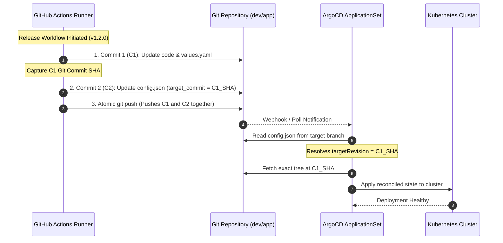

# Challenge 03: ArgoCD Commit Pinning vs Moving Pointers

> Why tracking mutable Git branches in GitOps creates production drift, and how an atomic 2-commit SHA pinning pattern achieved deterministic reconciliation.

---

## Problem Statement

Standard GitOps tutorials configure ArgoCD to track branch heads (such as `dev` or `main`) or floating tags (`latest`). In a multi-service, multi-developer environment, tracking mutable references introduces severe operational vulnerabilities:

- **Configuration Drift**: If multiple commits are pushed in rapid succession, ArgoCD reconciles intermediate, unvetted commits before integration checks finish.
- **Non-Deterministic Rollbacks**: Rolling back a deployment by reverting a Git branch creates new merge commits that re-trigger entire delivery pipelines rather than restoring a known good snapshot.
- **Multi-Service Concurrency Hazards**: When independent services (`api`, `worker`) share a deployment repository, commits from one service can cause ArgoCD to prematurely reconcile an unrelated service whose manifests are mid-edit.

---

## Investigation & Root Cause

Git branches and semantic tags are **mutable pointers** that advance dynamically with each push. When ArgoCD polls a branch:

- Git clone operations capture whatever commit HEAD points to at that specific millisecond.
- If a pipeline pushes code changes in commit $C_1$ and image tag updates in commit $C_2$, ArgoCD may reconcile $C_1$ before $C_2$ exists, causing pods to crash due to schema mismatches with old container images.
- Audit compliance fails because determining *exactly which commit* was running at any given time requires correlating Git commit timestamps with Kubernetes replica revision logs.

---

## Architectural Solution

We implemented **Immutable Commit Pinning** orchestrated by ArgoCD `ApplicationSet` matrix generators and a structured 2-commit release protocol:

1. **Discovery Manifest Configuration (`config.json`)**:
   - Each application directory under `infra/k8s/argocd/${env}/${app}/` contains a small configuration file recording two explicit fields:
     - `target_commit`: The exact, immutable Git commit hash to reconcile.
     - `target_version`: The semantic release version (e.g. `v1.2.0`) for human auditing.
2. **Multi-Source ApplicationSet Integration**:
   - The ArgoCD ApplicationSet uses a Git generator to discover configuration files and binds:
     - `targetRevision`: Set to `target_commit` for application manifests and values.
     - `targetRevision`: Set to `chart_version` for private AWS ECR OCI Helm charts.
3. **The Atomic 2-Commit Release Protocol**:
   - **Commit 1 ($C_1$)**: Updates application code and environment-specific `values.yaml` (new container image tag).
   - **Commit 2 ($C_2$)**: Pins `config.json` with `target_commit` set to $C_1$'s SHA and `target_version` set to the release version.
   - Both commits are pushed together atomically. ArgoCD detects the update to `config.json` and pulls the exact tree of commit $C_1$.

---

## Measurable Outcome & Production Invariants

- **100% Deterministic Deployments**: ArgoCD reconciles exact, cryptographically immutable Git tree hashes rather than moving branch pointers.
- **Instant Rollback**: Restoring the previous version requires only reverting `config.json` to the prior commit SHA, triggering an immediate rollback to that exact known-good configuration.
- **Audit Compliance**: Every running pod replica maps 1:1 to an audited Git commit hash recorded directly in the Kubernetes application status.
