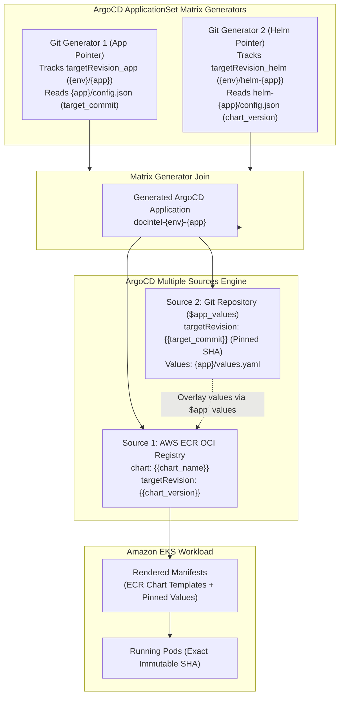

# Challenge 03: ArgoCD Commit Pinning vs Moving Pointers

> Why tracking mutable Git branches in GitOps creates production drift, and how an atomic 2-commit SHA pinning pattern achieved deterministic reconciliation.

---

## Problem Statement

Standard GitOps tutorials configure ArgoCD to track branch heads (such as `dev` or `main`) or floating tags (`latest`). In a multi-service, multi-developer environment, tracking mutable references introduces severe operational vulnerabilities:

- **Configuration Drift**: If multiple commits are pushed in rapid succession, ArgoCD reconciles intermediate, unvetted commits before integration checks finish.
- **Non-Deterministic Rollbacks**: Rolling back a deployment by reverting a Git branch creates new merge commits that re-trigger entire delivery pipelines rather than restoring a known good snapshot.
- **Multi-Service Concurrency Hazards**: When independent services (`api`, `worker`) share a deployment repository, commits from one service can cause ArgoCD to prematurely reconcile an unrelated service whose manifests are mid-edit.

---

## Investigation & Root Cause

Git branches and semantic tags are **mutable pointers** that advance dynamically with each push. When ArgoCD polls a branch:

- Git clone operations capture whatever commit HEAD points to at that specific millisecond.
- If a pipeline pushes code changes in commit $C_1$ and image tag updates in commit $C_2$, ArgoCD may reconcile $C_1$ before $C_2$ exists, causing pods to crash due to schema mismatches with old container images.
- Audit compliance fails because determining *exactly which commit* was running at any given time requires correlating Git commit timestamps with Kubernetes replica revision logs.

---

## Architectural Solution

We implemented **Multi-Source Matrix GitOps with Dual-Generator Commit Pinning** orchestrated by ArgoCD `ApplicationSet`:

1. **Dual Git Generators Tracking Distinct Revision Pointers**:
   - The `ApplicationSet` defines a cross-generator **matrix** combining two independent Git discovery generators:
     - **Generator 1 (Application Values Pointer)**: Tracks `${targetRevision_app}` (release branch `{env}/${app}` in staging/prod or `dev` in development), reading `infra/k8s/argocd/${environment}/${app}/config.json` to resolve the immutable `target_commit` Git hash.
     - **Generator 2 (Helm Chart Release Pointer)**: Tracks `${targetRevision_helm}` (release branch `{env}/helm-${app}` in staging/prod or `dev` in development), reading `infra/k8s/argocd/${environment}/helm-${app}/config.json` to resolve `chart_name` and `chart_version`.
2. **ArgoCD Multiple Sources Cross-Reconciliation (`$app_values`)**:
   - The matrix join dynamically instantiates an ArgoCD `Application` configuring two synchronized sources:
     - **Source 1 (Immutable Helm OCI Package)**: Pulls the packaged Helm chart directly from the private AWS ECR OCI registry (`targetRevision: "{{chart_version}}"`), injecting base chart defaults.
     - **Source 2 (Pinned Application Values)**: Clones the Git repository strictly at `targetRevision: "{{target_commit}}"`, assigned the named reference `ref: app_values`.
     - **Values Overlay**: In Source 1, Helm receives `- $app_values/infra/k8s/argocd/${environment}/{{app}}/values.yaml`, merging the pinned values and image tags directly onto the ECR Helm chart.
3. **Decoupled Helm Commits vs Application Commits**:
   - **Helm Release Pipeline (`{env}-helm-{app}-v*`)**: Updates Helm templates independently, publishes versioned OCI tarballs to AWS ECR, and commits the new `chart_version` to `{env}/helm-${app}`.
   - **Workload Release Pipeline (`{env}-{app}-v*`)**: Employs an atomic 2-commit protocol:
     - **Commit 1 ($C_1$)**: Updates application code and environment `values.yaml` (new container image tag).
     - **Commit 2 ($C_2$)**: Updates `config.json` with `target_commit` set to $C_1$'s SHA and `target_version` set to the release version.
   - Pushing both commits together allows ArgoCD to discover $C_2$ on the tracking branch and checkout the exact immutable tree of $C_1$.

---

## Measurable Outcome & Production Invariants

- **100% Deterministic Deployments**: ArgoCD reconciles exact, cryptographically immutable Git tree hashes rather than moving branch pointers.
- **Decoupled Template & App Lifecycles**: Infrastructure engineers release chart changes without triggering microservice rebuilds; developers release container updates without touching Helm chart versions.
- **Instant Rollback**: Restoring the previous version requires only reverting `config.json` to the prior commit SHA, triggering an immediate rollback to that exact known-good configuration.
- **Zero Race Conditions**: Because `values.yaml` is fetched from the pinned commit $C_1$ rather than branch HEAD, concurrent developer pushes never corrupt active deployments.
