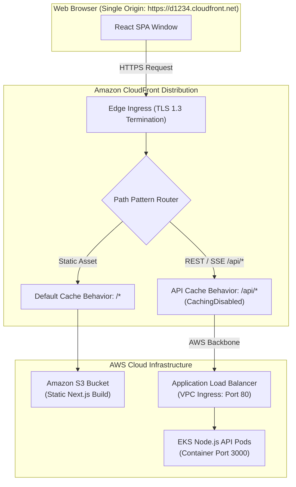

# Challenge 02: CloudFront Mixed-Content Rejection

> Resolving browser mixed-content security blocks across separated static client and API environments without third-party domain purchases.

---

## Problem Statement

The platform deploys the Next.js static client to Amazon S3 via Amazon CloudFront over HTTPS, while the Express API runs inside Amazon EKS behind an Application Load Balancer (ALB) operating over standard HTTP:

- **Frontend Origin**: `https://d123456789.cloudfront.net` (TLS-encrypted by default CloudFront certificate).
- **Backend API Origin**: `http://k8s-default-apigatew-12345.us-east-1.elb.amazonaws.com` (Unencrypted HTTP Port 80).

When users initiate asynchronous API actions (such as document uploads, session verification, or Server-Sent Events progress streams), modern browsers enforce **W3C Mixed Content Level 2** policies. The browser blocks the unencrypted API calls, resulting in immediate transport aborts and failed client operations.

---

## Investigation & Trade-Off Analysis

The conventional enterprise solution involves binding a custom domain:

1. Register a top-level domain (TLD) via Route 53 or an external registrar ($12–$30/year).
2. Request a public certificate from AWS Certificate Manager (ACM) with DNS validation.
3. Attach the ACM certificate to an HTTPS listener on the ALB (Port 443).

For staging and portfolio demonstration environments, purchasing and renewing dedicated domains introduces unnecessary recurring financial cost, manual DNS validation overhead, and external domain registrar dependencies. We required a cloud-native pattern providing **100% HTTPS encryption** to clients while avoiding custom domain purchases.

---

## Architectural Solution

We implemented **CloudFront Dual-Origin Unified Reverse Proxying** (formalized in [ADR-021](../design-decisions/cloudfront-api-routing.md)):

1. **Dual Origins in a Single Distribution**:
   - **S3 Origin**: Target for static assets, HTML, JavaScript chunks, and images.
   - **ALB Custom Origin**: Target for API traffic (`OriginProtocolPolicy: http-only`, Port 80).
2. **Path-Pattern Cache Behaviors**:
   - `/*` (Default): Serves static assets from S3 with aggressive browser caching (`public, max-age=31536000, immutable`).
   - `/api/*`: Forwards all HTTP methods directly to the ALB origin. Enforces `Redirect-to-HTTPS` at the edge and applies the AWS managed `CachingDisabled` policy.
3. **AWS Private Backbone Routing**:
   - CloudFront terminates TLS at the nearest global edge location.
   - Traffic between CloudFront and the ALB travels across AWS's low-latency, private global network.

---

## Measurable Outcome & Production Invariants

- **Zero Mixed-Content Rejections**: The browser communicates exclusively with `https://d1234.cloudfront.net`, eliminating mixed active content failures.
- **Zero Financial Cost**: Bypasses recurring domain registration fees and paid DNS hosting.
- **DDoS Mitigation & Edge Acceleration**: AWS Shield Standard automatically protects edge entry points against layer 3/4 volumetric attacks.
- **Simplified CORS Posture**: Because the API is served from the same host as the client SPA in production, cross-origin credential issues are eliminated.
