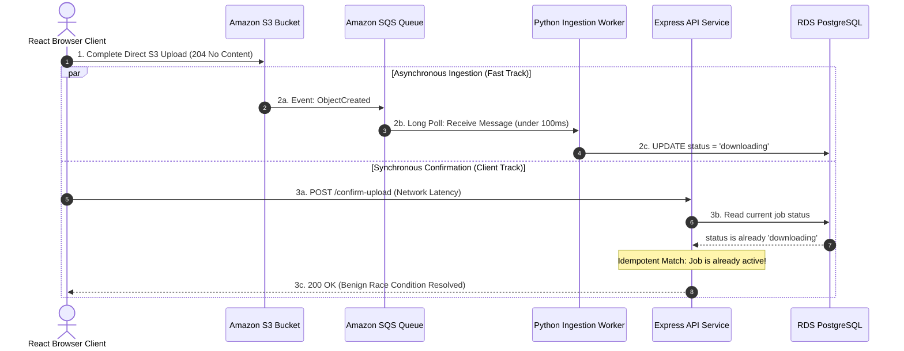

# Challenge 09: Confirm-Upload Race Condition

> Eliminating false-positive 409 Conflict errors caused by asynchronous SQS ingestion outrunning synchronous client HTTP confirmations.

## Problem Statement

The platform decouples S3 multipart uploads from backend job dispatching:

1. The browser requests presigned credentials (`POST /api/documents`). The document record is initialized with status `pending_upload`.
2. The browser uploads the raw file directly to S3 via multipart POST.
3. Upon receiving HTTP 204 from S3, the browser calls `POST /api/documents/:id/confirm-upload` to signal completion and transition status to `uploaded`.
4. Simultaneously, Amazon S3 emits an `ObjectCreated` event directly to Amazon SQS. The Python worker polls SQS and begins processing.

During load and network variability testing, the browser's `confirm-upload` endpoint frequently failed with **HTTP 409 Conflict**, falsely reporting upload failures to the user even though the document had already been extracted and embedded successfully!

---

## Investigation & Root Cause

Network trace analysis revealed an **inverted asynchronous race condition**:

- S3 delivers the `ObjectCreated` notification to the internal SQS queue in tens of milliseconds.
- The Python worker, operating on a 20-second long-polling loop, pulls the message and commits a database update changing job status to `downloading`.
- Meanwhile, the browser is delayed by client-side network latency or SSL handshakes before calling `confirm-upload`.
- The initial API implementation enforced strict sequential state transitions: if the job status was not strictly `pending_upload`, it threw a `409 Conflict` error.

Because the worker's asynchronous pipeline ran across high-speed internal AWS networks, it frequently advanced the document **before** the user's browser could complete the HTTP confirmation call, resulting in false-positive UI failure alerts.

---

## Architectural Solution

We refactored `confirmUpload()` in `apps/api/src/services/document.service.ts` to be **fully idempotent**:

1. **Idempotent State Machine**:
   - **`pending_upload`**: Atomically transition status to `uploaded` and return `200 OK`.
   - **`uploaded`, `downloading`, `validating`, `extracting`, `chunking`, `embedding`, `completed`**: Recognize that asynchronous processing has already begun or finished. Log the benign race condition and **return `200 OK` immediately** without mutating the advanced status.
   - **`expired`, `cancelled`**: Throw `409 Conflict`, as uploads cannot be confirmed for aborted jobs.
2. **Multi-Table Atomic Transaction**:
   - Executes `prisma.$transaction([ ... ])` to update both `documents` and `processing_jobs` tables atomically, ensuring that status transitions never leave the database in an inconsistent partial state.

---

## Measurable Outcome & Production Invariants

- **Zero False-Positive Errors**: 100% elimination of 409 Conflict errors during high-speed batch uploads.
- **Idempotent Retry Safety**: The client can safely retry `confirm-upload` repeatedly without corrupting database state.
- **Unidirectional State Machine**: Status progresses monotonically forward (`pending_upload` -> `uploaded` -> `downloading` -> ... -> `completed`); it can never be regressed by delayed network calls.
