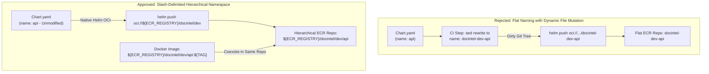

# Challenge 10: Hierarchical ECR Repository Naming

> Why Helm OCI chart packaging collided with Docker images in Amazon ECR, and how slash-delimited namespaces eliminated chart mutation in CI pipelines.

---

## Problem Statement

The platform uses Amazon Elastic Container Registry (ECR) as a unified registry for both **Docker container images** and **Helm OCI chart packages**.

Initial infrastructure provisioning named ECR repositories using flat, hyphenated naming conventions (such as `docintel-dev-api`).

When the Helm packaging workflow executed `helm push`, Helm rejected the push with repository not found errors. Helm OCI specifications strictly dictate that the destination repository name must match the `name:` field declared inside `Chart.yaml` (`name: api`). To make pushes succeed, CI pipelines had to dynamically rewrite `Chart.yaml` on disk during execution.

---

## Investigation & Root Cause

Dynamically mutating `Chart.yaml` during CI packaging created critical operational side effects:

- **Dirty Working Trees**: Modifying `Chart.yaml` during build steps dirtied Git workspaces, causing subsequent Git checkout and merge checks to fail.
- **Chart Dependency Breakage**: Helm subchart dependencies and template lookups broke when chart metadata was mutated at packaging time.
- **Repository Proliferation**: Creating separate ECR repositories for charts doubled the number of cloud repositories to manage, configure with lifecycle policies, and authorize in IAM.

---

## Architectural Solution

We refactored all ECR infrastructure and CI/CD pipelines to adopt **hierarchical, slash-delimited ECR repository namespaces**:

1. **Slash-Delimited Repository Naming**:
   - Updated ECR provisioning to structure repositories by project, environment, and application: `${project_name}/${environment}/${app}` (for example, `docintel/dev/api` and `docintel/dev/worker`).
2. **Harmonized Docker and Helm Registry Target**:
   - **Docker Container Images**: Pushed directly to the full repository path matching the application name.
   - **Helm OCI Chart Packages**: Pushed to the parent namespace path (`docintel/dev`), allowing Helm to append `name: api` natively without changing the chart manifest.
3. **ArgoCD Multi-Source Compatibility**:
   - The ArgoCD ApplicationSet points to the parent repository namespace as the base URL, resolving chart names and versions dynamically via matrix parameters.

---

## Measurable Outcome & Production Invariants

- **Zero Source Code Mutation**: `Chart.yaml` remains pristine and immutable in Git; no runtime string replacement scripts exist in CI workflows.
- **Unified Artifact Storage**: Docker images and Helm OCI charts share the exact same ECR repository, simplifying lifecycle policies and access audits.
- **Multi-Environment Isolation**: Clear directory hierarchy in ECR mirrors Git branching and Kubernetes namespace structure.
