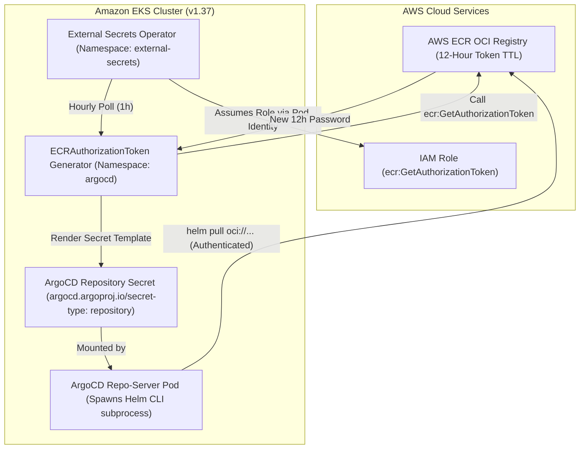

# Challenge 06: External Secrets Operator for ECR Tokens

> Resolving ArgoCD Helm OCI authentication failures caused by expired AWS ECR tokens through automated hourly rotation with the External Secrets Operator.

---

## Problem Statement

The platform packages Helm charts as Open Container Initiative (OCI) artifacts stored in private Amazon Elastic Container Registry (ECR) repositories. ArgoCD reconciles these charts via a multi-source `ApplicationSet`.

During cluster deployment, the ArgoCD repo-server repeatedly failed to pull charts with HTTP 401 Unauthorized errors, stalling all GitOps workload synchronization.

---

## Investigation & Root Cause

Investigating the ArgoCD repo-server container logs uncovered two intersecting root causes:

- **Subprocess Credential Inheritance Failure**: Enabling ArgoCD's built-in parameter `configs.params.reposerver.ecr.credential.helper` only injects AWS credentials into Go-native Git/HTTP libraries. When ArgoCD executes Helm operations, it spawns an external **Helm CLI binary** as a child subprocess. The Helm CLI does not inherit ArgoCD's in-process credential helper and requires pre-authenticated Kubernetes Docker registry secrets.
- **The 12-Hour ECR Token Expiration**: AWS ECR authorization tokens generated via the AWS API expire strictly after **12 hours**. Manually creating a Kubernetes Docker registry secret succeeds temporarily, but all ArgoCD chart reconciliation fails 12 hours later when the token expires.

---

## Architectural Solution

We implemented an automated, self-healing credential rotation engine combining the **External Secrets Operator (ESO)** with **EKS Pod Identity**:

1. **IAM Role & Pod Identity Binding**:
    - Created a dedicated IAM policy granting `ecr:GetAuthorizationToken` and `ecr:BatchGetImage`.
    - Bound the IAM role directly to the `external-secrets` ServiceAccount in the `external-secrets` namespace using an EKS Pod Identity Association.
2. **Automated Token Generation (`ECRAuthorizationToken`)**:
    - Declared an ECR token generator in namespace `argocd` that automatically requests authentication tokens from the target AWS region.
3. **Continuous Secret Synchronization (`ExternalSecret`)**:
    - Created an `ExternalSecret` resource configured with a **1-hour refresh interval** (`refreshInterval: 1h`).
    - Generates an `argocd.argoproj.io/secret-type: repository` secret with `enableOCI: "true"` directly targeting the ECR repository URL.
    - Refreshes the secret every hour—well before the 12-hour AWS expiration window.

---

## Measurable Outcome & Production Invariants

- **Zero Reconciliation Failures**: ArgoCD reliably pulls private Helm OCI charts continuously with zero 401 Unauthorized errors.
- **Hourly Automated Rotation**: ECR tokens are refreshed every 1 hour, well before the 12-hour AWS expiration window.
- **Elimination of Fragile Credential Helpers**: Removed unreliable in-container credential helper configurations from ArgoCD Helm values.
- **Principle of Least Privilege**: ArgoCD repo-server holds zero AWS IAM credentials; credential fetching is strictly isolated to the External Secrets Operator.
