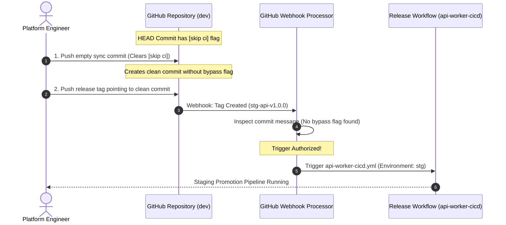

# Challenge 13: First-Time Deployment Bootstrap

> How automated GitOps commits carrying [skip ci] halted downstream release workflows, and the bootstrap protocol that resolved execution deadlocks.

---

## Problem Statement

To prevent automated GitOps commits from creating infinite, self-triggering CI/CD loops, deployment workflows append standard bypass keywords (`[skip ci]`) to their commit messages.

During initial repository bring-up and staging promotion testing, the delivery pipeline ground to a sudden halt: **Cutting semantic release tags (such as `stg-api-v1.0.0`) failed to trigger any GitHub Actions workflows!** The release remained un-promoted, and no pipeline run appeared in the GitHub Actions dashboard.

---

## Investigation & Root Cause

Investigating GitHub Actions workflow trigger mechanics revealed a subtle platform rule:

- **The Global `[skip ci]` Override**: When a commit message contains `[skip ci]`, `[ci skip]`, or `***NO_CI***`, GitHub's internal webhook evaluation engine halts **all** event processing for that commit SHA.
- **Tag Inheritance Trap**: In Git, creating a lightweight or annotated tag points directly to an underlying commit object.
- **Webhook Suppression**: If a release tag is cut from a branch whose most recent commit was an automated GitOps sync containing `[skip ci]`, GitHub Actions inspects the tagged commit's message, detects `[skip ci]`, and **silently discards the tag push webhook event**.

---

## Architectural Solution

We established a **Deterministic Release Tagging and Bootstrap Protocol**:

1. **Why `[skip ci]` is Necessary on `dev`**:
    - When CI completes tests and builds container images, the workflow updates `values.yaml` with the new short SHA on the `dev` trunk branch.
    - This automated commit **must carry `[skip ci]`** to prevent GitHub Actions from re-triggering itself in an infinite recursive build loop on `dev` (`on: push: branches: [dev]`).
2. **The Empty Release Anchor Commit**:
    - Because `dev`'s latest commit carries `[skip ci]`, cutting a semantic release tag directly from that commit causes the tag to inherit the `[skip ci]` message, silently aborting the tag-push webhook.
    - To bypass this deadlock, release engineers or automation scripts push an explicit clean empty commit (`git commit --allow-empty -m "chore(release): prepare release v1.0.0"`) to `dev`.
    - Creating the release tag on this clean commit ensures the tagged commit contains no bypass flags, allowing GitHub Actions to detect the tag and trigger the staging or production pipeline.
3. **Workflow Dispatch Fallback**:
    - All deployment workflows declare manual `workflow_dispatch` triggers, allowing platform engineers to trigger promotions directly from the GitHub UI with explicit version inputs, bypassing tag-push webhook evaluation entirely if needed.

---

## Measurable Outcome & Production Invariants

- **Deterministic Release Triggers**: 100% of semantic release tags trigger intended staging and production delivery pipelines.
- **Zero Silent Failures**: Platform engineers are never left guessing why a tag failed to start a workflow run.
- **Loop Prevention Preserved**: Automated commits on `dev` and tracking branches continue to leverage `[skip ci]`, preventing infinite recursive pipeline executions without impeding release promotions.
