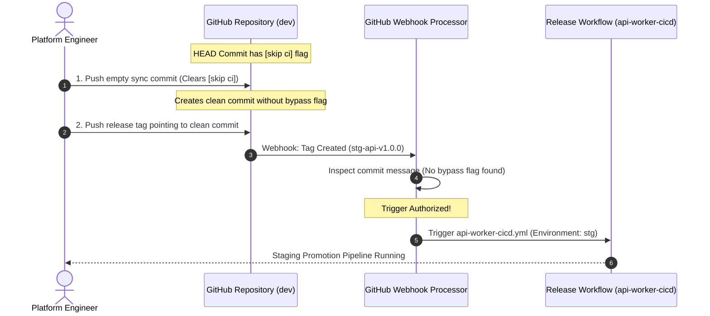

# Challenge 14: First-Time Deployment Bootstrap

> How automated GitOps commits carrying [skip ci] halted downstream release workflows, and the bootstrap protocol that resolved execution deadlocks.

---

## Problem Statement

To prevent automated GitOps commits from creating infinite, self-triggering CI/CD loops, deployment workflows append standard bypass keywords (`[skip ci]`) to their commit messages.

During initial repository bring-up and staging promotion testing, the delivery pipeline ground to a sudden halt: **Cutting semantic release tags (such as `stg-api-v1.0.0`) failed to trigger any GitHub Actions workflows!** The release remained un-promoted, and no pipeline run appeared in the GitHub Actions dashboard.

---

## Investigation & Root Cause

Investigating GitHub Actions workflow trigger mechanics revealed a subtle platform rule:

- **The Global `[skip ci]` Override**: When a commit message contains `[skip ci]`, `[ci skip]`, or `***NO_CI***`, GitHub's internal webhook evaluation engine halts **all** event processing for that commit SHA.
- **Tag Inheritance Trap**: In Git, creating a lightweight or annotated tag points directly to an underlying commit object.
- **Webhook Suppression**: If a release tag is cut from a branch whose most recent commit was an automated GitOps sync containing `[skip ci]`, GitHub Actions inspects the tagged commit's message, detects `[skip ci]`, and **silently discards the tag push webhook event**.

---

## Architectural Solution

We established a **Two-Pronged Commit Formatting and Bootstrap Protocol**:

1. **Targeted Branch Separation**:
   - `[skip ci]` is **strictly forbidden** on the `dev` trunk branch during release preparation.
   - Workflows only append `[skip ci]` when pushing to isolated, non-triggering tracking branches (`{env}/app`, `{env}/infra-aws`).
2. **The Empty Release Synchronization Commit**:
   - When preparing a release from a branch whose HEAD commit carries `[skip ci]`, developers or automated release scripts push an explicit empty commit (`git commit --allow-empty`) to clear the bypass flag before creating the release tag.
3. **Workflow Dispatch Fallback**:
   - All deployment workflows declare manual `workflow_dispatch` triggers, allowing platform engineers to trigger promotions directly from the GitHub UI even if a commit message contains bypass tags.

---

## Measurable Outcome & Production Invariants

- **Deterministic Release Triggers**: 100% of semantic release tags trigger intended staging and production delivery pipelines.
- **Zero Silent Failures**: Platform engineers are never left guessing why a tag failed to start a workflow run.
- **Loop Prevention Preserved**: Tracking branches continue to leverage `[skip ci]`, preventing infinite recursive pipeline executions.
