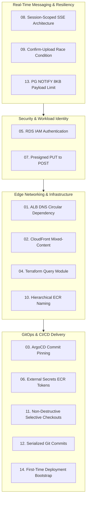

# Technical Challenges & Solutions

> Comprehensive index of 14 real-world engineering hurdles overcome during the design, deployment, and operation of the AI Document Intelligence Platform.

Building a production-grade, multi-tenant Retrieval-Augmented Generation (RAG) platform on AWS EKS presents intricate challenges across distributed state, security boundaries, and GitOps synchronization. This section documents 14 real-world engineering challenges, detailing the exact root cause, architectural solution, and measurable production outcome.

---

## Challenge Taxonomy & Architectural Domains

---

## Master Challenge Registry

| ID | Engineering Challenge | Domain | Core Bottleneck / Risk | Architectural Resolution | Measurable Outcome |
| :--- | :--- | :--- | :--- | :--- | :--- |
| **01** | [ALB DNS Circular Dependency](alb-dns-circular-dependency.md) | Edge & Infra | CloudFront requires ALB DNS; ALB requires EKS and VPC. | Two-stage apply automated via zero-provider query module. | Zero manual DNS intervention; automated drift checks. |
| **02** | [CloudFront Mixed-Content](cloudfront-mixed-content.md) | Edge & Infra | HTTPS frontend blocked calling HTTP ALB; custom domain adds cost. | CloudFront dual-origin reverse proxy (`/api/*` to ALB). | 100% end-to-end TLS without domain purchase fees. |
| **03** | [ArgoCD Commit Pinning](argocd-commit-pinning.md) | GitOps | Moving branch/tag pointers cause configuration drift and race conditions. | ApplicationSet matrix joins targeting pinned commit SHAs in `config.json`. | 100% reproducible deployments; instant rollback. |
| **04** | [Terraform Query Module](terraform-query-module.md) | CI/CD | Downloading provider plugins to read remote state adds 60–90s per CI job. | Standalone zero-provider module reading S3 remote state. | Remote state query runtime reduced from 90s to <3s. |
| **05** | [RDS IAM Authentication](rds-iam-auth.md) | Security | Static database credentials stored in cluster risk credential leakage. | In-memory token generation (`@aws-sdk/rds-signer`, boto3) with 10-min cache. | Zero static DB passwords; 15-minute token expiry. |
| **06** | [External Secrets ECR Tokens](external-secrets-ecr-tokens.md) | GitOps | ECR 12-hour tokens expire; ArgoCD in-container credential helper fails. | External Secrets Operator (ESO) + Pod Identity hourly token rotation. | Uninterrupted Helm OCI chart retrieval by ArgoCD. |
| **07** | [Presigned PUT to POST](presigned-put-to-post.md) | Security | Presigned PUT URLs cannot enforce file size or MIME policy at S3 layer. | Migrated to presigned POST with `content-length-range` policy conditions. | Storage-level size/type enforcement before compute. |
| **08** | [Session-Scoped SSE](session-scoped-sse.md) | Messaging | 5 concurrent document uploads exhaust browser HTTP/1.1 socket limits (max 6). | Single session socket listening to session-scoped PG NOTIFY channel. | 80% socket reduction (5 down to 1); zero connection blocking. |
| **09** | [Confirm-Upload Race Condition](confirm-upload-race-condition.md) | Messaging | Worker consumes SQS and updates DB before browser calls confirm-upload. | Idempotent endpoint handling returning `200 OK` on advanced states. | Zero false-positive frontend errors on async handoff. |
| **10** | [Hierarchical ECR Naming](ecr-repository-naming.md) | Infra & CI | Helm OCI chart push requires matching repo name, colliding with Docker images. | Slash-delimited repository namespaces (`${project}/${env}/${app}`). | Clean Docker and Helm OCI coexistence without file mutations. |
| **11** | [Non-Destructive Selective Checkouts](non-destructive-selective-checkouts.md) | GitOps | Deploying one service to `{env}/app` wiped sibling microservice files. | Selective sparse checkout updating only target app files and values. | Multi-service coexistence on unified tracking branches. |
| **12** | [Serialized Git Commits](serialized-git-commits.md) | GitOps | Parallel CI pipelines push to tracking branches simultaneously, causing push rejects. | Concurrency groups (`git-commit-dev`, `git-commit-${env}-app`) + rebase loops. | Zero failed Git pushes due to lock contention. |
| **13** | [PG NOTIFY 8KB Payload Limit](pg-notify-payload-size.md) | Messaging | PostgreSQL `pg_notify()` drops payloads exceeding 8,000 bytes during errors. | Trigger payload minimization + deterministic 500-char error truncation. | Payloads stay under 500 bytes; zero lost notifications. |
| **14** | [First-Time Deployment Bootstrap](first-time-deployment-bootstrap.md) | CI/CD | `[skip ci]` tags on automated commits prevent release tags from triggering workflows. | Explicit empty sync commits clearing `[skip ci]` state during bootstrap. | Deterministic workflow execution during cluster bring-up. |

---

## Reading Guide

Each challenge document follows a standardized four-part engineering post-mortem structure:

1. **Problem Statement**: The exact failure mode, operational symptoms, and security/performance constraints.
2. **Investigation & Root Cause**: Technical breakdown of why the system behaved as observed.
3. **Architectural Solution**: Distilled bullet points, sequence or topology diagrams, and configuration patterns.
4. **Measurable Outcome & Production Invariants**: Quantified operational metrics, safeguards, and trade-off commentary.
