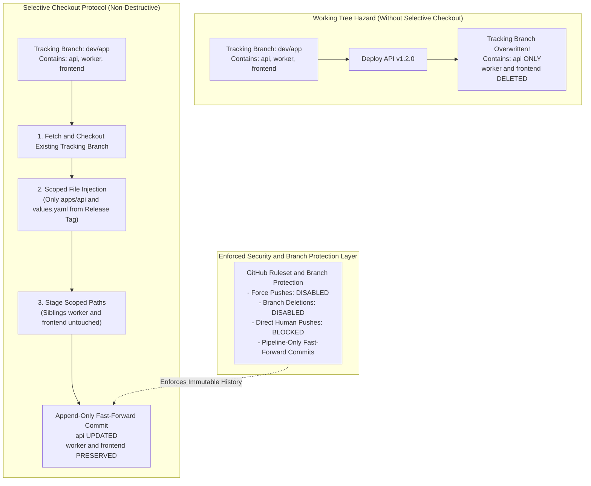

# Challenge 11: Non-Destructive Selective Checkouts

> Preventing accidental deletion of sibling microservice code on consolidated release tracking branches during independent service promotions.

---

## Problem Statement

To maintain an immutable, chronological audit trail of deployed applications, the platform maintains environment release tracking branches: `{env}/app` (such as `dev/app`, `stg/app`, `prod/app`). These branches house the actual code trees and GitOps values manifests for all three microservices:

- `apps/api/`
- `apps/worker/`
- `apps/frontend/`
- `infra/k8s/argocd/{env}/{app}/`

However, Git branch references are inherently mutable pointers that can be rewritten with `git push --force`. Furthermore, standard Git checkouts in multi-service CI/CD pipelines introduce a working-tree wipeout hazard: **deploying a single microservice (such as promoting `api` to staging) wiped `apps/worker/` and `apps/frontend/` completely off the `stg/app` tracking branch!**

---

## Investigation & Root Cause

Analysis of the deployment failure identified two distinct failure modes—one in working tree management and one in branch governance:

1. **Working Tree Obliteration**:
   - Standard CI checkout workflows create an empty branch snapshot and clone only the deploying application's repository subset.
   - When Git checks out a branch and executes a blanket staging commit (`git add .`), any file not explicitly present in the working tree is treated as deleted.
   - Because container CI/CD pipelines operate independently for `api` and `worker`, an `api` deployment had no awareness of `worker` or `frontend` code, overwriting the consolidated tracking tree with a snapshot containing only `apps/api`.
2. **Branch Mutability & History Overwrites**:
   - Git branches provide no cryptographic immutability on their own. Without explicit repository governance, force pushes, accidental re-initializations, or non-fast-forward pushes can overwrite branch histories, destroying the chronological audit trail.

---

## Architectural Solution

We implemented a two-pillar strategy combining **Strict Branch Governance** with a **Non-Destructive Selective Checkout Protocol**:

1. **Branch Governance & Access Control (Immutable Audit Ledger)**:
   - **Zero Human Writes**: Release tracking branches (`{env}/app`, `{env}/infra-aws`, `{env}/infra-k8s`) are protected via GitHub repository rulesets. Manual commits and pull request merges by human developers are strictly blocked.
   - **Force Pushes Disabled**: `Allow force pushes` is set to `false`, preventing any historical revision tampering.
   - **Deletions Prohibited**: `Allow deletions` is set to `false`.
   - **Pipeline-Only Fast-Forward Commits**: Only automated CI/CD runners (using short-lived workflow tokens) are authorized to commit to tracking branches, and only via forward-only fast-forward commits upon a verified, successful deployment apply.
2. **Non-Destructive Selective Checkout Protocol**:
   - **Existing Tree Preservation**: The pipeline fetches and checks out the remote tracking branch (`{env}/app`). If it exists, it preserves all existing sibling files (`worker`, `frontend`) from prior deployments.
   - **Scoped File Extraction**: Rather than wiping the workspace, the pipeline selectively extracts **only** the target service directory and its specific GitOps values from the release tag (`git checkout tags/${TAG} -- apps/${APP} infra/k8s/argocd/${ENV}/${APP}`).
   - **Scoped Staging**: Stages only the extracted paths, guaranteeing sibling microservice directories remain completely untouched in the newly created commit.

---

## Measurable Outcome & Production Invariants

- **Guaranteed Immutability**: Protected branches coupled with pipeline-only write permissions ensure the tracking history cannot be overwritten, force-pushed, or altered out of chronological order.
- **Multi-Service Coexistence**: Microservices release completely independently without risking code deletion of sibling services on shared tracking branches.
- **Accurate Release Diffs**: Viewing commit diffs on `{env}/app` reveals only the files changed by the specific deploying microservice.
- **Audit Traceability**: ArgoCD commit pinning points to `{env}/app` commit SHAs with 100% confidence that the entire platform repository tree remains intact and verifiable.
