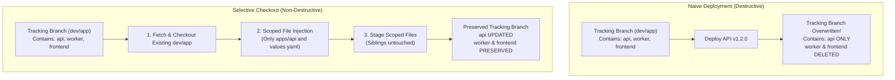

# Challenge 11: Non-Destructive Selective Checkouts

> Preventing accidental deletion of sibling microservice code on consolidated release tracking branches during independent service promotions.

---

## Problem Statement

To maintain an immutable, chronological audit trail of deployed applications, the platform maintains environment tracking branches: `{env}/app` (such as `dev/app`, `stg/app`, `prod/app`). These branches house the actual code trees and GitOps values manifests for all three microservices:

- `apps/api/`
- `apps/worker/`
- `apps/frontend/`
- `infra/k8s/argocd/{env}/{app}/`

During initial pipeline testing, deploying a single microservice (such as promoting `api` to staging) triggered an operational disaster: **The deployment wiped `apps/worker/` and `apps/frontend/` completely off the `stg/app` tracking branch!**

---

## Investigation & Root Cause

Standard Git checkout semantics in CI/CD pipelines assume a single application repository:

- Naive checkout workflows create an empty branch snapshot and copy only the deploying application's files.
- When Git checks out a branch and executes a blanket staging commit, any file not explicitly present in the working tree is treated as deleted.
- Because container CI/CD pipelines operate independently for `api` and `worker`, a deployment targeting `api` had no knowledge of `worker` or `frontend` files, replacing the tracking tree with a snapshot containing only `apps/api`.

---

## Architectural Solution

We developed a **Non-Destructive Selective Checkout Protocol** embedded into deployment workflows:

1. **Branch Existence Check & Preservation**:
   - The workflow fetches and checks out the remote tracking branch (`{env}/app`). If it exists, it preserves all existing files from previous sibling deployments.
   - If the branch does not yet exist, an orphan branch is initialized.
2. **Targeted Service Extraction**:
   - Rather than wiping the workspace, the pipeline selectively checks out **only** the target service directory and its specific GitOps configuration from the release commit.
3. **Scoped Path Staging & Atomic Commits**:
   - The pipeline stages only the targeted application paths (`apps/${APP}` and `infra/k8s/argocd/${ENV}/${APP}/values.yaml`), ensuring sibling directories remain completely untouched in the commit tree.

---

## Measurable Outcome & Production Invariants

- **Multi-Service Coexistence**: Microservices release completely independently without risking code deletion of sibling services on shared tracking branches.
- **Accurate Release Diffs**: Viewing commit diffs on `{env}/app` reveals only the files changed by the specific deploying microservice.
- **Audit Traceability**: ArgoCD commit pinning can safely point to `{env}/app` commit SHAs with 100% confidence that all platform components remain intact in the repository tree.
