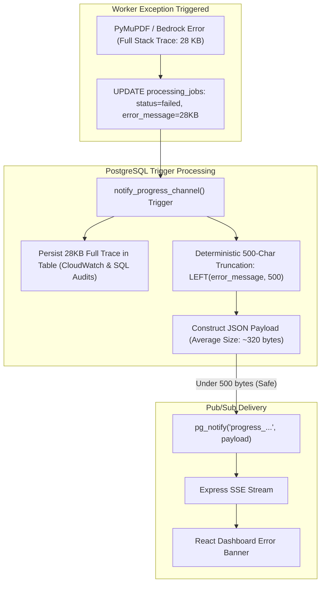

# Challenge 13: PostgreSQL NOTIFY 8KB Payload Limit

> How deterministic payload truncation in PostgreSQL triggers prevented silent Server-Sent Events dropouts during document ingestion error states.

---

## Problem Statement

To deliver real-time progress indicators to the React dashboard, the Python worker commits job state updates to the `processing_jobs` table. A PostgreSQL database trigger (`notify_progress_channel`) automatically fires on every `UPDATE`, publishing serialized JSON across the session-scoped pub/sub channel.

During error resilience testing with malformed, password-protected, or corrupted PDF files, the system exhibited a baffling failure mode: **The frontend UI remained indefinitely stuck in "Extracting..." state, even though the database clearly recorded `status = 'failed'`!**

---

## Investigation & Root Cause

Examining PostgreSQL database engine logs revealed that the notification trigger was silently failing:

- **The 8,000-Byte Engine Boundary**: The internal PostgreSQL notification subsystem allocates a fixed buffer of 8,000 bytes per notification frame. Any payload exceeding this size fails with `payload string too long`.
- **Raw Stack Trace Blowup**: When document extraction or embedding calls threw exceptions, the worker captured the full multiline Python stack trace, complete with embedded HTTP request headers and parameter dumps (frequently 12 KB to 45 KB in length), writing it directly to the error message field.
- **Trigger Abort**: Because the serialized JSON payload exceeded 8,000 bytes, `pg_notify()` failed to broadcast. The database transaction completed, but the Express API's SSE listener never received the `failed` frame, leaving the browser progress bar hanging indefinitely.

---

## Architectural Solution

We implemented a **two-tier telemetry separation and deterministic payload truncation strategy**:

1. **Trigger-Level Truncation (`notify_progress_channel`)**:
   - Updated the PostgreSQL trigger migration to explicitly truncate the error message to a maximum of **500 characters** (`LEFT(NEW.error_message, 500)`) before constructing the JSON notification payload.
   - Restricts payload keys to essential operational counters: document identifier, status, progress percentage, processed chunks, total chunks, and error code.
2. **Telemetry Separation of Concerns**:
   - **Lightweight Notification Bus**: The SSE stream carries only the truncated 500-character snippet—sufficient to render actionable, user-friendly error banners on the frontend dashboard.
   - **Full Forensic Storage**: The un-truncated, full-length exception stack trace is safely persisted in the PostgreSQL `processing_jobs.error_message` column (`TEXT`) and emitted to AWS CloudWatch Logs for deep engineering post-mortems.

---

## Measurable Outcome & Production Invariants

- **Zero Dropped Notifications**: Real-time payloads are guaranteed to stay under 600 bytes, safely below the 8,000-byte boundary.
- **Instant UI Error Feedback**: Dashboard cards transition immediately to error states with retry/dismiss actions upon document failure.
- **Zero Loss of Diagnostic Detail**: Platform engineers retain access to the full, un-truncated stack trace in database logs for troubleshooting.
