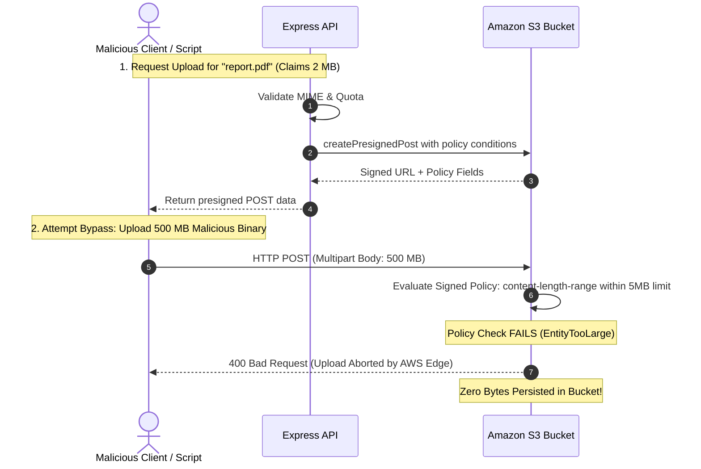

# Challenge 07: Presigned PUT to Presigned POST Migration

> Why presigned PUT URLs fail to protect cloud storage from malicious uploads, and how migrating to presigned POST enforced storage-layer policy guardrails.

---

## Problem Statement

To prevent the Express API from becoming a memory and network bandwidth bottleneck, the platform uses direct browser-to-S3 uploads. The initial implementation utilized standard S3 **presigned PUT URLs**.

During security reviews, we identified a critical vulnerability: **Presigned PUT URLs cannot enforce payload size limits at the Amazon S3 storage layer**.

Even though the API requested file metadata beforehand and validated that the file was under 5 MB, a malicious actor or modified client could use the presigned PUT URL to upload a 50 GB file or an unapproved binary format directly to S3. S3 would accept the payload in its entirety, incurring massive storage costs and triggering worker processing failures downstream.

---

## Investigation & Root Cause

S3 presigned PUT mechanisms generate a signed signature based only on the HTTP method (`PUT`), destination path, and expiration timestamp:

- Amazon S3 does **not** evaluate HTTP headers (like `Content-Length`) against policy conditions for presigned PUT requests unless signed explicitly—which standard AWS SDK PUT helpers do not support.
- If a client sends an oversized payload using the PUT URL, S3 processes the upload because the cryptographic signature over the URL itself is valid.
- Application-level validation on the API server is completely bypassed once the presigned PUT URL is returned to the client.

---

## Architectural Solution

We migrated the entire direct upload engine from presigned PUT to **AWS SDK v3 Presigned POST (`createPresignedPost`)** (formalized in [ADR-016](../design-decisions/index.md)):

1. **Storage-Layer Policy Conditions**:
    - `createPresignedPost` generates a cryptographically signed IAM policy document containing exact validation conditions:
        - `content-length-range`: Strictly enforced between 1 byte and 5 MB (5,242,880 bytes).
        - `Content-Type`: Strictly matches the verified MIME type allowlist (`application/pdf`, `text/plain`).
        - `Expires`: Presigned credentials expire automatically after 15 minutes.
2. **Multipart FormData Protocol**:
    - Amazon S3 requires form fields to appear in the multipart body **before** the file data.
    - The frontend constructs a native `FormData`, appends all key-value pairs from the signed policy fields, and appends the raw file object last.
    - S3 validates the policy conditions in-flight; any violation aborts the transfer immediately at the AWS edge before persisting data.

---

## Measurable Outcome & Production Invariants

- **Storage-Layer Enforcement**: S3 enforces the 5 MB ceiling directly at the AWS edge; uploads exceeding 5,242,880 bytes are aborted immediately with HTTP 400 (`EntityTooLarge`).
- **MIME Type Guardrail**: Uploads with mismatched `Content-Type` headers fail signature verification.
- **Zero API Server Bandwidth Overhead**: Upload traffic flows directly to S3 without traversing API pods.
- **Native Progress Callbacks**: Multipart POST requests support native browser `XMLHttpRequest.upload.onprogress` events, driving smooth 0–100% UI progress bars.
