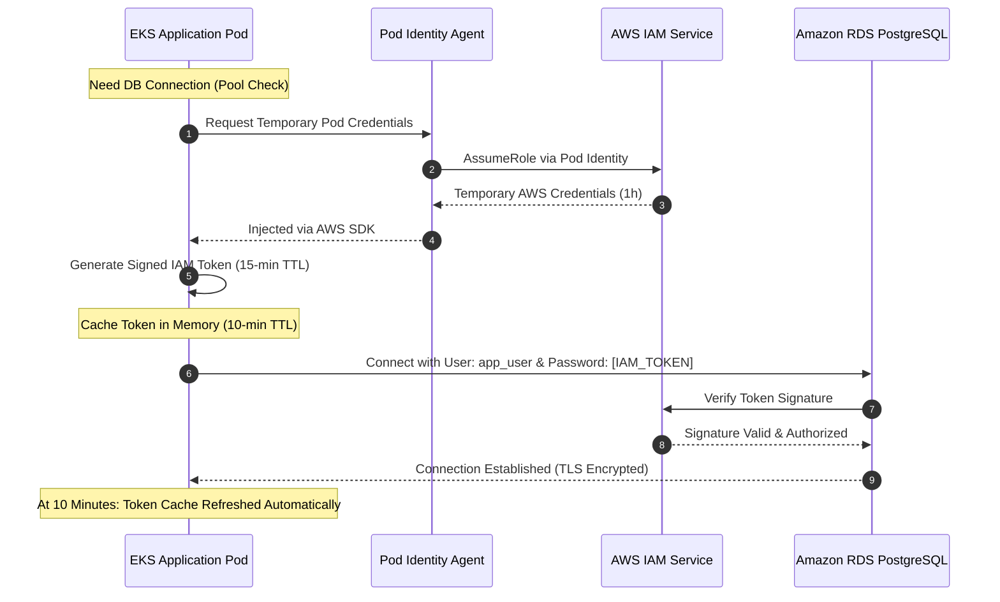

# Challenge 05: RDS IAM Authentication Enablement

> Eliminating static database passwords from Kubernetes secrets through dynamic IAM token generation and dual-ORM connection pooling.

---

## Problem Statement

Storing static database passwords inside Kubernetes secrets or environment variables creates persistent security risks:

- **Credential Leakage**: Any entity with secret inspection privileges can extract raw database credentials.
- **Stale Secrets**: Database password rotation requires rolling pod restarts across the entire cluster.
- **Compliance Breach**: Enterprise security guidelines mandate short-lived, centrally auditable credentials without static password persistence in workload clusters.

The requirement was to implement **IAM Database Authentication**, where Kubernetes pods authenticate to Amazon RDS PostgreSQL using short-lived (15-minute) cryptographic IAM connection tokens.

---

## Investigation & Root Cause

Enabling IAM authentication in RDS requires coordinating three separate layers that cannot be solved by Terraform infrastructure provisioning alone:

1. **PostgreSQL Grant Prerequisite**: While Terraform sets `iam_database_authentication_enabled = true` on the RDS instance, PostgreSQL does not automatically authorize IAM tokens for existing users. The database user must be created and granted the native `rds_iam` role within the engine.
2. **Token Expiration**: Standard database ORM connection pools assume a static password at pool initialization. Because IAM tokens expire after **15 minutes**, long-lived connection pools attempt to reconnect using stale tokens, causing database authentication failures.
3. **Dual-Stack Polyglot Mechanics**: Both the Node.js Express API (Prisma ORM) and the Python Ingestion Worker (SQLAlchemy ORM) required dynamic, non-blocking token resolution that refreshes tokens before expiration without restarting pod processes.

---

## Architectural Solution

We implemented a **dynamic token generator and caching layer** integrated directly into each application's connection lifecycle:

1. **Node.js Express API (`apps/api`)**:
   - Implemented an in-memory token cache with a **10-minute Time-To-Live (TTL)** using `@aws-sdk/rds-signer`.
   - The token is refreshed 5 minutes prior to the 15-minute AWS expiration boundary.
   - Configured the database connection pool with dynamic password resolution, injecting the refreshed token into both the raw pool and the Prisma Client via the driver adapter.
2. **Python Worker Daemon (`apps/worker`)**:
   - Generates tokens dynamically using the AWS SDK (`boto3.client('rds').generate_db_auth_token()`).
   - Hooks into SQLAlchemy engine connection events to supply a fresh token on every new connection establishment.
3. **EKS Pod Identity Permissions**:
   - The IAM role bound to the service account includes least-privilege `rds-db:connect` permissions scoped strictly to the authorized database resource identifier and username.

---

## Measurable Outcome & Production Invariants

- **Zero Static Credentials**: No database passwords exist anywhere in Kubernetes secrets, ConfigMaps, or Git repositories.
- **Automated Token Rotation**: In-memory caching ensures zero latency penalty on active connections while refreshing credentials seamlessly every 10 minutes.
- **Blast Radius Containment**: If a container is compromised, the extracted token expires within minutes and cannot be reused across different database instances or usernames.
- **Audit Trails**: All database authentication attempts are logged in AWS CloudTrail under the `rds-db:connect` action with full IAM principal attribution.
