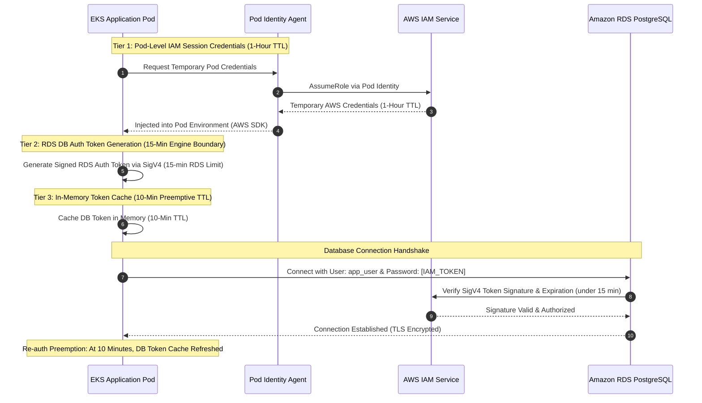

# Challenge 05: RDS IAM Authentication Enablement

> Eliminating static database passwords from Kubernetes secrets through dynamic IAM token generation and dual-ORM connection pooling.

---

## Problem Statement

Storing static database passwords inside Kubernetes secrets or environment variables creates persistent security risks:

- **Credential Leakage**: Any entity with secret inspection privileges can extract raw database credentials.
- **Stale Secrets**: Database password rotation requires rolling pod restarts across the entire cluster.
- **Compliance Breach**: Enterprise security guidelines mandate short-lived, centrally auditable credentials without static password persistence in workload clusters.

The requirement was to implement **IAM Database Authentication**, where Kubernetes pods authenticate to Amazon RDS PostgreSQL using short-lived (15-minute) cryptographic IAM connection tokens.

---

## Investigation & Root Cause

Enabling IAM authentication in RDS requires coordinating three separate layers that cannot be solved by Terraform infrastructure provisioning alone:

1. **PostgreSQL Grant Prerequisite**: While Terraform sets `iam_database_authentication_enabled = true` on the RDS instance, PostgreSQL does not automatically authorize IAM tokens for existing users. The database user must be created and granted the native `rds_iam` role within the engine.
2. **Token Expiration**: Standard database ORM connection pools assume a static password at pool initialization. Because IAM tokens expire after **15 minutes**, long-lived connection pools attempt to reconnect using stale tokens, causing database authentication failures.
3. **Dual-Stack Polyglot Mechanics**: Both the Node.js Express API (Prisma ORM) and the Python Ingestion Worker (SQLAlchemy ORM) required dynamic, non-blocking token resolution that refreshes tokens before expiration without restarting pod processes.

---

## Architectural Solution

We implemented a **multi-tiered credential and dynamic token caching architecture** that clearly separates pod-level AWS IAM session credentials from database-level authentication tokens:

1. **Two Distinct Credential Lifecycles**:
   - **Layer 1: Pod-Level AWS IAM Session Credentials (1-Hour TTL)**: The EKS Pod Identity Agent injects temporary AWS IAM credentials (`AWS_ACCESS_KEY_ID`, `AWS_SECRET_ACCESS_KEY`, `AWS_SESSION_TOKEN`) into the pod. These credentials have a standard 1-hour validity and are refreshed automatically by the AWS SDK in the background.
   - **Layer 2: Database-Level RDS IAM Auth Token (15-Minute Engine Limit)**: Using its AWS credentials, the application calls the RDS signer SDK to produce a signed SigV4 token used as the database password. **Amazon RDS strictly enforces a 15-minute maximum lifetime** on this token; any connection handshake attempted with a token older than 15 minutes is rejected by RDS PAM authentication.
2. **Application In-Memory Token Cache (10-Minute TTL)**:
   - Generating a new SigV4 token on every single pool connection adds unnecessary latency.
   - Both the Node.js Express API (`apps/api`) and Python Worker (`apps/worker`) cache the generated database token in memory with a **10-minute Time-To-Live (TTL)**.
   - This guarantees that tokens are refreshed 5 minutes prior to the 15-minute RDS cutoff, ensuring every pool reconnection receives a valid, unexpired token without restarting pods.
3. **Dual ORM Lifecycle Integration**:
   - **Express API (Prisma ORM)**: Configured the database connection pool with dynamic password resolution, injecting refreshed tokens into the raw pool and the Prisma Client via the driver adapter.
   - **Python Worker (SQLAlchemy ORM)**: Hooks into SQLAlchemy engine `do_connect` events via `boto3.client('rds').generate_db_auth_token()` to supply fresh cached tokens.
4. **Least-Privilege EKS Pod Identity**:
   - The IAM role bound to the service account includes `rds-db:connect` permissions scoped strictly to the authorized database resource identifier and username.

---

## Measurable Outcome & Production Invariants

- **Zero Static Credentials**: No database passwords exist anywhere in Kubernetes secrets, ConfigMaps, or Git repositories.
- **Automated Token Rotation**: In-memory caching ensures zero latency penalty on active connections while refreshing credentials seamlessly every 10 minutes.
- **Blast Radius Containment**: If a container is compromised, the extracted token expires within minutes and cannot be reused across different database instances or usernames.
- **Audit Trails**: All database authentication attempts are logged in AWS CloudTrail under the `rds-db:connect` action with full IAM principal attribution.
