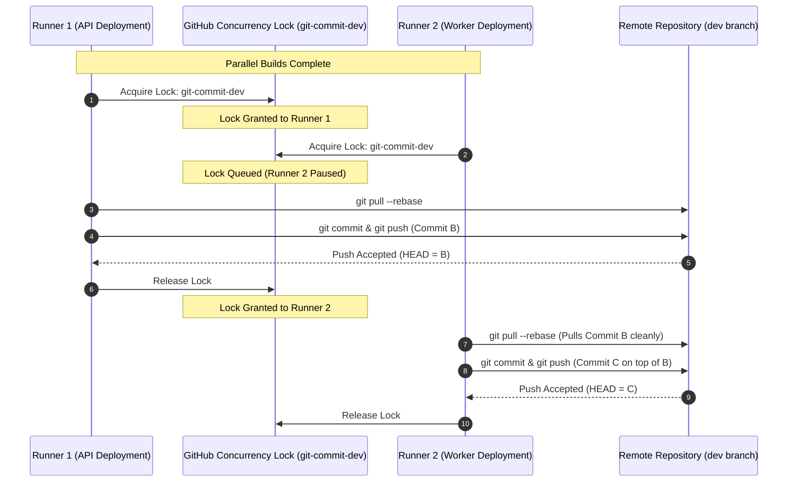

# Challenge 12: Serialized Git Commits via Concurrency Groups

> Eliminating Git reference contention and failed pipeline runs during simultaneous microservice deployments through serialized GitHub Actions concurrency locks.

---

## Problem Statement

The platform embraces a decoupled microservice deployment model where multiple continuous delivery pipelines execute in parallel:

- Container deployment pipeline (API and Worker)
- Helm chart CI/CD pipeline (OCI packaging and version updates)
- Frontend deployment pipeline (static Next.js assets and tracking branch updates)

During automated multi-service releases, pipelines frequently failed at the final step with Git reference rejections, aborting deployments due to non-fast-forward conflicts.

---

## Investigation & Root Cause

Git push operations are inherently stateful and atomic:

1. Runner 1 (Deploying `api`) and Runner 2 (Deploying `helm-worker`) start simultaneously, both checking out commit $A$ on branch `dev`.
2. Runner 1 updates its configuration, creates commit $B$, and executes `git push origin dev` successfully. The remote branch now points to commit $B$.
3. Runner 2 finishes packaging 2 seconds later, updates its configuration, creates commit $C$ (based on parent $A$), and attempts `git push origin dev`.
4. Git rejects Runner 2's push because commit $C$ does not have commit $B$ in its direct ancestry (non-fast-forward conflict).

In a fast-moving continuous delivery environment, concurrent pipelines constantly step on each other's push operations.

---

## Architectural Solution

We established a **Two-Tier Serialization and Rebase Resilience Pattern**:

1. **Shared GitHub Actions Concurrency Groups**:
   - Workflows pushing to the development trunk bind to a shared, global concurrency lock (`git-commit-dev`).
   - Workflows promoting to staging or production use environment-scoped app locks (`git-commit-${env}-app`).
   - Setting `cancel-in-progress: false` ensures subsequent release commits queue cleanly in sequential order rather than terminating early.
2. **Automated Rebase-and-Retry Push Loop**:
   - Even with concurrency groups, network jitter or manual pushes can introduce race conditions.
   - The commit step implements an automated 5-attempt retry loop that executes `git pull --rebase` before each push attempt, applying exponential backoff between retries.

---

## Measurable Outcome & Production Invariants

- **Zero Non-Fast-Forward Push Failures**: 100% elimination of Git push race condition failures across all automated workflows.
- **Ordered Audit History**: Tracking branch commits appear in strict, linear chronological sequence without broken ancestry branches.
- **Queue Transparency**: Developers can observe pending deployments cleanly queued in the GitHub Actions dashboard.
