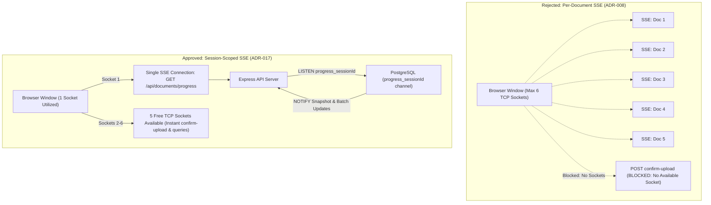

# Challenge 08: Session-Scoped Real-Time SSE Architecture

> How evolving from per-document SSE streams to a unified session-scoped pub/sub connection eliminated browser socket pool exhaustion during multi-file batch uploads.

---

## Problem Statement

To give users transparency during document ingestion, the platform streams real-time state changes (`downloading`, `extracting`, `chunking`, `embedding`, `completed`) via Server-Sent Events (SSE).

The initial design ([ADR-008](../design-decisions/index.md)) established a **per-document SSE stream** targeting individual document IDs.

When users initiated the maximum supported batch upload of **5 concurrent documents**, the browser opened 5 persistent HTTP/1.1 connections simultaneously. Immediately, user interface operations began failing:

- Document upload confirmations stalled or timed out.
- Navigation between dashboard tabs froze.
- Browser network inspectors showed pending HTTP requests queued in `Waiting for available socket` state.

---

## Investigation & Root Cause

The issue is governed by standard browser network connection limits defined in RFC 2616:

- **Browser Socket Limit**: Web browsers enforce a strict ceiling of **6 concurrent HTTP/1.1 TCP connections per origin**.
- **Socket Saturation**: Opening 5 persistent SSE connections consumed 5 out of the 6 available sockets for the origin. Any background AJAX call (such as confirming uploads, fetching session status, or executing search queries) competed for the single remaining socket. If two requests fired simultaneously, the browser queued them indefinitely until an SSE connection terminated.
- **Server-Side Thread/Listener Amplification**: On the backend, maintaining 5 open connections per active user rapidly exhausted Express socket pools and created 5 separate PostgreSQL `LISTEN` handles in the connection pool.

---

## Architectural Solution

We superseded ADR-008 with **Session-Scoped SSE Streams ([ADR-017](../design-decisions/session-scoped-sse.md))**:

1. **Single Persistent Connection**:
   - Replaced per-document routes with one session-scoped endpoint: `GET /api/documents/progress`.
   - Only **one** SSE socket is established per browser session, regardless of whether 1, 5, or 20 documents are actively processing.
2. **PostgreSQL Session-Scoped NOTIFY Channel**:
   - Overwrote the database trigger `notify_progress_channel()` to emit notifications on a channel partitioned strictly by session ID (`progress_{sessionId}`, replacing hyphens with underscores).
   - Express executes `LISTEN progress_{sessionId}` once per connected user session, avoiding global broadcast noise.
3. **Typed SSE Event Lifecycle**:
   - **`event: snapshot`**: Emitted once on connection establishment, delivering the current status array of all active documents in the session.
   - **`event: update`**: Emitted whenever the PostgreSQL trigger fires for any document belonging to that session.
4. **Resilient Polling Fallback**:
   - If SSE disconnects or corporate proxies terminate long-lived streams, the frontend transparently falls back to polling `GET /api/documents/status` every 3 seconds.

---

## Measurable Outcome & Production Invariants

- **80% Browser Socket Reduction**: Sockets per session dropped from 5 to 1 during batch uploads.
- **Zero Request Throttling**: 5 remaining browser sockets are permanently available for instant upload confirmations and queries.
- **Tenant Isolation**: PostgreSQL pub/sub routing enforces tenancy at the database layer; users never receive event frames from sibling sessions.
- **Scalability Guardrail**: For enterprise workloads with tens of thousands of concurrent listeners, the documentation documents transitioning from PG NOTIFY to Redis Pub/Sub to safeguard database connection limits.
