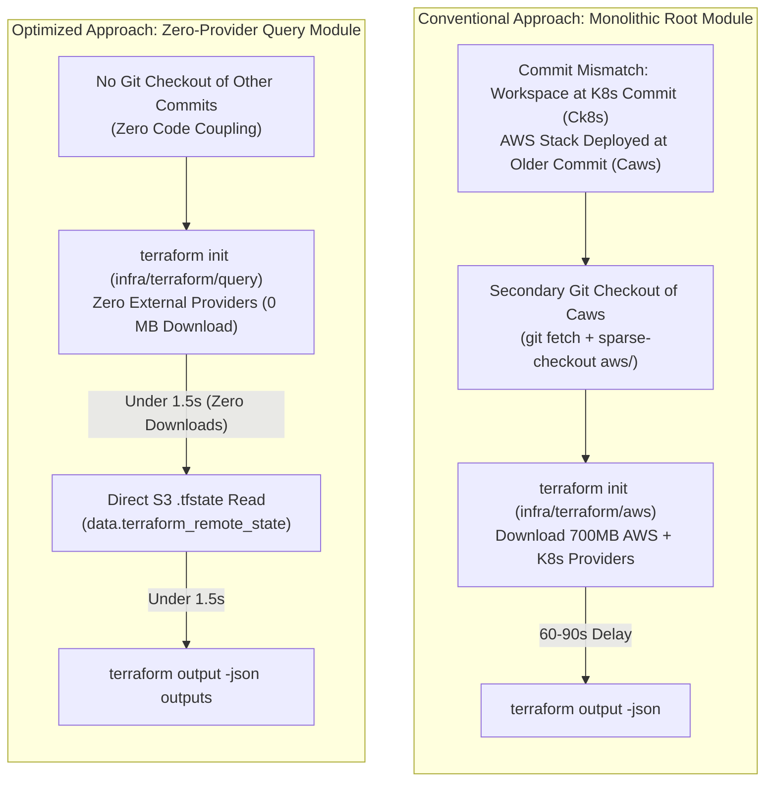

# Challenge 04: Terraform Query Module

> How replacing full Terraform provider downloads with a zero-provider remote state query module cut CI/CD output resolution latency from 90 seconds to under 3 seconds.

---

## Problem Statement

In a modular cloud architecture, downstream deployment jobs require outputs produced by upstream infrastructure layers:

- Kubernetes deployment pipelines require VPC identifiers, cluster names, and OIDC provider ARNs from the AWS layer.
- Container CI/CD pipelines require ECR registry URLs and repository paths.
- Frontend deployment workflows require S3 bucket names and CloudFront distribution IDs.

The conventional approach runs `terraform init` and `terraform output` against the root Terraform module (`infra/terraform/aws`). However, this introduces two major bottlenecks:

1. **Cross-Release Commit Divergence**: Infrastructure concerns release independently on different git tags and tracking branches (e.g., `{env}/infra-aws` vs `{env}/infra-k8s`). The workspace checkout at the current commit does not match the deployed release commit of the upstream stack.
2. **Heavy Provider Download Overhead**: While CI caching (`plugin-cache-dir`) can mitigate binary downloads, initializing heavy root modules (`hashicorp/aws`, `hashicorp/kubernetes`, `hashicorp/helm`) still adds unnecessary runner complexity, cache invalidation churn, and lockfile synchronization friction across different runner architectures.

---

## Investigation & Root Cause

Analysis of multi-stack CI/CD lifecycles identified the true architectural problem:

- **Independent Concern Lifecycles**: The AWS infrastructure (`infra-aws`) and Kubernetes platform layer (`infra-k8s`) are released on independent cadences. When `k8s-deploy.yml` runs at release commit $C_{K8S}$, the deployed AWS infrastructure may be running code from an earlier release commit $C_{AWS}$.
- **The Cross-Commit Checkout Dilemma**: Running `terraform output` inside `infra/terraform/aws` from the local workspace at commit $C_{K8S}$ evaluates local Terraform configuration that may be unreleased, experimental, or syntactically diverged from what was actually applied at $C_{AWS}$.
- **Secondary Git Checkout Overhead**: To extract outputs safely using conventional root modules, the pipeline would be forced to:
    1. Determine the active release commit $C_{AWS}$ for that environment.
    2. Perform a secondary `git fetch` and `git checkout` of $C_{AWS}$ into a separate directory.
    3. Run `terraform init` on that older configuration, reconciling provider lock files and downloading ~700 MB of provider plugins.
    4. Finally execute `terraform output -json`.
- **Read-Only State Reality**: Downstream deployment workflows do not provision or modify upstream infrastructure. They only need to read output values already committed to the deployed S3 `.tfstate` file.

---

## Architectural Solution

We designed and implemented `infra/terraform/query/`, a lightweight state reader that **completely decouples state extraction from git commit history and external providers**:

1. **Zero Secondary Git Checkouts**:
    - The query module does not inspect or execute root module code from either the current commit or prior release commits.
    - It reads the deployed S3 state file directly using Terraform's built-in `data "terraform_remote_state"` data source, completely bypassing local code divergence.
2. **Zero External Provider Dependencies**:
    - Declares no `hashicorp/aws`, `hashicorp/kubernetes`, or `hashicorp/helm` providers.
    - Uses exclusively `provider["terraform.io/builtin/terraform"]`, which requires zero network downloads and zero `.terraform.lock.hcl` maintenance across AMD64 and ARM64 runners.
3. **1:1 Backend Configuration Mapping**:
    - Variables defined in `query/` (`bucket`, `key`, `region`) mirror each environment's `backend.config.hcl`.
    - CI workflows pass `backend.config.hcl` directly via `-var-file` without generating intermediary configuration files.
4. **Sub-Second Output Extraction**:
    - Initializes in less than 1 second, queries S3 directly using the runner's native AWS credentials, and prints JSON outputs in under 1.5 seconds.

---

## Measurable Outcome & Production Invariants

- **Zero Cross-Commit Checkouts**: Pipelines extract accurate deployed outputs without fetching foreign release tags or checking out historical commits.
- **96% Latency Reduction**: Output resolution drops from ~82 seconds to under 3 seconds per job.
- **Zero Provider Downloads**: Runners consume zero bandwidth downloading redundant provider binaries.
- **Zero Provider Lock Maintenance**: The query module requires no platform-specific lockfile maintenance across AMD64 and Apple Silicon (ARM64) platforms.
- **Blast-Radius Isolation**: Prevents accidental drift or terraform state locks against upstream root modules during read-only output queries.
