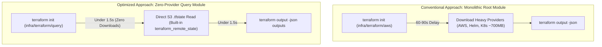

# Challenge 04: Terraform Query Module

> How replacing full Terraform provider downloads with a zero-provider remote state query module cut CI/CD output resolution latency from 90 seconds to under 3 seconds.

---

## Problem Statement

In a modular cloud architecture, downstream deployment jobs require outputs produced by upstream infrastructure layers:

- Kubernetes deployment pipelines require VPC identifiers, cluster names, and OIDC provider ARNs from the AWS layer.
- Container CI/CD pipelines require ECR registry URLs and repository paths.
- Frontend deployment workflows require S3 bucket names and CloudFront distribution IDs.

The conventional approach runs `terraform init` and `terraform output` against the root Terraform module (`infra/terraform/aws`). However, because that module declares heavy providers (`hashicorp/aws`, `hashicorp/kubernetes`, `hashicorp/helm`), Terraform forcibly downloads all provider binaries on every fresh CI runner, adding **60 to 90 seconds of initialization latency per pipeline job**.

---

## Investigation & Root Cause

Analysis of runner execution profiles identified the source of delay:

- **Heavy Provider Overhead**: Initializing the root module downloads over 700 MB of compiled binaries across AWS, Helm, and Kubernetes provider plugins.
- **Read-Only Requirement**: Downstream deployment workflows do not provision, modify, or destroy infrastructure. They only need to read output values that are already persisted in the S3 `.tfstate` JSON file.
- **Cumulative Bottleneck**: Across multiple parallel matrix jobs in continuous deployment workflows, redundant provider downloads added over 10 minutes of cumulative wait time to every deployment cycle.

---

## Architectural Solution

We designed and implemented `infra/terraform/query/`, a lightweight utility module with **zero external provider dependencies**:

1. **Pure Remote State Data Source**:
   - The module declares no external provider blocks.
   - It relies exclusively on Terraform's built-in `data "terraform_remote_state"` data source, reading the S3 state file directly using native AWS credentials already present in the runner.
2. **Direct Parameter Mapping**:
   - The variables defined in the query module (`bucket`, `key`, `region`) align 1:1 with the keys defined in each environment's `backend.config.hcl`.
   - CI pipelines pass `backend.config.hcl` directly as a variable file during execution without requiring custom parsing scripts or temporary files.
3. **Instant Output Resolution**:
   - Outputs are exposed directly from the remote state data source, allowing runners to parse attributes via standard JSON outputs in less than 3 seconds.

---

## Measurable Outcome & Production Invariants

- **96% Latency Reduction**: Output resolution drops from ~82 seconds to under 3 seconds per job.
- **Zero Provider Downloads**: Runners consume zero network bandwidth downloading redundant provider binaries.
- **Zero Provider Lock Maintenance**: The query module requires no `.terraform.lock.hcl` maintenance across AMD64 and Apple Silicon (ARM64) platforms.
- **Cross-Workflow Time Savings**: Across multi-environment deployment matrices, this eliminates over 12 minutes of cumulative runner execution time per deployment cycle.
