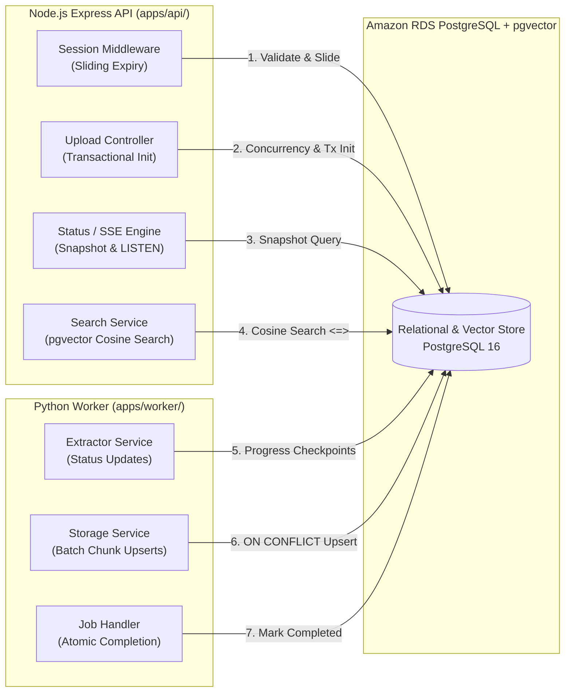

# Database Access Patterns

> Overview of transactional, analytical, and vector retrieval query patterns across the polyglot microservices.

---

## Access Architecture Overview

Database operations are strictly partitioned across services based on their operational domain: the **Node.js Express API** handles user sessions, upload intake transactions, and vector search, while the **Python Worker** handles document extraction, bulk vector upserts, and progress checkpoints.

---

## Core Query Patterns

### 1. Session Authentication & Sliding Expiration

- **Executing Service**: Express API (`apps/api/src/middleware/session.ts`)
- **Frequency**: Every authenticated incoming HTTP request.
- **Preconditions**: Cryptographic session cookie present in HTTP request headers.
- **Execution Lifecycle**:
  1. **Token Lookup**: Looks up the session row in `sessions` using a unique B-tree index on `session_token`.
  2. **Signature Verification**: Verifies the HMAC-SHA256 signature using constant-time comparison to prevent timing attacks.
  3. **Sliding Window Extension**: Atomically updates `last_active_at` to the current timestamp and advances `expires_at` by 24 hours.

---

### 2. Multi-File Batch Upload Initialization

- **Executing Service**: Express API (`apps/api/src/services/document.service.ts`)
- **Frequency**: Triggered when a user confirms document selection (`POST /api/documents`).
- **Execution Lifecycle**:
  1. **Tier-2A Concurrency Evaluation**: Performs a count query on `processing_jobs` filtering by `session_id` and active in-flight states (`pending_upload`, `downloading`, `extracting`, `embedding`). Fails fast with `HTTP 429` if active count exceeds 5.
  2. **Tier-2B Storage Quota Evaluation**: Aggregates the sum of `file_size_bytes` in `documents` for non-terminal records. Rejects with `HTTP 400` if the cumulative session storage exceeds 50 MB.
  3. **Atomic Transactional Commit**: Executes a single multi-row transaction that inserts each validated file into `documents` and generates corresponding records in `processing_jobs` with status `pending_upload`.

---

### 3. Parameterized Vector Cosine Similarity Search

- **Executing Service**: Express API (`apps/api/src/services/search.service.ts`)
- **Frequency**: Executed on each conversational user question (`POST /api/query/search`).
- **Execution Lifecycle**:
  1. **Query Embedding**: The API converts the natural language question into a 1024-dimensional dense vector via Amazon Bedrock Titan Embeddings V2 (or local E5-large-v2).
  2. **Session Pre-Filtering**: The query enforces a strict parameterized clause on `document_chunks.session_id` matching the authenticated user's session UUID.
  3. **HNSW Vector Search**: Calculates cosine distance using the `<=>` operator against indexed chunk embeddings, applying a distance threshold cutoff (`<= 0.5`) to eliminate irrelevant noise.
  4. **Top-K Ordering**: Traverses the HNSW graph to return the top 5 nearest chunks in ascending distance order, joining `documents` to retrieve source filenames and page numbers.

---

### 4. Idempotent Batch Chunk Upsert

- **Executing Service**: Python Worker (`apps/worker/app/repositories/job_repository.py`)
- **Frequency**: Executed every 50 chunks during document ingestion.
- **Execution Lifecycle**:
  1. **Bulk Ingestion**: Chunks and their 1024-dimensional embeddings are batched into a single multi-row insert statement.
  2. **Conflict Resolution**: Leverages PostgreSQL `ON CONFLICT (document_id, chunk_index) DO UPDATE` to overwrite content, token count, model version, and embedding vector in place.
  3. **Idempotency Guarantee**: If an Amazon SQS visibility timeout triggers a duplicate delivery or a worker restarts mid-batch, existing chunks are safely refreshed without generating duplicate records.

---

### 5. Checkpoint Progress Tracking & Final Completion

- **Executing Service**: Python Worker (`apps/worker/app/repositories/job_repository.py`)
- **Frequency**: Checkpoints every 50 chunks; completes once after the final batch.
- **Execution Lifecycle**:
  1. **Progress Checkpoint**: Updates `processed_chunks`, `checkpoint_index`, and computes linear `progress_pct` (capped at 99%). Triggers an immediate PostgreSQL `NOTIFY` event.
  2. **Atomic Terminal Commit**: Upon embedding the final batch, commits an atomic transaction setting `status = 'completed'`, `progress_pct = 100`, and `completed_at = now()` across both `processing_jobs` and `documents`.

---

### 6. Automated Orphan & Timeout Sweeps

- **Executing Service**: Express API Scheduled Daemon (`apps/api/src/jobs/cleanup.ts`)
- **Frequency**: Runs periodically every 5 minutes in background.
- **Execution Lifecycle**:
  1. **Expired Presigned URL Sweep**: Identifies `processing_jobs` in `pending_upload` created more than 30 minutes ago without user confirmation; transitions status to `expired` with error code `upload_expired`.
  2. **Stuck Ingestion Sweep**: Identifies jobs in `uploaded` status that have not been claimed by a worker after 10 minutes; transitions status to `failed` with error code `sqs_delivery_failure`.

---

## Query Pattern Summary Matrix

| Pattern | Target Tables | Primary Filter / Join | Concurrency / Isolation Guard |
| :--- | :--- | :--- | :--- |
| **Session Lookup** | `sessions` | `session_token = $1` | Constant-time HMAC comparison |
| **Quota & Concurrency** | `documents`, `processing_jobs` | `session_id = $1 AND status IN (...)` | Compound B-tree index evaluation |
| **Batch Init Transaction** | `documents`, `processing_jobs` | Multi-row INSERT | Atomic Prisma transaction boundary |
| **Vector Similarity** | `document_chunks` JOIN `documents` | `session_id = $1 AND distance <= 0.5` | HNSW cosine graph traversal |
| **Batch Upsert** | `document_chunks` | `(document_id, chunk_index)` | PostgreSQL `ON CONFLICT DO UPDATE` |
| **Progress Checkpoint** | `processing_jobs` | `document_id = $1` | Triggers PostgreSQL `pg_notify` event |
| **Orphan Sweeps** | `processing_jobs` | `status = $1 AND created_at < $2` | Batch update via scheduled timer |
