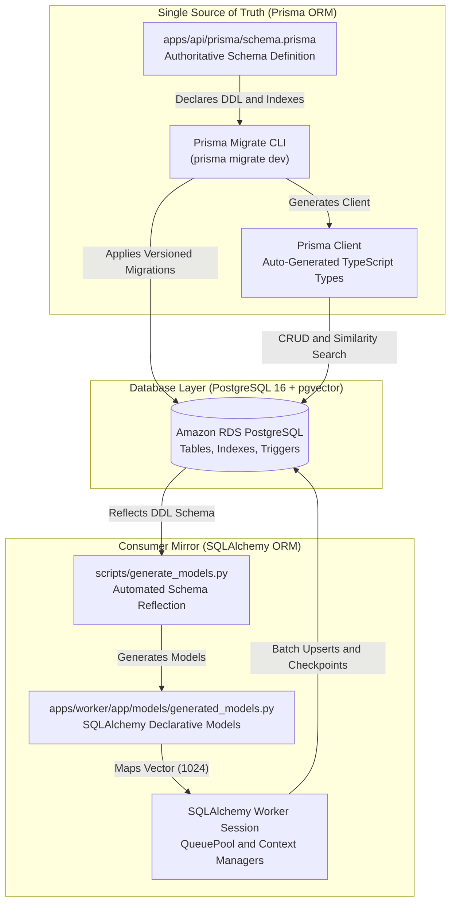

# Polyglot Dual-ORM Strategy

> Architectural governance, schema authority, and model reflection patterns uniting TypeScript Prisma and Python SQLAlchemy.

---

## Strategy Overview

The platform uses a polyglot microservice architecture consisting of a **Node.js Express API** and a **Python Worker daemon** accessing a shared **Amazon RDS PostgreSQL** instance with `pgvector`. 

To maintain clean codebases and prevent SQL injection attacks, the project constitution (`GEMINI.md`) enforces a strict **Zero Raw SQL Mandate**:
> *"Do not write raw SQL queries. All database transactions, inserts, updates, and vector similarity queries must be executed strictly via ORM models and parameters."*

To satisfy this rule across two languages without risking database migration deadlocks, we established a **unidirectional schema authority lifecycle**:

---

## 1. Single Source of Truth: Prisma Migrate

All table definitions, relations, cascading deletes, unique constraints, and PostgreSQL extensions are declared authoritatively in `apps/api/prisma/schema.prisma`:

### Key Prisma Responsibilities

- **DDL Authority**: Only the Prisma CLI executes schema modification statements (`CREATE TABLE`, `ALTER TABLE`, or index definitions).
- **Versioned Git Migrations**: Every structural change produces a deterministic, human-auditable SQL migration file under `apps/api/prisma/migrations/`.
- **Driver Adapter Integration**: Employs `@prisma/adapter-pg` driver adapter (`PrismaPg`) with a custom connection pool supporting dynamic **AWS RDS IAM Authentication** tokens generated via `@aws-sdk/rds-signer`.
- **Compile-Time Type Safety**: Generates end-to-end TypeScript interfaces for all controllers, services, and request validators.

---

## 2. Python SQLAlchemy Declarative Mirror

The Python worker daemon requires robust database integration for batch chunk insertions, transactional checkpoints, and dimensional vector calculations.

### Key SQLAlchemy Responsibilities

- **Zero Python Migrations**: The worker includes **no migration tooling** (such as Alembic), completely eliminating schema migration race conditions. It assumes the schema has already been applied by Prisma.
- **Native Vector Type Support**: Uses `pgvector.sqlalchemy.Vector(1024)` to bind dense vector embeddings directly to PostgreSQL `vector` columns.
- **Idempotent Batch Upserts**: Implements PostgreSQL `insert(DocumentChunk).on_conflict_do_update` keyed on composite index `(document_id, chunk_index)`.
- **Connection Pool Management**: Employs SQLAlchemy `QueuePool` with context managers to guarantee immediate connection disposal.

---

## 3. Automated Model Reflection (`generate_models.py`)

To eliminate human error when updating Python models following a Prisma migration, the worker includes an automated reflection script (`apps/worker/scripts/generate_models.py`):

- **Catalog Inspection**: The script inspects the live PostgreSQL database catalog metadata using SQLAlchemy reflection engines.
- **Automated Code Generation**: Generates fully typed SQLAlchemy Declarative classes under `apps/worker/app/models/generated_models.py`.
- **Constraint Preservation**: Faithfully captures table arguments, composite unique constraints, foreign key cascades, and `Vector(1024)` column mappings.
- **Developer Workflow**: Triggered via a single CLI invocation during local development whenever database migrations are applied.

---

## 4. ORM Operational Comparison

| Architectural Dimension | Node.js Express API (`apps/api/`) | Python Ingestion Worker (`apps/worker/`) |
| :--- | :--- | :--- |
| **ORM Framework** | **Prisma ORM (v5.x)** | **SQLAlchemy (v2.x)** |
| **Database Access Layer** | `@prisma/client` via `@prisma/adapter-pg` | SQLAlchemy Declarative with context managers |
| **Migration Authority** | **Sole Authority** (`prisma migrate dev`) | **Zero Authority** (Read/Write Only) |
| **Vector Storage Binding** | Unsupported(`"vector(1024)"`) with `prisma.$queryRaw` | `pgvector.sqlalchemy.Vector(1024)` |
| **Connection Pooling** | Prisma Client + dedicated `pgPool` for SSE `LISTEN` | SQLAlchemy `QueuePool` with dynamic IAM hooks |
| **Idempotency Pattern** | Batch transactions (`prisma.$transaction`) | `ON CONFLICT (document_id, chunk_index) DO UPDATE` |

---

## 5. Model Drift Prevention & Verification

Because two separate codebases map to one physical database schema, **schema drift** represents an inherent operational risk:

### Drift Mitigation Guardrails

- **Shared Integration Test Fixtures**: Both services execute integration test suites (`apps/worker/tests/test_integration.py` and `apps/api/src/tests/documents.test.ts`) against the identical containerized PostgreSQL instance during local development and CI runs.
- **Foreign Key Synchronization**: If a migration drops or modifies a column without updating the Python models, worker integration tests immediately fail with `AttributeError` or `CompileError` before code merges into `dev`.
- **Zero Raw SQL Enforcement**: Neither service executes arbitrary string-interpolated SQL statements, guaranteeing parameter sanitization and ORM consistency across all endpoints.
