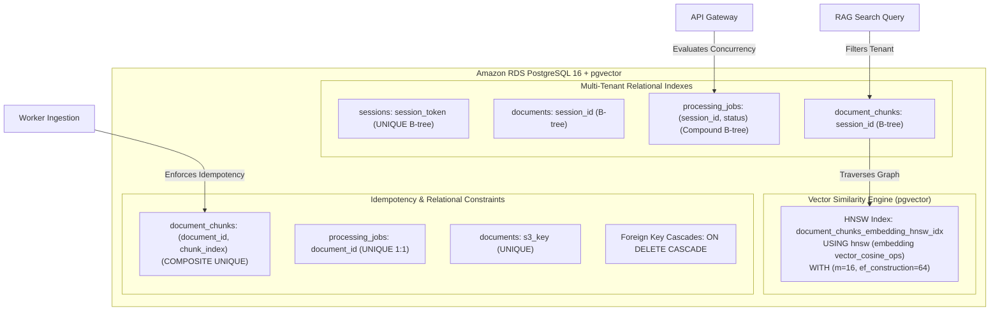

# Indexes & Constraints Architecture

> Multi-tier indexing strategy, HNSW vector similarity configuration, and relational integrity constraints.

---

## Indexing Architecture Overview

The database implements a multi-tier indexing strategy designed to balance **sub-50ms vector similarity searches**, **strict multi-tenant isolation**, and **high-throughput batch ingestion**:

---

## 1. HNSW Vector Cosine Similarity Index

The platform implements **Hierarchical Navigable Small World (HNSW)** indexing on the `document_chunks` table via `pgvector` for approximate nearest-neighbor (ANN) vector retrieval.

### Configuration Specifications

- **Target Table & Column**: `document_chunks.embedding` (1024-dimensional dense vector).
- **Index Method**: `HNSW` (multi-layer proximity graph).
- **Distance Metric**: Cosine distance operator (`<=>` via `vector_cosine_ops`).
- **Graph Link Count (`m = 16`)**: Defines the maximum number of bi-directional connections per graph node. Balances index memory footprint against cluster navigability.
- **Candidate List Size (`ef_construction = 64`)**: Specifies the dynamic candidate evaluation depth during index construction. Balances ingestion build latency against graph connectivity.

### Architectural Rationale: HNSW vs. IVFFlat

| Evaluation Dimension | HNSW Index (Implemented) | Inverted File Index (IVFFlat) |
| :--- | :--- | :--- |
| **Warm-Up Requirement** | **Incremental Build**: Vectors can be indexed immediately as chunks arrive without pre-training. | **Centroid Pre-Training**: Requires a pre-existing vector dataset to train k-means cluster centroids before building. |
| **Query Latency** | **Sub-50ms at High Recall**: Logarithmic graph traversal scales gracefully under high concurrency. | **Linear Scan of Probing Lists**: Degrades significantly if probe counts increase to improve recall. |
| **Dynamic Mutation** | **Resilient to Document Churn**: Maintains >95% recall as documents and sessions are continuously deleted and created. | **Centroid Drift**: Frequent deletes and inserts cause cluster centroid drift, requiring periodic index re-indexing. |

---

## 2. Multi-Tenant Relational Indexes

B-tree indexes are applied across foreign keys and filtering columns to enforce tenant separation and sub-10ms query execution:

| Index Name | Target Entity & Columns | Index Type | Operational Purpose |
| :--- | :--- | :--- | :--- |
| `sessions_session_token_key` | `sessions(session_token)` | `UNIQUE B-tree` | Sub-millisecond HMAC signature lookup on incoming HTTP requests. |
| `documents_session_id_idx` | `documents(session_id)` | `B-tree` | Instantaneous listing of documents belonging to an active user session. |
| `processing_jobs_session_id_status_idx` | `processing_jobs(session_id, status)` | `Compound B-tree` | Powers the Tier-2 concurrency validation check, counting active in-flight jobs in <2ms. |
| `document_chunks_session_id_idx` | `document_chunks(session_id)` | `B-tree` | Pre-filters the vector search space to the active user session before computing cosine distance. |
| `documents_s3_key_key` | `documents(s3_key)` | `UNIQUE B-tree` | Guarantees absolute storage key uniqueness across all Amazon S3 uploads. |

---

## 3. Idempotency & Unique Constraints

### Composite Upsert Key: `(document_id, chunk_index)`

The `document_chunks` table enforces a composite uniqueness constraint across the parent document UUID and chunk sequence index.

- **Idempotent Retry Guarantee**: When a worker pod fails and SQS redelivers the message after visibility timeout expiration, chunks are updated in place rather than duplicated.
- **Ordered Sequence Integrity**: Prevents chunk numbering collisions and maintains strict page-level citation mapping.
- **Document-Job 1:1 Mapping**: `processing_jobs(document_id)` enforces a strict one-to-one relationship between documents and their background processing state.

---

## 4. Foreign Key Integrity & Cascading Rules

Relational integrity is enforced using PostgreSQL foreign keys with cascading deletion rules across all child entities:

| Relationship | Cascade Rule | Architectural Behavior |
| :--- | :--- | :--- |
| `sessions` -> `documents` | `ON DELETE CASCADE` | Deleting an expired session automatically cleans up all associated document records. |
| `sessions` -> `query_logs` | `ON DELETE CASCADE` | Purges conversational history when the user session expires. |
| `documents` -> `processing_jobs` | `ON DELETE CASCADE` | Purges worker state and checkpoint counters when a document is removed. |
| `documents` -> `document_chunks` | `ON DELETE CASCADE` | Reclaims vector memory and disk space immediately upon document deletion. |
| `audit_log` (Standalone) | **No Cascade** | Intentionally decoupled from foreign keys to preserve immutable forensic logs. |
