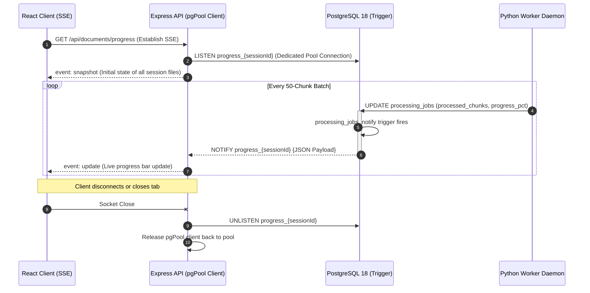

# PostgreSQL NOTIFY & Real-Time Triggers

> Technical deep dive into push-based ingestion progress streaming via PostgreSQL triggers, session pub/sub routing, and SSE delivery.

---

## Architectural Mechanism Overview

To deliver real-time progress updates to user browsers as documents traverse extraction, chunking, and embedding stages, the platform implements an event-driven **PostgreSQL `LISTEN/NOTIFY`** push pipeline:

---

## 1. Database Trigger Mechanism & Execution Lifecycle

The real-time notification engine relies on a database-level trigger bound to the `processing_jobs` table:

- **Trigger Event**: Executes on `AFTER UPDATE` for rows modified in `processing_jobs`.
- **Execution Hook**: Calls the PL/pgSQL function `notify_progress_channel()`.
- **Asynchronous In-Memory Buffering**: Calling `pg_notify()` inside the trigger does **not** perform network I/O or wait for listening clients. The notification payload is buffered locally in backend memory (`async.c`).
- **Commit Delivery**: Upon `db.commit()`, PostgreSQL appends the event to a shared-memory queue in RAM and signals listening backend processes. The worker's commit completes immediately without blocking on listener acknowledgment.
- **Decoupled Listener Architecture**: The listening client (`LISTEN progress_{sessionId}` held by Express) is completely independent. If no listeners are active, or if listeners are slow, worker transactions commit at full database speed.
- **Why Batching Prevents Contention**: PostgreSQL serializes writes to its global notification queue during commit. By triggering notifications only on `processing_jobs` (once per 50-chunk batch) rather than on `document_chunks` (per vector row), write overhead is negligible (<10 microseconds per batch), completely bypassing known PostgreSQL notification lock contention bottlenecks.

---

## 2. Session-Scoped Channel Routing

### The Cross-Tenant Noise Problem (ADR-008)

In early architecture drafts, notifications were broadcast to a single global channel (`progress_channel`). This required the Express API to ingest every database event across all platform tenants, inspect payloads, and filter out events belonging to other users, creating unnecessary CPU overhead and potential data leakage risks.

### The Session-Scoped Solution (ADR-017)

The trigger function dynamically targets a session-isolated channel following a deterministic naming convention:

> **Channel Naming Convention**: `progress_<session_id_with_underscores>`  
> *Example*: `progress_550e8400_e29b_41d4_a716_446655440000`

- **Identifier Sanitization**: Hyphens in the UUID are replaced with underscores (`replace(NEW.session_id::text, '-', '_')`) producing a valid unquoted PostgreSQL identifier.
- **Kernel-Level Tenant Isolation**: PostgreSQL delivers notifications **only to the backend connection listening on that specific channel**. Express API instances perform zero cross-tenant event filtering.

---

## 3. Payload Structure & 8KB Limit Mitigation

PostgreSQL enforces a strict **8,000-byte payload limit** on `pg_notify` messages. Payloads exceeding this limit cause silent notification dropouts without transaction rollbacks.

### Notification Payload Schema

| Field | Data Type | Description | Optimization Guardrail |
| :--- | :--- | :--- | :--- |
| `document_id` | `UUID` | Target document identifier | Relates the update to client-side document registry. |
| `status` | `String` | Current pipeline stage | Status enum (`extracting`, `embedding`, `completed`). |
| `progress_pct` | `Integer` | Computed progress percentage | Normalized value between 0% and 100%. |
| `processed_chunks` | `Integer` | Total chunks processed so far | Granular counter incremented in batches of 50. |
| `total_chunks` | `Integer` | Total chunks identified | Set during initial extraction phase. |
| `error_code` | `String` | Machine-readable error code | Populated only on failure states. |
| `error_message` | `String` | High-level diagnostic summary | Populated on failure; kept concise by worker error handlers to protect the 8KB buffer. |

### Payload Size Optimization Invariants

1. **Compact Payload Footprint**: Payloads transmit only mutable progress metrics (`status`, `progress_pct`, `processed_chunks`, `total_chunks`, and error fields). Static attributes (`filename`, `file_size_bytes`) are omitted, keeping average payload size under 250 bytes (well within PostgreSQL's 8,000-byte limit).
2. **Channel-Encoded Session Context**: Because the session UUID is already encoded in the channel name, it is omitted from the JSON body, saving ~20% of the payload frame size.
3. **Metadata Enrichment**: Static attributes (`filename`, `file_size_bytes`) are omitted from the trigger payload; the Express API enriches the SSE stream using cached connection snapshot data.

---

## 4. Connection Pool Lifecycle & Fallback Polling

### Express `pgPool` Connection Management

- **Dedicated Connection**: Each active browser SSE client (`GET /api/documents/progress`) reserves one dedicated connection from Express's `pgPool` instance to execute `LISTEN progress_{sessionId}`.
- **Initial State Synchronization**: Upon connecting, the API immediately executes a snapshot query returning the current status of all session documents as an `event: snapshot` frame.
- **Graceful Teardown**: When the browser disconnects (`req.on('close')`), the API executes `UNLISTEN progress_{sessionId}` and releases the client back to the pool, preventing connection exhaustion.

### 3-Second Fallback Polling Loop

If corporate firewalls or transient network issues terminate the persistent HTTP/1.1 SSE stream:
- The React client detects socket closure within 3 seconds.
- Automatically initiates polling against `GET /api/documents/status` on a 3-second interval.
- Seamlessly terminates the polling loop when the SSE connection is re-established.

---

## 5. Architectural Scalability Caveats

While PostgreSQL `LISTEN/NOTIFY` provides a lightweight real-time event system without requiring external message brokers for current workloads, senior cloud architecture demands acknowledging its scaling boundaries:

| Architectural Factor | Current PostgreSQL `LISTEN/NOTIFY` | Target Enterprise Evolution (Redis Pub/Sub) |
| :--- | :--- | :--- |
| **Connection Overhead** | Requires 1 dedicated PostgreSQL connection per active SSE client. | Redis multiplexes tens of thousands of subscribers over a single connection pool. |
| **RDS Proxy Incompatibility** | Long-held persistent `LISTEN` sockets pin connections and disrupt RDS Proxy connection multiplexing. | API pods bypass database proxies entirely for real-time pub/sub. |
| **Target Scale** | Optimal for designed platform volume (100–500 concurrent active browser sessions). | Required when scaling to 10,000+ simultaneous connected streaming clients. |
