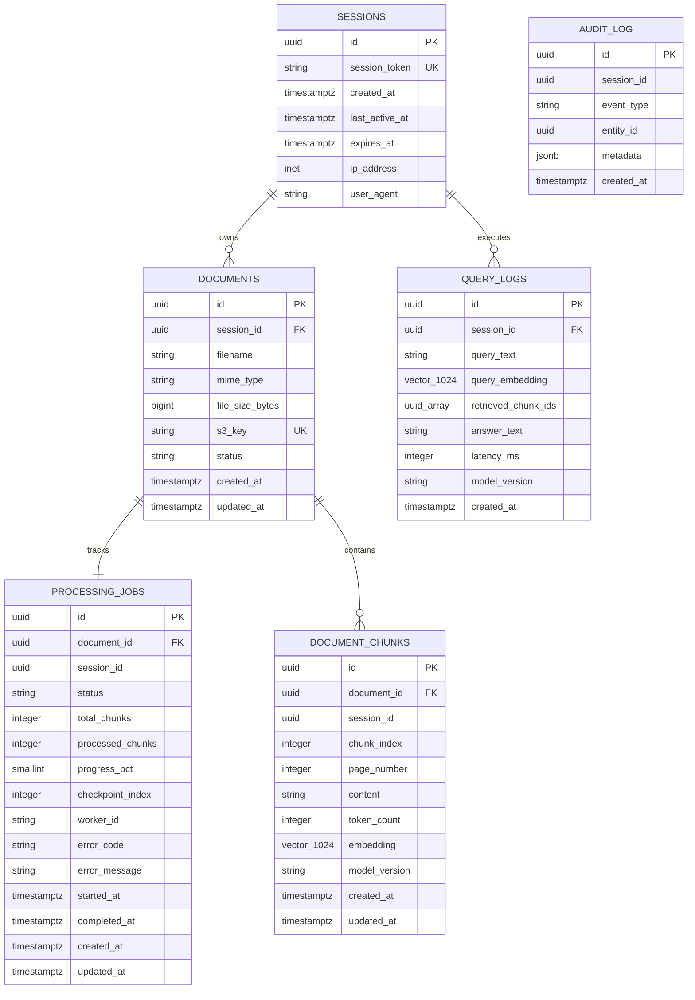
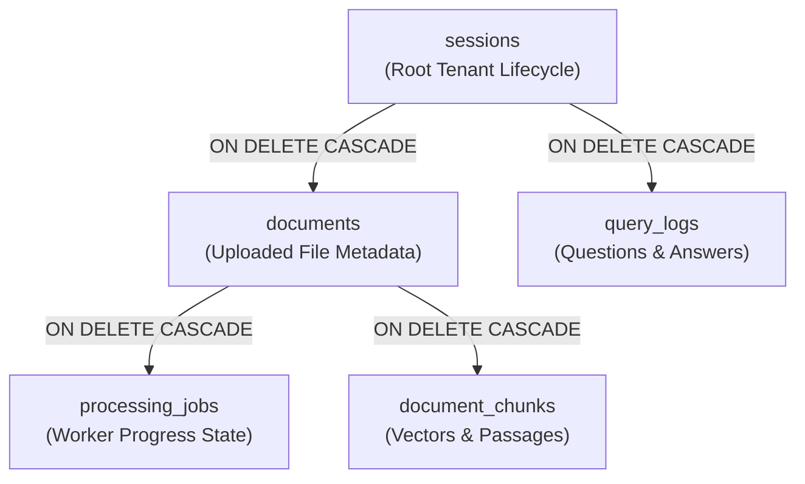

# Database Schema & Entity Relationships

> Relational schema specifications for sessions, documents, processing jobs, vector chunks, query logs, and audit trails.

---

## Architecture Overview

The database architecture is designed for **strict session multi-tenancy**, **vector similarity retrieval**, and **granular job state tracking**. Deployed on **Amazon RDS PostgreSQL 16** with the **`pgvector`** extension, the schema provides relational integrity, cascading lifecycle management, and dimensional vector storage.

All table structures and migrations are governed authoritatively by the **Prisma schema** (`apps/api/prisma/schema.prisma`) in TypeScript and mapped into **SQLAlchemy Declarative models** (`apps/worker/app/models/generated_models.py`) in Python.

---

## Entity Relationship Diagram

---

## Relational Entity Specifications

### 1. `sessions` Table

Maintains transient multi-tenant security contexts. All document storage, vector chunks, and query history are bound to an active session context.

| Column | Type | Constraints | Description |
| :--- | :--- | :--- | :--- |
| `id` | `UUID` | `PRIMARY KEY`, Default: `gen_random_uuid()` | Unique internal identifier for the session |
| `session_token` | `TEXT` | `NOT NULL`, `UNIQUE` | Cryptographically signed HMAC-SHA256 cookie token |
| `created_at` | `TIMESTAMPTZ` | `NOT NULL`, Default: `now()` | Timestamp when the session was created |
| `last_active_at` | `TIMESTAMPTZ` | `NULLABLE` | Timestamp of the most recent user request |
| `expires_at` | `TIMESTAMPTZ` | `NOT NULL` | Sliding window expiration boundary (24-hour lifetime) |
| `ip_address` | `INET` | `NULLABLE` | Client IP address for fraud detection and rate limiting |
| `user_agent` | `TEXT` | `NULLABLE` | Browser user-agent header string |

---

### 2. `documents` Table

Tracks user-uploaded files, validation states, and storage pointers in Amazon S3.

| Column | Type | Constraints | Description |
| :--- | :--- | :--- | :--- |
| `id` | `UUID` | `PRIMARY KEY`, Default: `gen_random_uuid()` | Unique document identifier |
| `session_id` | `UUID` | `NOT NULL`, `FK` -> `sessions(id)` ON DELETE CASCADE | Parent tenant session reference |
| `filename` | `TEXT` | `NOT NULL` | Original user-uploaded file name |
| `mime_type` | `TEXT` | `NOT NULL` | Content MIME type (`application/pdf`, `text/plain`) |
| `file_size_bytes` | `BIGINT` | `NOT NULL` | File byte length (enforced: 1 byte to 5 MB) |
| `s3_key` | `TEXT` | `NOT NULL`, `UNIQUE` | Amazon S3 storage path (`{sessionId}/{documentId}/{filename}`) |
| `status` | `TEXT` | `NOT NULL`, Default: `'pending_upload'` | Lifecycle state: `pending_upload`, `uploaded`, `completed`, `failed` |
| `created_at` | `TIMESTAMPTZ` | `NOT NULL`, Default: `now()` | Upload request initiation timestamp |
| `updated_at` | `TIMESTAMPTZ` | `NOT NULL`, Default: `now()` | State modification timestamp |

---

### 3. `processing_jobs` Table

Tracks asynchronous worker ingestion progress, batch checkpoints, and error diagnostics.

| Column | Type | Constraints | Description |
| :--- | :--- | :--- | :--- |
| `id` | `UUID` | `PRIMARY KEY`, Default: `gen_random_uuid()` | Unique processing job identifier |
| `document_id` | `UUID` | `NOT NULL`, `UNIQUE`, `FK` -> `documents(id)` ON DELETE CASCADE | 1:1 relationship to target document |
| `session_id` | `UUID` | `NOT NULL` | Denormalized session reference for fast NOTIFY routing |
| `status` | `TEXT` | `NOT NULL`, Default: `'pending_upload'` | Processing phase: `downloading`, `validating`, `extracting`, `chunking`, `embedding`, `completed`, `failed` |
| `total_chunks` | `INTEGER` | `NULLABLE` | Total text chunks identified after extraction |
| `processed_chunks` | `INTEGER` | `NOT NULL`, Default: `0` | Chunks embedded and committed to database |
| `progress_pct` | `SMALLINT` | `NOT NULL`, Default: `0` | Computed percentage (0-99% during processing, 100% on complete) |
| `checkpoint_index` | `INTEGER` | `NOT NULL`, Default: `-1` | Index of the last successfully committed 50-chunk batch |
| `worker_id` | `TEXT` | `NULLABLE` | Hostname of the processing Kubernetes worker pod |
| `error_code` | `TEXT` | `NULLABLE` | Machine-readable failure reason (`invalid_magic_bytes`, `sqs_timeout`) |
| `error_message` | `TEXT` | `NULLABLE` | Diagnostic error string (truncated to 500 chars in triggers) |
| `started_at` | `TIMESTAMPTZ` | `NULLABLE` | Timestamp when worker began downloading |
| `completed_at` | `TIMESTAMPTZ` | `NULLABLE` | Timestamp when final batch committed |
| `created_at` | `TIMESTAMPTZ` | `NOT NULL`, Default: `now()` | Job initialization timestamp |
| `updated_at` | `TIMESTAMPTZ` | `NOT NULL`, Default: `now()` | Last progress update timestamp |

---

### 4. `document_chunks` Table

Contains extracted text passages and 1024-dimensional dense vector embeddings.

| Column | Type | Constraints | Description |
| :--- | :--- | :--- | :--- |
| `id` | `UUID` | `PRIMARY KEY`, Default: `gen_random_uuid()` | Unique chunk passage identifier |
| `document_id` | `UUID` | `NOT NULL`, `FK` -> `documents(id)` ON DELETE CASCADE | Parent document reference |
| `session_id` | `UUID` | `NOT NULL` | Denormalized session ID for tenant isolation filtering |
| `chunk_index` | `INTEGER` | `NOT NULL` | Sequential position within document (0, 1, 2...) |
| `page_number` | `INTEGER` | `NULLABLE` | Source PDF page number for citation badges |
| `content` | `TEXT` | `NOT NULL` | Extracted passage text (~500 tokens) |
| `token_count` | `INTEGER` | `NULLABLE` | Token length of the passage |
| `embedding` | `vector(1024)` | `NULLABLE` | Bedrock Titan V2 / local E5-large-v2 dense embedding |
| `model_version` | `TEXT` | `NOT NULL`, Default: `'titan-embed-text-v2'` | Embedding model identifier |
| `created_at` | `TIMESTAMPTZ` | `NOT NULL`, Default: `now()` | Creation timestamp |
| `updated_at` | `TIMESTAMPTZ` | `NOT NULL`, Default: `now()` | Modification timestamp |

---

### 5. `query_logs` Table

Records conversational questions, retrieval latency, retrieved chunk IDs, and generated answers.

| Column | Type | Constraints | Description |
| :--- | :--- | :--- | :--- |
| `id` | `UUID` | `PRIMARY KEY`, Default: `gen_random_uuid()` | Unique query transaction ID |
| `session_id` | `UUID` | `NOT NULL`, `FK` -> `sessions(id)` ON DELETE CASCADE | Associated session context |
| `query_text` | `TEXT` | `NOT NULL` | User's natural language question |
| `query_embedding` | `vector(1024)` | `NULLABLE` | Embedded vector representation of the query |
| `retrieved_chunk_ids`| `UUID[]` | `NULLABLE` | Ordered array of top-5 retrieved chunk UUIDs |
| `answer_text` | `TEXT` | `NULLABLE` | Generated response from Bedrock Claude 3.5 Sonnet |
| `latency_ms` | `INTEGER` | `NULLABLE` | Total query execution latency in milliseconds |
| `model_version` | `TEXT` | `NULLABLE` | LLM model identifier |
| `created_at` | `TIMESTAMPTZ` | `NOT NULL`, Default: `now()` | Query execution timestamp |

---

### 6. `audit_log` Table

Provides an append-only forensic event log for compliance, rate limiting, and administrative audits.

| Column | Type | Constraints | Description |
| :--- | :--- | :--- | :--- |
| `id` | `UUID` | `PRIMARY KEY`, Default: `gen_random_uuid()` | Unique audit event ID |
| `session_id` | `UUID` | `NULLABLE` | Session associated with event (if applicable) |
| `event_type` | `TEXT` | `NOT NULL` | Action code (`upload_init`, `session_expired`, `quota_exceeded`) |
| `entity_id` | `UUID` | `NULLABLE` | Identifier of affected resource |
| `metadata` | `JSONB` | `NULLABLE` | Contextual JSON payload (file names, limits, client IP) |
| `created_at` | `TIMESTAMPTZ` | `NOT NULL`, Default: `now()` | Event occurrence timestamp |

---

## Foreign Key Cascading & Deletion Topology

To prevent orphaned records and resource leaks upon session expiration, the database implements **strict foreign key cascades**:

### Cascade Behavior

1. **Session Termination**: Deleting a record from `sessions` automatically purges all related `documents`, `processing_jobs`, `document_chunks`, and `query_logs` in a single atomic database operation.
2. **Document Removal**: Deleting an individual document record automatically purges its associated `processing_jobs` and all associated `document_chunks`.
3. **Audit Preservation**: The `audit_log` table intentionally has no foreign key cascade constraint, ensuring forensic records survive user session deletions.
