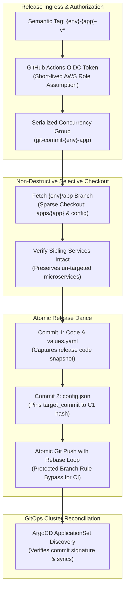

# Release Protection & Governance

> Production release governance enforcing protected audit branches, non-destructive sparse checkouts, serialized push concurrency, and cryptographic commit verification.

---

## Release Branch Topology & Purpose

### Immutable Audit Branches
Rather than tracking dynamic release branches with complex multi-developer merges, the platform maintains dedicated, automated release tracking branches:

- **`{env}/infra-aws`**: Chronological record of deployed AWS Terraform state configurations.
- **`{env}/infra-k8s`**: Chronological record of deployed Kubernetes platform manifests and Gateway resources.
- **`{env}/app`**: Consolidated application tracking branch shared by `api`, `worker`, and `frontend` microservices.
- **`{env}/helm`**: Chronological record of deployed Helm OCI chart version pointers (`config.json`).

---

## Governance & Automated Commit Architecture

The diagram below illustrates how CI/CD pipelines enforce protection boundaries, execute non-destructive checkouts, and serialize GitOps updates:

---

## Core Governance Mechanisms

### 1. Branch Protection Rules
- **Direct Pushes Blocked**: Developers and maintainers cannot push directly or merge manual pull requests into release tracking branches.
- **CI/CD Authorization**: Only GitHub Actions runner environments authenticated via repository secrets and scoped OIDC credentials (`contents: write`) can commit to tracking branches.
- **Linear Commit History**: Fast-forward linear history is strictly enforced; squash or merge commits are disabled on release branches.

### 2. Non-Destructive Selective Checkouts
- **The Sibling Microservice Dilemma**:
    - The `api`, `worker`, and `frontend` applications share the consolidated `{env}/app` release branch.
    - Naive Git checkout and commit approaches wipe out un-tracked sibling folders during deployment.
- **The Selective Sparse Checkout Solution**:
    - CI runners execute sparse checkouts targeting only the directory of the microservice being deployed (`apps/${app}`) and its corresponding GitOps configuration (`infra/k8s/argocd/${env}/${app}/`).
    - Sibling application code and configurations are preserved without modification.

### 3. Serialized Git Concurrency Locking
- **The Push Race Condition**:
    - Simultaneous releases (e.g. promoting `api` and `worker` to staging at the same time) create Git non-fast-forward push rejections if both runners attempt to push concurrently.
- **The Concurrency Group Lock**:
    - All staging and production application workflows share an environment-level concurrency lock: `git-commit-${env}-app`.
    - Only one pipeline can checkout, commit, and push to `{env}/app` at any given time.
    - Runners implement an automated rebase-and-retry loop (`git pull --rebase`) to resolve any transient contention gracefully.

### 4. Cryptographic Commit Signing (🚧 Planned / Designed)
- **Planned RFC Model**:
    - Future platform iterations will introduce automated GPG or AWS KMS commit signing within the GitHub Actions runner.
    - Every commit pushed to `{env}/app` or `{env}/helm` will carry a certified cryptographic signature.
    - ArgoCD will enforce signature verification on all repository manifests, guaranteeing that deployed workloads originate exclusively from authorized CI/CD pipelines.

---

## Governance Policy Reference Matrix

| Governance Control | Target Branches | Enforcement Mechanism | Failure Mode Prevented |
| :--- | :--- | :--- | :--- |
| **Branch Protection** | `{env}/infra-*`, `{env}/app`, `{env}/helm` | GitHub Protected Branch Rules | Manual human edits, un-reviewed configuration changes |
| **Sparse Checkout** | `{env}/app` | Git sparse-checkout script in CI | Accidental deletion of sibling microservice code |
| **Concurrency Locking** | `dev`, `{env}/app`, `{env}/helm` | GitHub Actions `concurrency: group` | Git non-fast-forward push rejections and pipeline deadlocks |
| **Fail-Fast Verification** | All semantic tags | `aws ecr describe-images` in CI | Deploying untested or unverified code to higher environments |
| **Commit Signing** | Release branches | 🚧 GPG / AWS KMS signature check | Manifest spoofing, untrusted Git commit injections |
