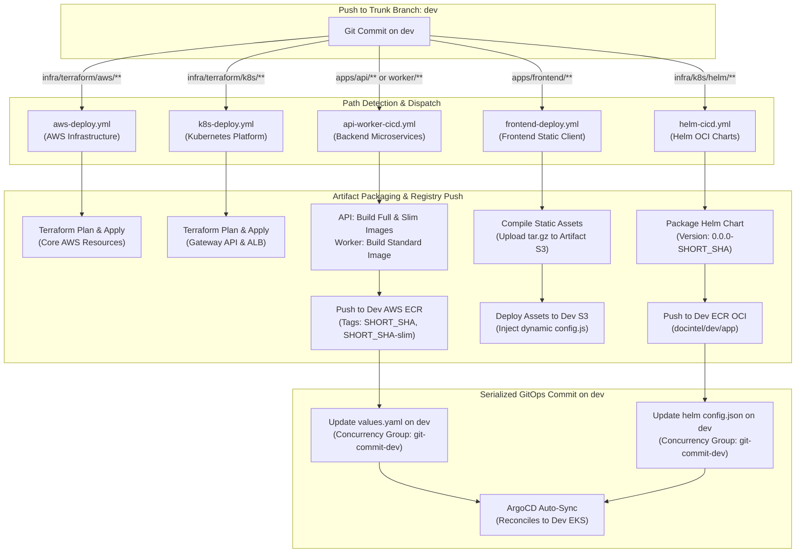

# Development Continuous Deployment

> Automated continuous deployment triggered by pushes to the development trunk, featuring path-filtered execution, parallel artifact packaging, dynamic configuration injection, and serialized GitOps commits.

---

## Architecture & Operational Flow

### Trunk Automation Mechanics
- **Path-Filtered Workflows**: Changes committed or merged into `dev` trigger only the specific GitHub Actions workflows responsible for the modified files.
- **Immediate Feedback Loop**: Code changes are built, validated, and deployed to the `dev` environment within minutes.
- **Trunk GitOps Discovery**: In the development environment, ArgoCD tracks the moving `dev` branch pointer (`"target_commit": "dev"` in `config.json`), allowing newly committed container image tags and Helm chart versions to reconcile automatically.

---

## Development Deployment Topology

The diagram below illustrates the five parallel pipelines triggered by pushes to the `dev` trunk:

---

## Detailed Pipeline Operations

### 1. AWS Cloud Infrastructure (`aws-deploy.yml`)
- **Pre-Flight Inspection**: Uses the zero-provider remote state query module (`infra/terraform/query`) to inspect Kubernetes remote state for dynamic ALB DNS hostnames without downloading heavy provider plugins.
- **Execution**: Initializes Terraform with `environments/dev/backend.config.hcl`, applies changes with `dev.tfvars`, and provisions VPC, EKS Auto Mode, RDS PostgreSQL, S3, SQS, and CloudFront.

### 2. Kubernetes Platform (`k8s-deploy.yml`)
- **Prerequisite Validation**: Queries AWS remote state to ensure the VPC, EKS cluster endpoint, ACM certificates, and IAM parameters exist before planning platform components.
- **ALB Allocation & Drift Monitoring**: Applies Gateway API manifests and polls until the AWS Load Balancer Controller provisions the ALB. Verifies that the allocated ALB DNS matches the origin expected by CloudFront, flagging any drift.

### 3. Backend Containers (`api-worker-cicd.yml`)
- **Dual Image Matrix for API**:
    - `full` variant: Built with `ENVIRONMENT=dev` to bundle Swagger UI and OpenAPI documentation (tagged `${SHORT_SHA}`).
    - `slim` variant: Built with `ENVIRONMENT=prod` to strip Swagger UI and minimize container footprint (tagged `${SHORT_SHA}-slim`).
- **Worker Image**: Built as a single standard container image (tagged `${SHORT_SHA}`).
- **Atomic Values Commit**: Updates `container.image.tag` inside `infra/k8s/argocd/dev/${app}/values.yaml` in a single atomic commit under the `git-commit-dev` concurrency lock.

### 4. Frontend Static Client (`frontend-deploy.yml`)
- **Build Once in Dev**: Runs Next.js static export compilation (`npm run build`) once per commit.
- **Central Artifact Archival**: Packages exported HTML/JS/CSS assets into a tarball and uploads it to the central artifact bucket (`s3://${ARTIFACT_BUCKET_NAME}/builds/${COMMIT_SHA}.tar.gz`).
- **Dynamic Runtime Config Injection**: Deploys assets to the dev S3 bucket and injects an un-hashed `config.js` containing the development API Gateway URL, followed by a CloudFront cache invalidation (`/*`).

### 5. Helm OCI Charts (`helm-cicd.yml`)
- **Dynamic Semantic Packaging**: Packages chart templates dynamically using `helm package --version 0.0.0-${SHORT_SHA}`. Chart files on disk (`Chart.yaml`) remain untouched.
- **Private OCI Push**: Pushes the packaged chart archive to the private AWS ECR OCI registry (`docintel/dev/${app}`).
- **Config Pointer Update**: Updates `chart_version` in `infra/k8s/argocd/dev/helm-${app}/config.json` and pushes to `dev` under the `git-commit-dev` lock.

---

## Development Pipeline Comparison Matrix

| Pipeline Workflow | Primary Trigger Paths | Build Output / Artifact | Registry / Storage | GitOps Update Target |
| :--- | :--- | :--- | :--- | :--- |
| **`aws-deploy.yml`** | `infra/terraform/aws/**` | Terraform State Plan | S3 Remote State Backend | Output consumed by query module |
| **`k8s-deploy.yml`** | `infra/terraform/k8s/**` | Gateway API & Helm Releases | Amazon EKS Cluster | Live Gateway & ALB DNS allocation |
| **`api-worker-cicd.yml`** | `apps/api/**`, `apps/worker/**` | Full & Slim Docker Images | AWS ECR (`docintel/dev/{app}`) | `infra/k8s/argocd/dev/{app}/values.yaml` |
| **`frontend-deploy.yml`** | `apps/frontend/**` | Static HTML/JS Export Tarball | S3 Artifact Bucket + Dev S3 | CloudFront CDN Edge Distribution |
| **`helm-cicd.yml`** | `infra/k8s/helm/**` | Helm OCI Package | AWS ECR (`docintel/dev/{app}`) | `infra/k8s/argocd/dev/helm-{app}/config.json` |

---

## Concurrency Governance & Collision Prevention

- **Shared Concurrency Group (`git-commit-dev`)**: Shared between `api-worker-cicd.yml` and `helm-cicd.yml` when committing to the `dev` branch.
- **Automated Rebase Loop**: If another pipeline pushes to `dev` during execution, the runner pulls with rebase (`git pull --rebase origin dev`) and retries the push up to 5 times.
- **Non-Interference Guarantee**: Prevents Git non-fast-forward push rejections and ensures automated commits never deadlock or overwrite sibling updates.
