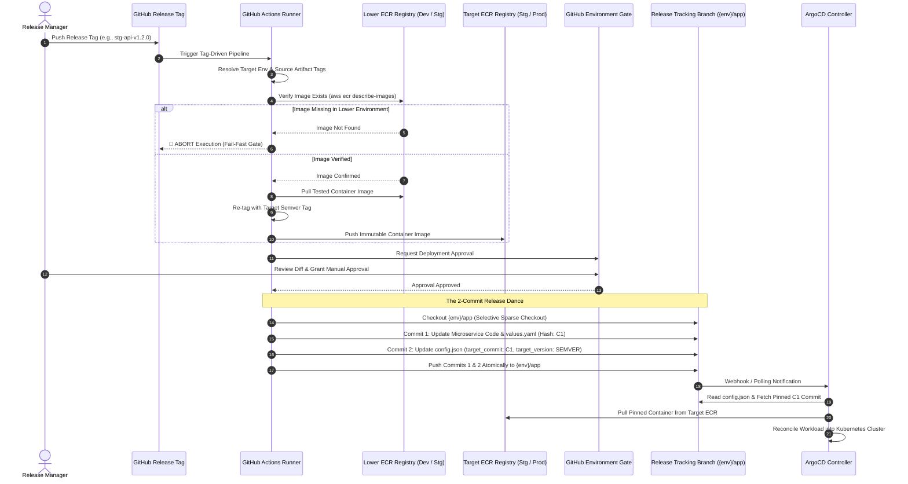

# Staging & Production Artifact Promotion

> Strict immutable promotion pipeline enforcing zero re-compilation across environments, fail-fast verification against lower-tier registries, manual approval gates, and the atomic 2-commit GitOps release dance.

---

## Architectural Philosophy

### The Rebuild Anti-Pattern
- In traditional deployment pipelines, code is re-compiled or container images are rebuilt from source when promoting from development to staging or production.
- This creates severe risks: minor dependency changes, build environment drift, or transient compiler updates can produce subtle differences between tested and deployed artifacts.

### The Build-Once Solution
- The platform enforces a strict **"Build Once in Dev, Promote Identical Immutable Artifacts to Staging and Production"** invariant:
    - **Containers**: Built strictly once in development. Staging and production releases pull the tested image directly from the lower-environment AWS ECR repository, re-tag it, and push it to the target registry without rebuilding.
    - **Frontend**: Compiled statically once in development. The exact tarball is fetched from a central S3 artifact bucket, deployed to the target bucket, and configured at runtime via an un-hashed `config.js`.
    - **Helm Charts**: Packaged once as an OCI artifact and promoted across ECR registries.

---

## Staging & Production Promotion Flow

The sequence diagram below traces the end-to-end promotion lifecycle triggered by cutting a semantic release tag:

---

## Microservice Promotion Mechanics

### 1. Fail-Fast Verification Gate
- Before altering any target registry or GitOps configuration, the promotion pipeline queries the lower-tier ECR repository (`aws ecr describe-images`).
- **Dev to Staging**: Asserts that image tag `${SHORT_SHA}` exists in Dev ECR. For the API service, the pipeline specifically verifies and promotes the production-optimized `${SHORT_SHA}-slim` variant.
- **Staging to Production**: Asserts that the exact semantic version tag (e.g. `1.2.0`) exists in the Staging ECR repository.
- **Fail-Fast Boundary**: If unverified or un-tested code is referenced, the pipeline aborts immediately (`exit 1`), preventing untested artifacts from entering higher environments.

### 2. Manual Environment Approval Gates
- Deployments to `stg` and `prod` bind directly to protected GitHub Environments.
- The pipeline builds or copies artifacts into the target registry first, then pauses execution.
- Designated release reviewers must review change summaries, verification results, and diffs before approving the downstream GitOps commit.

### 3. The 2-Commit Release Dance on `{env}/app`
Higher-environment releases update the consolidated release tracking branch (`{env}/app`) using an atomic two-commit dance to ensure 100% auditability and avoid GitOps race conditions:

1. **Commit 1 (Code & Manifest Update)**:
    - Uses non-destructive selective sparse checkouts to update only the target microservice folder (`apps/${app}`) and values file (`infra/k8s/argocd/${env}/${app}/values.yaml`).
    - Sibling microservices sharing the `{env}/app` branch remain completely untouched.
    - Generates an immutable commit hash: `C1_SHA`.
2. **Commit 2 (GitOps Pointer Pinning)**:
    - Updates `infra/k8s/argocd/${env}/${app}/config.json`.
    - Pins `"target_commit": "${C1_SHA}"` and records human-readable metadata `"target_version": "${SEMVER}"`.
3. **Atomic Push**:
    - Both commits are pushed together to the remote tracking branch under the `git-commit-${env}-app` concurrency lock.
    - ArgoCD discovers the updated `config.json` pointer, fetches the exact `C1_SHA` commit tree, and reconciles the deployment.

---

## Environment Promotion Lifecycle Comparison

| Lifecycle Dimension | Development (`dev`) | Staging (`stg`) | Production (`prod`) |
| :--- | :--- | :--- | :--- |
| **Pipeline Trigger** | Push to `dev` trunk | Semantic Tag: `stg-{app}-v*` | Semantic Tag: `prod-{app}-v*` |
| **Artifact Origin** | Compiled from source in CI | Promoted from Dev ECR / S3 | Promoted from Staging ECR / S3 |
| **API Container Variant** | Full (`${SHORT_SHA}`) & Slim | Canonical Slim (`${SHORT_SHA}-slim`) | Canonical Slim (`${SEMVER}`) |
| **Lower-Tier Verification** | N/A (Build source) | Verified against Dev ECR | Verified against Staging ECR |
| **Approval Requirement** | Fully automated (No gate) | GitHub Environment Approval | Mandatory Multi-Party Review |
| **GitOps Tracking Model** | Moving branch pointer (`dev`) | Pinned Commit SHA (`C1_SHA`) | Pinned Commit SHA (`C1_SHA`) |
| **Audit Metadata** | Target commit set to `'dev'` | Pinned SHA + Target Version | Pinned SHA + Target Version |
