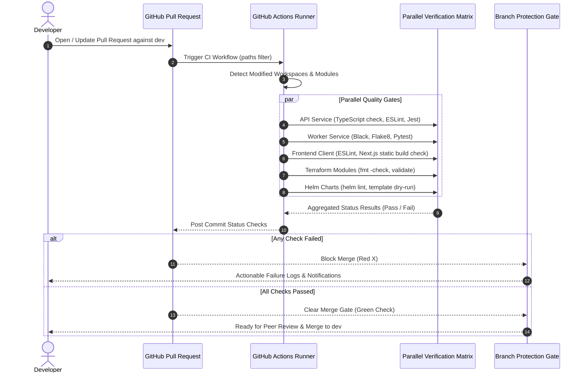

# 🚧 Continuous Integration Pipeline

> Designed pre-merge pull request validation framework enforcing automated linting, type-checking, test execution, and status check gates before code enters the trunk branch.

---

## Architectural Purpose & RFC Specification

### The Pre-Merge Quality Invariant
- **Shift-Left Quality Assurance**: Prevents syntax errors, broken dependencies, type mismatches, and test regressions from polluting the `dev` trunk.
- **Fail-Fast Feedback**: Developers receive immediate status notifications on GitHub Pull Requests within 2–3 minutes of opening or updating a PR.
- **Merge Gate Governance**: Direct commits to `dev` are blocked; branch protection rules enforce passing CI checks and mandatory peer review prior to merge.

---

## Designed PR Validation Sequence Flow

The diagram below outlines the automated validation lifecycle triggered when a developer submits a pull request targeting `dev`:

---

## Planned Validation Matrix Across Concerns

The CI pipeline runs targeted verification jobs based on modified paths, avoiding redundant checks across unaffected modules:

| Target Concern | Trigger Paths | Planned Verification Steps | Failure Threshold |
| :--- | :--- | :--- | :--- |
| **API Gateway** | `apps/api/**` | Strict TypeScript check (`tsc --noEmit`), ESLint linting, Jest unit tests, and Prisma schema validation | Any compiler error, lint failure, or broken test assertion |
| **Python Worker** | `apps/worker/**` | Flake8/Black PEP-8 formatting checks, Pytest unit tests (chunker, extractor, embeddings provider interfaces) | Any style violation or test suite failure |
| **Frontend Client** | `apps/frontend/**` | ESLint rules, TypeScript strict check, Next.js static export compilation test (`next build`) | Any JSX syntax issue, unhandled type error, or build break |
| **AWS Terraform** | `infra/terraform/aws/**` | `terraform fmt -check`, `terraform validate`, and static security scanning | Unformatted HCL, syntax error, or invalid provider configuration |
| **K8s Terraform** | `infra/terraform/k8s/**` | `terraform fmt -check`, `terraform validate`, and manifest schema checks | Misconfigured provider attribute or YAML syntax error |
| **Helm Charts** | `infra/k8s/helm/**` | `helm lint` across API and Worker charts, `helm template` dry-run verification | Missing required values, invalid indentations, or schema breaks |

---

## Current CD Enforcement vs Planned PR Gates

While formal PR merge gate automation is planned, core validation checks are currently enforced directly within the active CD deployment pipelines:

| Quality Dimension | Current CD Enforcement (Active) | Planned PR Gate (🚧 Designed) |
| :--- | :--- | :--- |
| **Execution Trigger** | Push to `dev` trunk | Pull request creation / update against `dev` |
| **Test Execution** | Unit suites executed during container build steps | Isolated test runners executed prior to merge |
| **Helm Verification** | `helm lint` and `helm template` run before ECR packaging | Linting runs as pre-merge validation on PR |
| **Terraform Validation** | Pre-flight state queries via remote state query module | Static syntax and format validation on PR |
| **Merge Protection** | Direct push to `dev` permitted for initial repository setup | Protected `dev` branch with required status checks |
