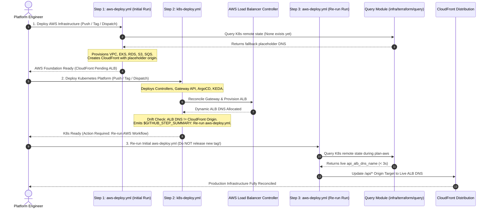

# Infrastructure Deployment Sequence

> Structured deployment runbook resolving the circular dependency between CloudFront and the Kubernetes Application Load Balancer, first-time release bootstrapping, and graceful reverse teardowns.

---

## The Cross-Stack Dependency Challenge

### The CloudFront-ALB Circular Dependency
- **The Deadlock Condition**:
    - The Amazon CloudFront CDN distribution requires the DNS hostname of the Application Load Balancer (`api_alb_dns_name`) to configure its `/api/*` reverse-proxy origin.
    - The Application Load Balancer is provisioned dynamically by the Kubernetes AWS Load Balancer Controller, which requires the EKS cluster, VPC subnets, and IAM roles to already exist.
- **The Naive Failure Mode**:
    - Attempting to provision AWS infrastructure in a single pass fails because the ALB DNS does not yet exist.
    - Attempting to provision Kubernetes infrastructure first fails because the underlying EKS cluster and networking do not exist.

---

## The 3-Step Canonical Provisioning Sequence

The sequence diagram below illustrates the automated 3-step deployment loop orchestrated to resolve cross-layer dependencies without manual intervention:

---

## Detailed Step-by-Step Execution Runbook

### Step 1: AWS Foundation Provisioning (`aws-deploy.yml`)
- **Target Module**: `infra/terraform/aws`
- **Actions**:
    - Triggered via branch push to `dev`, semantic release tag, or manual `workflow_dispatch`.
    - Dynamic pre-flight check executes `infra/terraform/query` against Kubernetes remote state. On initial bootstrap, falls back to `placeholder.elb.amazonaws.com`.
    - Provisions VPC, multi-AZ subnets, security groups, EKS Auto Mode cluster, RDS PostgreSQL with pgvector, S3 buckets, and SQS queues.
    - Initializes the CloudFront distribution with the placeholder origin for `/api/*`, allowing AWS foundation provisioning to complete without blocking on the ALB.

### Step 2: Kubernetes Platform Deployment (`k8s-deploy.yml`)
- **Target Module**: `infra/terraform/k8s`
- **Actions**:
    - Authenticates to the newly created EKS cluster using AWS credentials.
    - Deploys core platform controllers via Helm: AWS Load Balancer Controller, Secrets Store CSI Driver, External Secrets Operator, KEDA, and ArgoCD.
    - Applies Gateway API manifests (`alb_gatewayclass.yaml`, `api_gateway.yaml`, `argocd-applicationset.yaml`).
    - The AWS Load Balancer Controller detects the Gateway resource, provisions the physical Application Load Balancer across public subnets, and assigns a dynamic AWS DNS name.
    - **Blast-Radius Isolation & Re-run Prompt**: To preserve strict stack boundaries, `k8s-deploy.yml` never modifies CloudFront or AWS resources. Instead, it compares the allocated ALB DNS against the CloudFront origin output and generates a structured `$GITHUB_STEP_SUMMARY` instructing operators to re-run the existing AWS deployment workflow.

### Step 3: Re-Run Existing AWS Infrastructure Deployment
- **Target Workflow**: `.github/workflows/aws-deploy.yml`
- **Actions**:
    - **Do NOT Cut a New Release**: The operator does not create a new git tag or push a new release commit. Instead, they navigate to the existing `aws-deploy.yml` execution in GitHub Actions and click **Re-run all jobs** (or re-triggers dispatch).
    - During the `plan-aws` pre-flight phase, `infra/terraform/query` automatically reads the active `api_alb_dns` output directly from the Kubernetes remote state (< 3 seconds execution time).
    - Terraform identifies that only the CloudFront distribution `/api/*` origin target requires modification, leaving all VPC, compute, and database resources untouched.
    - The `apply-aws` job applies the plan, updating the origin target from placeholder to the live ALB DNS with zero edge downtime.

---

## First-Time Deployment Bootstrap

### The `[skip ci]` Release Deadlock
- **The Issue**: Automated GitOps commits executed by continuous deployment pipelines append `[skip ci]` to their commit messages to prevent recursive workflow loops.
- **The Deadlock**: When a release manager creates a semantic tag (e.g. `stg-api-v1.0.0`) pointing to a commit containing `[skip ci]`, GitHub Actions webhooks suppress workflow execution, preventing the staging or production pipeline from running.
- **The Resolution**:
    - An explicit empty synchronization commit is pushed to the trunk branch prior to cutting release tags:
        - Creates a clean Git commit reference free of the `[skip ci]` directive.
        - Tags are then pinned to this clean commit SHA, ensuring all downstream GitHub Actions webhooks fire reliably.

---

## Infrastructure Teardown Pipeline (`infra-destroy.yml`)

When decommissioning an environment, teardown must execute in **strict reverse dependency order** to prevent orphaned cloud resources and security group deadlocks:

| Destruction Stage | Target Subsystem | Teardown Operations | Dependency Guard |
| :--- | :--- | :--- | :--- |
| **Phase 1: Kubernetes Workloads** | `infra/terraform/k8s` | Deletes Helm releases, ArgoCD applications, and Gateway resources | Triggers AWS Load Balancer Controller to de-provision the physical ALB and release associated security group bindings |
| **Phase 2: Platform Controllers** | `infra/terraform/k8s` | Destroys controllers, CRDs, CSI drivers, and Kubernetes namespaces | Frees AWS VPC Elastic Network Interfaces (ENIs) attached to worker pods and controllers |
| **Phase 3: Root AWS Infrastructure** | `infra/terraform/aws` | Destroys EKS cluster, RDS PostgreSQL database, S3 buckets, and VPC subnets | Confirms all VPC ENIs and security group locks are released before deleting VPC subnets and routing tables |
