# Trunk-Based Deployment Architecture

> Unified delivery governance built on a single trunk branch, decoupled lifecycle concerns, immutable semantic release tagging, and isolated GitOps audit tracking branches.

---

## Core Philosophy & Strategy

### The Trunk-Based Invariant
- **Single Source of Truth**: All active feature development, configuration updates, and continuous integration converge on the `dev` trunk branch.
- **Zero Long-Lived Feature Branches**: Eliminates merge debt, configuration divergence, and complex multi-branch cherry-picking anti-patterns.
- **Automated Validation**: Every commit pushed to `dev` undergoes immediate change detection, building, and deployment to the shared development environment.

### Decoupled Lifecycle Concerns
To minimize blast radius and allow microservices to deploy independently, the platform isolates deployment into five distinct concerns across three environments (`dev`, `stg`, `prod`):

| Concern | Scope & Workload | Primary Source Paths | Release Tag Pattern | Tracking Branch |
| :--- | :--- | :--- | :--- | :--- |
| **AWS Cloud Infrastructure** | VPC, EKS Auto Mode, RDS pgvector, S3, SQS, CloudFront | `infra/terraform/aws/**` | `{env}-infra-aws-v*` | `{env}/infra-aws` |
| **Kubernetes Platform** | Gateway API, AWS LB Controller, ArgoCD, KEDA, ESO, CSI | `infra/terraform/k8s/**` | `{env}-infra-k8s-v*` | `{env}/infra-k8s` |
| **Backend Microservices** | Express API Gateway (`api`) & Python Worker daemon (`worker`) | `apps/api/**`, `apps/worker/**` | `{env}-{app}-v*` | `{env}/app` |
| **Frontend Static Client** | Next.js 16 SPA, S3 static assets, CloudFront edge distribution | `apps/frontend/**` | `{env}-frontend-v*` | `{env}/app` |
| **Helm Workload Charts** | OCI chart packaging, Kubernetes template definitions | `infra/k8s/helm/**` | `{env}-helm-{app}-v*` | `{env}/helm` |

---

## Branching & Release Promotion Lifecycle

The diagram below illustrates how code flows from feature branches to the `dev` trunk, and how semantic release tags promote immutable artifacts into staging and production:

```mermaid
flowchart TD
    subgraph DevelopmentCycle ["Development Trunk (dev)"]
        direction TB
        FeatureBranch["Feature Work / Commits"] --> PR["Pull Request Gate<br/>(🚧 Planned Tests & Linting)"]
        PR --> DevTrunk["Trunk Branch: dev<br/>(Continuous Integration)"]
        DevTrunk --> DevDeploy["Automated Dev Deployment<br/>(Build once, push to Dev ECR/S3)"]
    end

    subgraph ReleaseTagging ["Semantic Release Tagging"]
        direction TB
        DevDeploy -.->|"Validate in Dev"| CutTag["Cut Semver Release Tag<br/>(e.g., stg-api-v1.2.0)"]
    end

    subgraph StagingPromotion ["Staging Environment (stg)"]
        direction TB
        CutTag --> StgVerify["Fail-Fast ECR Verification<br/>(Verify artifact exists in Dev)"]
        StgVerify --> StgPromote["Promote Immutable Artifact<br/>(Dev ECR -> Stg ECR)"]
        StgPromote --> StgGate{"GitHub Environment Gate<br/>(Manual Reviewer Approval)"}
        StgGate --> StgGitOps["2-Commit Release Dance<br/>(Target Commit pinned on stg/app)"]
        StgGitOps --> StgReconcile["ArgoCD Multi-Source Sync<br/>(Target: Staging Cluster)"]
    end

    subgraph ProductionPromotion ["Production Environment (prod)"]
        direction TB
        StgReconcile -.->|"Validate in Staging"| ProdTag["Cut Production Tag<br/>(e.g., prod-api-v1.2.0)"]
        ProdTag --> ProdVerify["Fail-Fast Verification<br/>(Verify artifact exists in Stg)"]
        ProdVerify --> ProdPromote["Promote Immutable Artifact<br/>(Stg ECR -> Prod ECR)"]
        ProdPromote --> ProdGate{"Production Environment Gate<br/>(Mandatory Approval)"}
        ProdGate --> ProdGitOps["2-Commit Release Dance<br/>(Target Commit pinned on prod/app)"]
        ProdGitOps --> ProdReconcile["ArgoCD Multi-Source Sync<br/>(Target: Production Cluster)"]
    end
```

---

## Core Operational Invariants

### 1. Release Tag Alignment Invariant
- Release tags for higher environments (`stg` and `prod`) **must point directly to the commit from which lower environments deployed**.
- When promoting to staging, the CI pipeline checks that the exact container image or Helm chart exists in the Dev registry. If the commit differs, the image SHA will not match, and promotion aborts immediately (`exit 1`).
- When promoting to production, the pipeline verifies the artifact exists in the Staging registry before retagging.

### 2. Isolated Release Tracking Branches
- Tracking branches (`{env}/infra-aws`, `{env}/infra-k8s`, `{env}/app`, `{env}/helm`) serve as **immutable audit ledgers**.
- Developers never push to or merge pull requests into tracking branches.
- Deployments execute non-destructive selective checkouts, updating only the deployed concern while leaving siblings untouched.
- Preserves a clean, chronological commit history of exactly what code, configuration, and image digests ran in each environment.

### 3. Concurrency Serialization
- Parallel workflow runs are protected by environment-scoped concurrency groups (`git-commit-dev` and `git-commit-${env}-app`).
- Eliminates Git non-fast-forward push rejections when simultaneous microservice releases occur.
- Automated rebase-and-retry loops guarantee push delivery without manual pipeline restarts.
