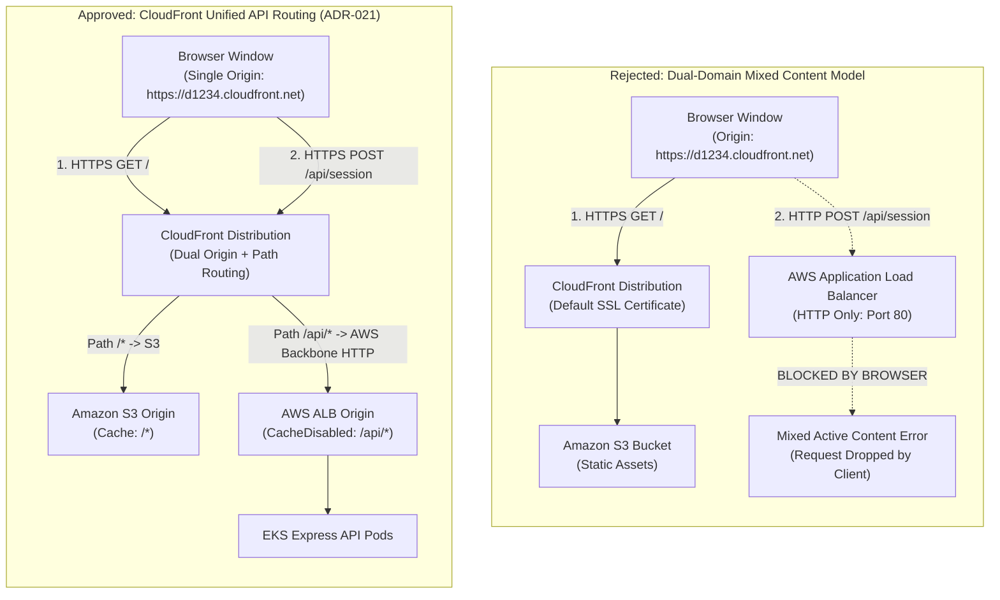
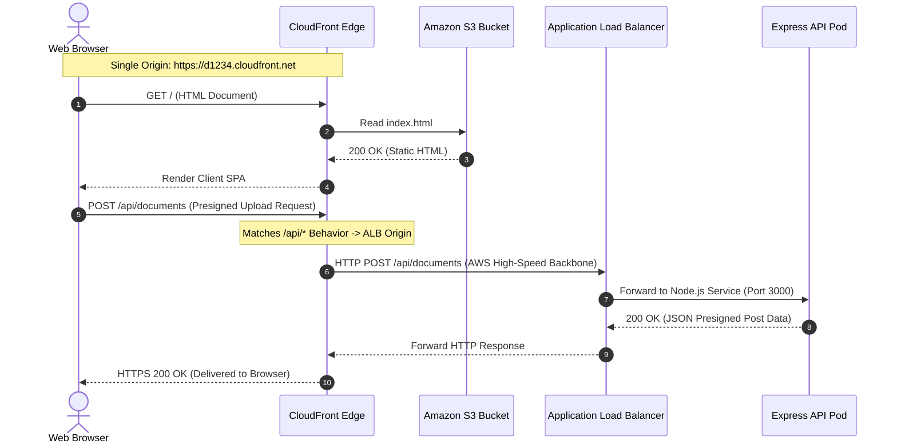

# ADR-021: CloudFront Unified API Routing

- **Status**: Approved
- **Date**: 2026-10-11
- **Domain**: Edge Networking & Ingress Security
- **Deciders**: Cloud Infrastructure Architect, Platform Engineer

---

## Context & Problem Statement

The platform decouples the static Next.js frontend from the containerized Express API running inside Amazon EKS. This physical separation created a critical transport security conflict during deployment:

1. **Static Client Origin**: The frontend is compiled to static HTML/JS/CSS, stored in an Amazon S3 bucket, and distributed globally over **HTTPS** via an Amazon CloudFront distribution (`https://d123456789.cloudfront.net`).
2. **Backend API Origin**: The Express API runs in private EKS worker nodes, exposed through the AWS Load Balancer Controller as an Application Load Balancer (ALB). By default, internal ALBs operate over standard **HTTP** (`http://k8s-default-apigatew-12345.us-east-1.elb.amazonaws.com`).
3. **Browser Mixed-Content Rejection**: Modern browser security specifications (W3C Mixed Content Level 2) strictly block mixed active content. When the secure HTTPS frontend issues asynchronous API requests (`fetch`, `XMLHttpRequest`, or `EventSource`) to an unencrypted HTTP endpoint, the browser immediately aborts the network request to prevent transport tampering.

### The Cost & Certificate Constraint

The industry standard remedy requires:

1. Purchasing a custom top-level domain (TLD) from Route 53 or an external registrar.
2. Generating a publicly trusted certificate via AWS Certificate Manager (ACM).
3. Validating domain ownership via CNAME DNS records.
4. Binding the ACM certificate to an HTTPS listener on the ALB (Port 443).

For a portfolio demonstration and staging environment, purchasing and maintaining third-party domain registrations introduces recurring financial overhead and external DNS dependencies. We required a cloud-native pattern providing **100% HTTPS end-to-end transport encryption** without purchasing custom domains.

---

## Architectural Decision

We decided to establish **Amazon CloudFront as the Unified Ingress and Reverse Proxy** for both static assets and API workloads under a single, shared CloudFront domain:

1. **Dual-Origin CloudFront Architecture**:
   - **Primary Origin (S3 Bucket)**: Serves static client bundles, icons, and pre-rendered assets.
   - **Secondary Origin (Application Load Balancer)**: Points directly to the AWS ALB DNS name as a custom HTTP origin (`OriginProtocolPolicy: http-only`, Port 80).
2. **Path-Based Cache Behavior Routing**:
   - **Default Cache Behavior (`/*`)**: Routes to the S3 origin. Enforces `Redirect-to-HTTPS`, optimal edge caching (TTL 1 year for hashed static chunks), and compression (`brotli`, `gzip`).
   - **API Cache Behavior (`/api/*`)**: Routes to the ALB origin. Enforces `Redirect-to-HTTPS`, forwards all HTTP methods (`GET, HEAD, OPTIONS, PUT, POST, PATCH, DELETE`), and applies AWS managed `CachingDisabled` and `AllViewerExceptHostHeader` request policies.

---

## Visual Architecture Comparison

---

## Detailed Ingress Request Lifecycle

---

## Consequences & Trade-Offs

### Positive Consequences

- **Mixed-Content Elimination**: The browser interacts exclusively with a single HTTPS origin (`https://d123456789.cloudfront.net`), completely resolving mixed-content blocking.
- **Zero Financial Cost**: Bypasses the requirement to buy and renew custom domain names ($12-$30/year) and provision paid third-party DNS services.
- **Global DDoS & TLS Edge Termination**: AWS Shield Standard and CloudFront edge servers terminate TLS close to end users, reducing latency.
- **Unified CORS Posture**: Because API calls match the frontend domain origin, complex cross-origin credential issues (`withCredentials: true` with strict origins) are substantially reduced in production.

### Negative Consequences & Mitigations

- **Terraform Circular Dependency**: CloudFront requires the ALB DNS hostname at provisioning time, but the ALB is generated dynamically by the Kubernetes Gateway API, which requires the EKS cluster and VPC to exist first.
  - _Mitigation_: The infrastructure CI/CD pipeline deploys AWS infrastructure initially with a placeholder, applies the Kubernetes platform layer to allocate the ALB DNS, and re-executes the AWS Terraform module via the lightweight zero-provider query module (`infra/terraform/query/`).
- **Edge Latency Overhead**: Requests traverse an additional CloudFront hop before reaching the ALB.
  - _Mitigation_: CloudFront routes internal traffic across AWS's private global fiber backbone, mitigating public Internet transit latency.
