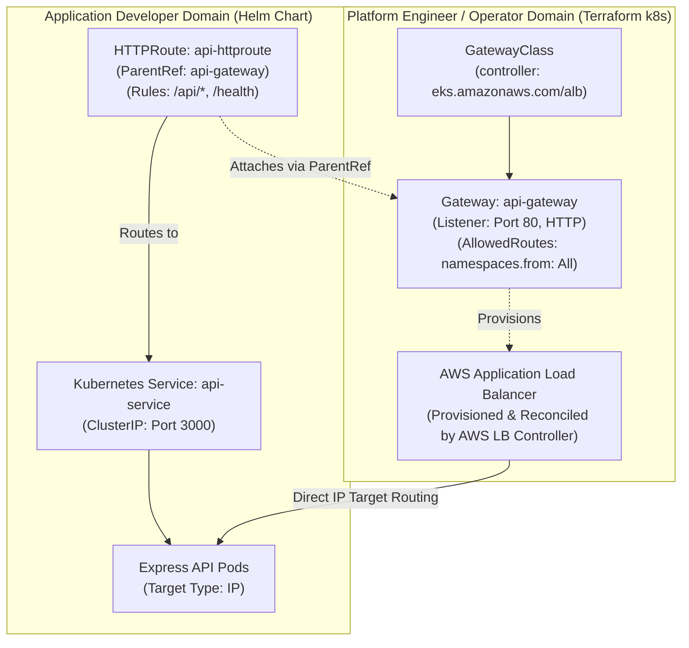
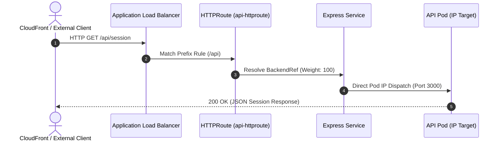

# ADR-020: Gateway API & HTTPRoute over Ingress

- **Status**: Approved
- **Date**: 2026-10-11
- **Domain**: Kubernetes Networking & Traffic Management
- **Deciders**: Certified Kubernetes Administrator (CKA), Cloud Platform Engineer

---

## Context & Problem Statement

Exposing the Express API Gateway to external edge traffic requires a resilient, declarative ingress layer on Amazon EKS. Historically, this was handled via the Kubernetes `Ingress` (v1) API. However, `Ingress` presents severe architectural liabilities in enterprise production environments:

1. **Annotation Sprawl & Vendor Lock-In**:
   Standard Ingress specifications only support rudimentary host and prefix matching. Advanced load balancer features (such as IP-mode target groups, internet-facing schemes, and custom health check paths) require proprietary controller annotations. These untyped string annotations fail silently on syntax errors and bypass Kubernetes schema validation.

2. **Violation of Separation of Concerns**:
   In standard `Ingress`, a single YAML manifest mixes cluster-level infrastructure (ALB provisioning, subnets, IP target types) with application-level routing rules (paths, prefixes, services). This forces application developers to manage infrastructure concerns in their Helm charts.

3. **SIG-Network Deprecation Trajectory**:
   Kubernetes SIG-Network has officially frozen the `Ingress` specification in maintenance mode, focusing all future routing innovation on the **Gateway API**.

---

## Architectural Decision

We decided to adopt the **Kubernetes Gateway API (v1.6.1)** managed by the **AWS Load Balancer Controller (v3.5.0)**:

1. **Role-Oriented Resource Separation**:
   The ingress architecture is explicitly separated into three decoupled personas:
   - **Infrastructure Provider (Kubernetes)**: Defines the `GatewayClass` (`alb_gatewayclass.yaml`) backed by controller `eks.amazonaws.com/alb`.
   - **Cluster Operator (Terraform `infra/terraform/k8s/`)**: Provisions the `Gateway` (`api_gateway.yaml`), specifying listeners, protocols, and infrastructure parameters.
   - **Application Developer (Helm `infra/k8s/helm/api/`)**: Provisions the `HTTPRoute` (`httproute.yaml`), declaring path routing rules (`/api/*`, `/health`) and attaching them to the operator's parent `Gateway`.

2. **First-Class AWS ALB Controller Integration**:
   The AWS Load Balancer Controller provisions and reconciles the AWS Application Load Balancer directly from the `Gateway` and `HTTPRoute` definitions, completely eliminating the legacy `ingress-nginx` or annotation-based ALB workflows.

---

## Role-Oriented Architecture Topology

---

## HTTPRoute Routing Manifest Structure

The application's `HTTPRoute` attaches declaratively to the platform `Gateway`, routing incoming edge requests directly to container endpoints:

---

## Consequences & Trade-Offs

### Positive Consequences

- **True Separation of Duties (SoD)**: Platform engineers control load balancer infrastructure and security groups without modifying application Helm values. Application teams configure routing and traffic splits without infrastructure permissions.
- **Strict Schema Validation**: The Gateway API uses strongly typed Custom Resource Definitions (CRDs) with OpenAPI v3 validation, eliminating silent failures caused by mistyped annotations.
- **Advanced Traffic Splitting**: Enables native canary deployments and traffic splitting across multiple backend services (e.g. `weight: 90` to v1, `weight: 10` to v2) without third-party service meshes.
- **Direct IP Target Routing**: The AWS LB Controller targets pod IP addresses directly via AWS VPC CNI, bypassing Kubernetes `kube-proxy` iptables NAT hops for lower latency and better connection distribution.

### Negative Consequences & Mitigations

- **CRD Pre-requisite**: The cluster must install the experimental or standard Gateway API CRDs before Helm manifests can be applied.
  - *Mitigation*: Our Terraform Kubernetes module (`infra/terraform/k8s/k8s.tf`) installs Gateway API CRDs (v1.6.1) prior to reconciling Helm releases.
- **Ecosystem Maturity**: Some legacy Kubernetes ingress management tools do not yet support Gateway API natively.
  - *Mitigation*: The AWS Load Balancer Controller v3.5.0 provides native, production-grade support for Gateway API, and CloudFront handles external TLS termination.
