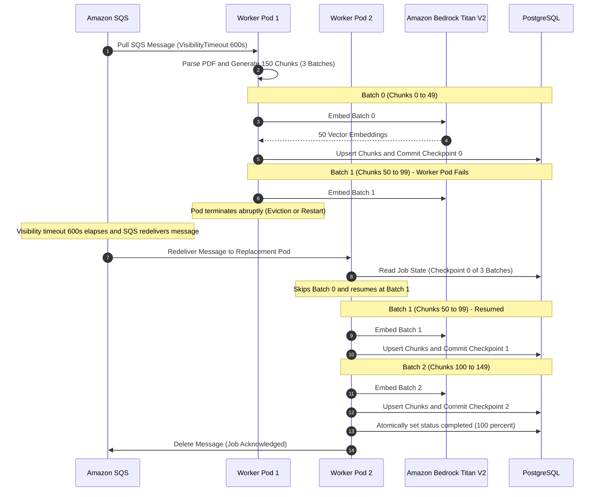

# ADR-012: Idempotent Batch Checkpoint Resumption

- **Status**: Approved
- **Date**: 2026-10-10
- **Domain**: Ingestion Pipeline Reliability & Resilience
- **Deciders**: Senior Data Engineer, Cloud Platform Architect

---

## Context & Problem Statement

Ingesting a large document requires significant compute and multi-stage orchestration: validating file signatures, extracting hundreds of text paragraphs via PyMuPDF, generating 1024-dimensional vector embeddings via AWS Bedrock Titan V2, and persisting chunks to PostgreSQL.

In cloud-native environments running on Kubernetes (EKS), workers are subject to unexpected terminations:
- Worker pods can be evicted due to node drain events or spot instance interruptions.
- Heavy PDFs can push containers close to memory thresholds, risking transient SIGKILL terminations.
- Amazon SQS enforces an **at-least-once message delivery** contract. Duplicate message delivery can occur when network latency exceeds polling timeouts.

### The Re-processing Failure Modes

Without an explicit idempotency and checkpoint strategy:
1. **Duplicate Vector Pollution**: Re-inserting chunks creates duplicate vectors for the same document in `document_chunks`, degrading similarity search accuracy and returning duplicate citations in the RAG prompt.
2. **Wasted Cloud AI Spend**: A 100-page document generating 1,000 chunks makes 20 batch calls to Bedrock. If a pod crashes on batch 19 and restarts from scratch, the system needlessly re-embeds 950 chunks, multiplying Bedrock API billing.
3. **Poison Message Loss**: Deleting the SQS message upon download risks losing the document forever if the worker crashes mid-extraction.

---

## Architectural Decision

We decided to implement a **three-mechanism idempotency and batch checkpoint resumption strategy**:

1. **Composite Upsert Key on Document Chunks**:
   The `document_chunks` table enforces a composite unique constraint on `(document_id, chunk_index)` in the database schema. When saving chunks, the worker performs atomic upserts (`ON CONFLICT DO UPDATE`), safely updating existing records if re-processed without creating duplicate rows or throwing constraint errors.

2. **Per-Batch Checkpoint State Persistence**:
   The `processing_jobs` table maintains a `checkpoint_index` column. After successfully embedding and committing each batch of 50 chunks, the worker atomically commits the current batch index, increments the processed chunk count, and updates the linear progress percentage. If a worker restarts mid-document, it queries the database for the last committed checkpoint index and resumes execution starting strictly from the next batch, skipping all previously completed chunks.

3. **Delayed SQS Message Deletion & Visibility Timeout**:
   The SQS message is never deleted during processing. The consumer sets a 600-second (10-minute) visibility timeout. If a pod terminates abruptly, the message remains unacknowledged in the queue. Once the 600-second window elapses, SQS automatically makes the message visible again to surviving worker pods. Only after the document is completely processed and marked completed does the worker acknowledge and delete the SQS message.

---

## Failure Recovery & Checkpoint Resumption Lifecycle

---

## Consequences & Trade-Offs

### Positive Consequences

- **Exactly-Once Logical Execution**: While transport is at-least-once, database upserts and checkpoint resumes provide deterministic, idempotent state transitions.
- **Cost Minimization**: Restarting workers skip completed batches, saving up to 95% of embedding API costs on long-running document processing failures.
- **Zero Orphaned Vector Rows**: Composite uniqueness guarantees that retries never leave duplicate chunks with divergent IDs.
- **Dead-Letter Queue (DLQ) Safeguard**: If a malformed document causes 3 consecutive pod failures, SQS routes the message to the DLQ, where a secondary worker daemon marks the job `failed` with code `max_retries_exceeded`.

### Negative Consequences & Mitigations

- **Write Amplification on Job Table**: Writing progress updates every 50 chunks produces periodic transactions.
  - *Mitigation*: Batching updates every 50 chunks balances database write load (only 20 writes for 1,000 chunks) with real-time UI visibility.
- **Visibility Timeout Delay**: If a worker pod crashes, the job will not be retried until the 600-second visibility timeout elapses.
  - *Mitigation*: 600 seconds is necessary to allow valid large documents to complete without concurrent workers picking up the same message.
