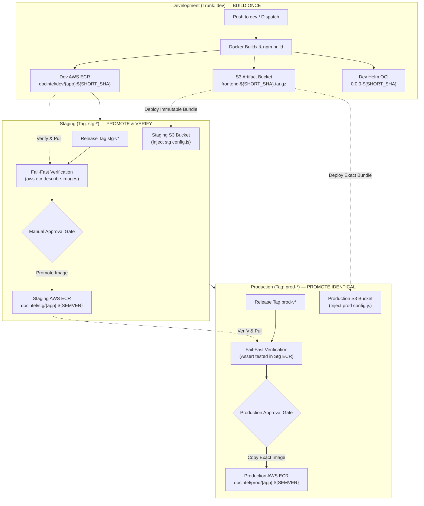
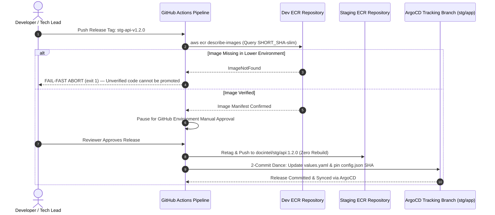

# ADR-022: Immutable Artifact Promotion Pipeline

- **Status**: Approved
- **Date**: 2026-10-11
- **Domain**: CI/CD Pipelines & Release Governance
- **Deciders**: Lead DevOps Engineer (AWS-DOP), Release Platform Architect

---

## Context & Problem Statement

Deploying a multi-service platform across multi-stage cloud environments (`dev` -> `stg` -> `prod`) presents severe drift vulnerabilities when releases are built from source at each stage:

1. **The Rebuild Anti-Pattern**:
   Compiling Docker containers, Next.js static bundles, or Helm packages independently in staging and production violates **artifact immutability**:
   - Upstream base image updates (`node:24-alpine` or `python:3.11-slim`) can alter underlying shared C-libraries between staging and production builds.
   - Minor transitive package resolution differences (`npm install` or `pip install`) can introduce undetected bugs into production that were never present in staging.
   - Compile-time environment variable inlining (e.g., `NEXT_PUBLIC_API_URL`) tightly couples static frontend bundles to a specific environment, forcing rebuilds.

2. **Deployment Latency**:
   Re-running Docker Buildx, TypeScript compilation, Prisma generation, and PyMuPDF dependency installations adds 8–15 minutes of pipeline overhead to every production release.

---

## Architectural Decision

We decided to enforce a strict **"Build Once in Dev, Promote Identical Immutable Artifacts to Stg/Prod"** governance model across all platform layers:

1. **Microservice Containers (`api` & `worker`)**:
   - Containers are built strictly once during commits on `dev` via Docker Buildx with GitHub Actions layer caching.
   - Staging releases verify the container's existence in the Dev ECR repository (`aws ecr describe-images`), pull the exact tested image, retag with the semver release tag, and push directly to Staging ECR (`docintel/stg/{app}:{semver}`).
   - For the API, the workflow compiles dual variants in dev: `full` (`${SHORT_SHA}`) and `slim` (`${SHORT_SHA}-slim`), and canonically promotes the hardened `slim` variant to higher environments.
   - Production releases verify and promote the exact container image from Staging ECR to Production ECR with **zero re-compilation**.

2. **Frontend Static Assets (`apps/frontend/`)**:
   - Next.js static HTML/JS bundles are compiled once in `dev` via `npm run build` (`output: 'export'`).
   - Packaged into an immutable `.tar.gz` archive and uploaded to a central S3 artifact bucket (`vars.ARTIFACT_BUCKET_NAME`).
   - Staging and production workflows download the exact tarball, unpack it into the environment S3 bucket, and inject an un-hashed runtime `/config.js` script containing environment-specific API URLs.

3. **Helm Charts (`infra/k8s/helm/`)**:
   - Helm charts are linted and packaged once in `dev` with dynamic version `0.0.0-${SHORT_SHA}` and pushed to Dev ECR as OCI artifacts.
   - Promoted to Staging and Production ECR registries via OCI pull, repack with semver, and push, without altering `Chart.yaml` on disk.

---

## Multi-Environment Promotion Lifecycle

---

## Promotion Verification Matrix

---

## Consequences & Trade-Offs

### Positive Consequences

- **Guaranteed Parity**: The container image and static assets running in Production are byte-for-byte identical to the artifacts validated in Staging.
- **Fail-Fast Safety**: If a developer tags a release for code that was never built and tested on `dev`, the pipeline aborts immediately during the pre-flight verification step (`aws ecr describe-images`), preventing unverified code deployments.
- **Sub-90-Second Deployments**: Eliminating the build and compilation phase cuts Staging and Production deployment times from over 12 minutes to under 90 seconds.
- **Audit Traceability**: Every production container tag directly maps back to its originating git commit SHA and staging verification record.

### Negative Consequences & Mitigations

- **Storage Utilization in ECR**: Maintaining separate ECR repositories per environment (`dev`, `stg`, `prod`) multiplies stored image tags.
  - *Mitigation*: Terraform lifecycle policies automatically prune untagged images and retain only the last 30 tagged container versions.
- **Strict Release Tag Discipline**: Staging and production release tags must point to commits where the lower-environment pipeline has already executed.
  - *Mitigation*: Detailed in `docs-site/docs/deployment/overview.md` and enforced by automated pipeline verification scripts.
