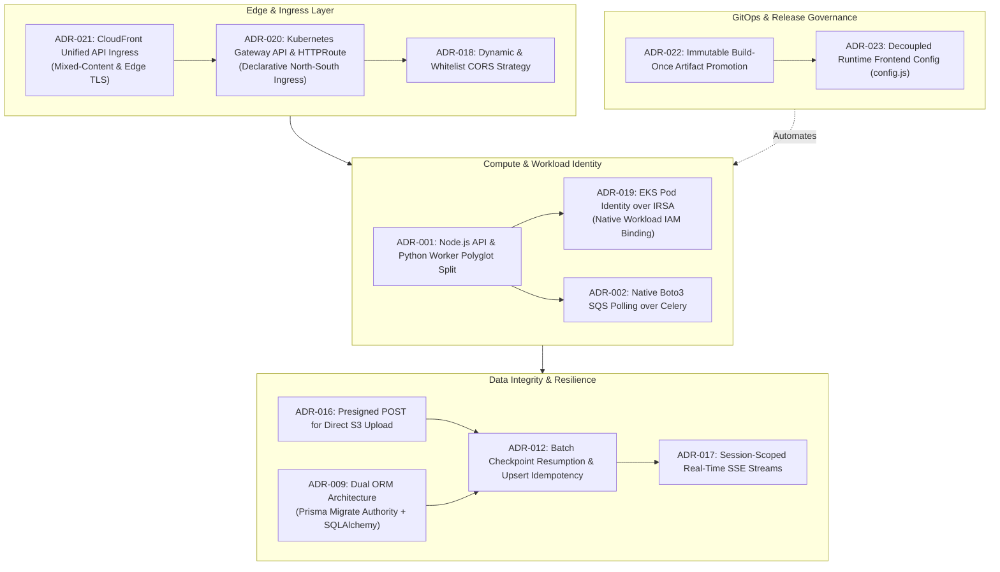
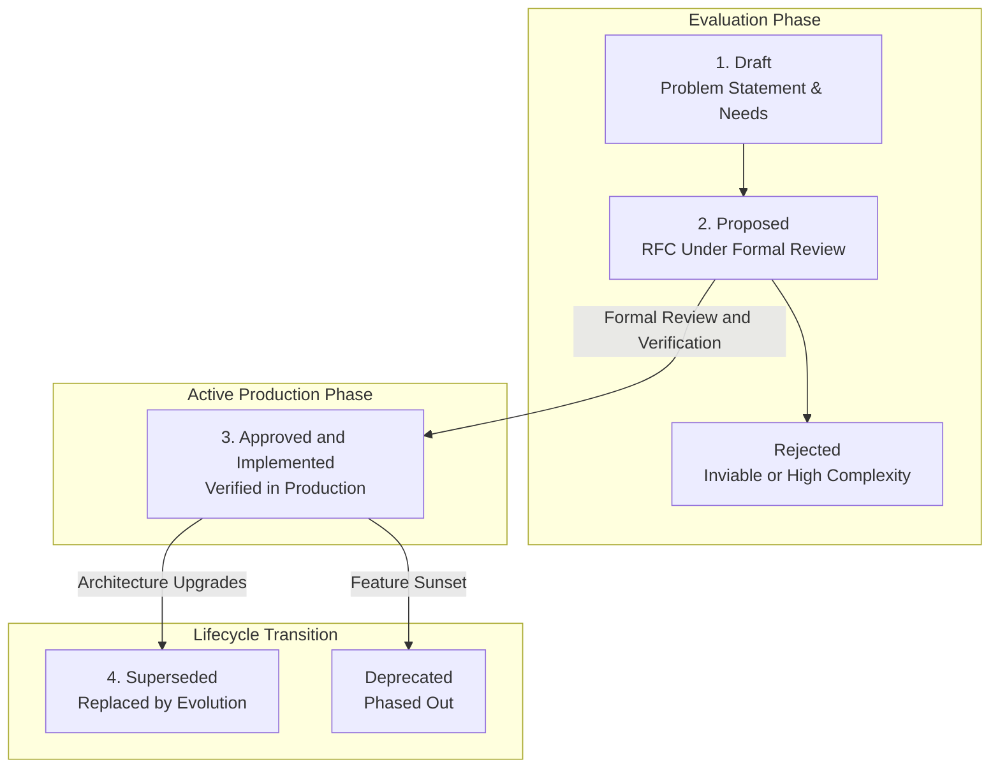

# Architecture Decision Records (ADRs)

Architecture Decision Records (ADRs) document the critical architectural choices, structural trade-offs, and operational governance established across the **AI Document Intelligence Platform**. Every record captures the problem context, evaluated alternatives, the final decision, and positive/negative architectural consequences.

---

## Architectural Decision Topology

The platform's decisions are not isolated; they reinforce a coherent, defense-in-depth model spanning edge routing, compute isolation, data consistency, and GitOps release delivery:

---

## Master Architecture Decision Registry

The table below catalogs the complete set of architectural decisions governing the platform:

| ADR ID      | Decision Title                                                              | Architectural Domain    | Status         | Core Rationale & Architectural Consequence                                                                               |
| :---------- | :-------------------------------------------------------------------------- | :---------------------- | :------------- | :----------------------------------------------------------------------------------------------------------------------- |
| **ADR-001** | [Polyglot Microservice Split](polyglot-microservices-split.md)              | Compute Architecture    | **Approved**   | Decouple Node.js Express (high-concurrency non-blocking I/O) from Python (PyMuPDF C-bindings and vector math).           |
| **ADR-002** | Custom Boto3 SQS Consumer over Celery                                       | Messaging & Compute     | **Approved**   | Direct Boto3 long-polling loop eliminates Redis broker dependency and Celery SQS transport instabilities.                |
| **ADR-003** | React SPA Served from S3 + CloudFront                                       | Client Architecture     | **Approved**   | Compile frontend to static assets, offloading cluster compute and cutting hosting costs to <$3/mo.                       |
| **ADR-004** | Amazon Bedrock Foundation Models                                            | Machine Learning        | **Approved**   | Titan V2 embeddings and Claude 3.5 Sonnet invoked via AWS SDK using Pod Identity (zero third-party API keys).            |
| **ADR-005** | PyMuPDF Text Extraction over Docling                                        | Document Processing     | **Approved**   | C-native parsing delivers sub-second extraction without GPU or heavy JVM resource footprints.                            |
| **ADR-006** | RDS Proxy + IAM Database Authentication                                     | Persistence & Security  | **Approved**   | Ephemeral 15-minute IAM auth tokens eliminate static database passwords in Kubernetes pods.                              |
| **ADR-007** | Local Testing & Parity Environment                                          | Developer Experience    | **Approved**   | LocalStack (S3/SQS), containerized pgvector, and local CPU E5 models permit 100% offline development.                    |
| **ADR-008** | Per-Document SSE Progress Streaming                                         | Real-Time Streaming     | **Superseded** | Replaced by ADR-017 due to browser connection limits (max 6 connections per host in HTTP/1.1).                           |
| **ADR-009** | [Dual ORM Architecture Strategy](dual-orm-strategy.md)                      | Database Architecture   | **Approved**   | Prisma Migrate owns schema declarations as single source of truth; SQLAlchemy mirrors models in Python.                  |
| **ADR-010** | Confirm-Upload Status Transition                                            | Ingestion State Machine | **Approved**   | Browser explicitly calls `POST /confirm-upload` after S3 204 response, decoupling client signals from SQS pickup.        |
| **ADR-011** | Hybrid Batch-Level Progress Updates                                         | Real-Time Streaming     | **Approved**   | Progress counters committed to DB every 50 chunks, avoiding write amplification on 5,000+ chunk documents.               |
| **ADR-012** | [Idempotency & Checkpoint Resumption](idempotency-checkpoint-resumption.md) | Ingestion Reliability   | **Approved**   | `UNIQUE(document_id, chunk_index)` upserts and `checkpoint_index` allow workers to resume after crashes.                 |
| **ADR-013** | Per-Session Upload Concurrency Limit                                        | Resource Governance     | **Approved**   | Enforce maximum 5 simultaneous in-flight uploads per session at API and UI layers to prevent pod starvation.             |
| **ADR-014** | Cumulative Per-Session Storage Quota                                        | Resource Governance     | **Approved**   | 50 MB cumulative session storage cap calculated via live DB aggregate query without denormalized counters.               |
| **ADR-015** | Batch Upload Initialization Contract                                        | API Contract            | **Approved**   | Single `POST /api/documents` accepts array of files; atomic quota validation prevents partial batch race conditions.     |
| **ADR-016** | Presigned POST for Direct S3 Upload                                         | Storage & Security      | **Approved**   | `createPresignedPost` enforces file size (1B-5MB) and MIME type at the S3 storage layer via policy conditions.           |
| **ADR-017** | [Session-Scoped Real-Time SSE Streams](session-scoped-sse.md)               | Real-Time Streaming     | **Approved**   | Replaces ADR-008 with single session connection listening on PostgreSQL channel `progress_{sessionId}`.                  |
| **ADR-018** | Environment-Driven CORS Policy                                              | Edge Security           | **Approved**   | Dynamic request origin reflection in local dev; strict whitelist with preflight caching (24h) in production.             |
| **ADR-019** | [EKS Pod Identity over IRSA](pod-identity-over-irsa.md)                     | Kubernetes Security     | **Approved**   | Native EKS Pod Identity Associations eliminate OIDC provider provisioning and complex trust policy mutations.            |
| **ADR-020** | [Gateway API over Ingress](gateway-api-over-ingress.md)                     | Kubernetes Networking   | **Approved**   | Modern Kubernetes Gateway API (v1.6.1) + HTTPRoute replaces legacy Ingress with declarative role separation.             |
| **ADR-021** | [CloudFront Unified API Routing](cloudfront-api-routing.md)                 | Edge & Networking       | **Approved**   | Solves browser mixed-content rejection without purchasing custom domains by proxying `/api/*` to the ALB.                |
| **ADR-022** | [Immutable Artifact Promotion Pipeline](immutable-artifact-promotion.md)    | CI/CD & GitOps          | **Approved**   | Build containers, frontend bundles, and Helm charts once in `dev`; promote identical immutable binaries to `stg`/`prod`. |
| **ADR-023** | Decoupled Runtime Frontend Config                                           | Frontend Architecture   | **Approved**   | Un-hashed `/config.js` script dynamically injected at deployment time eliminates compile-time environment coupling.      |

---

## Architectural Decision Lifecycle

Every decision in this repository follows a disciplined state machine:

- **Proposed**: Under formal evaluation; trade-offs and prototypes under review.
- **Approved**: Implemented in production with automated verification tests.
- **Superseded**: Replaced by a more advanced pattern; retained for architectural auditability.
- **Rejected / Deprecated**: Evaluated and discarded, or phased out.
