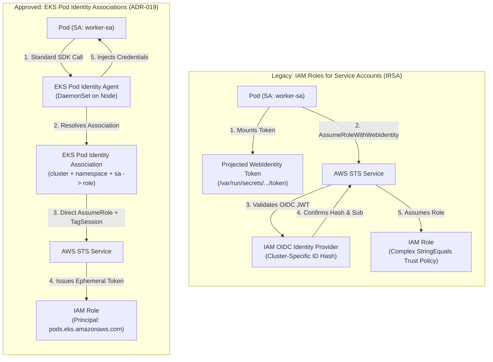
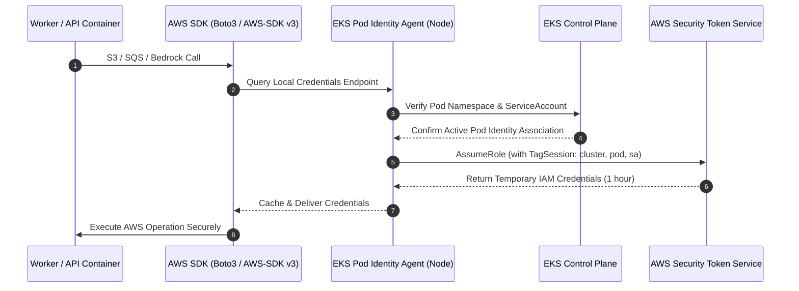

# ADR-019: EKS Pod Identity Associations over IRSA

- **Status**: Approved
- **Date**: 2026-10-11
- **Domain**: Kubernetes Workload Security & Cloud Identity
- **Deciders**: Cloud Infrastructure Architect, Senior Platform Engineer

---

## Context & Problem Statement

Workloads running on the Amazon EKS cluster require least-privilege permissions to interact with AWS cloud resources:

- **Express API Pods**: Require `bedrock:InvokeModelWithResponseStream` (Claude 3.5 Sonnet), `bedrock:InvokeModel` (Titan Embeddings V2), `s3:PutObject` (presigned POST generation), and `rds-db:connect` (IAM database authentication).
- **Python Worker Pods**: Require `sqs:ReceiveMessage`, `sqs:DeleteMessage`, `s3:GetObject`, `bedrock:InvokeModel`, and `rds-db:connect`.
- **Platform Controllers**: External Secrets Operator (ESO) requires `ecr:GetAuthorizationToken` to rotate ArgoCD credentials hourly.

### The Legacy IRSA Bottleneck

Historically, Kubernetes workloads on AWS utilized **IAM Roles for Service Accounts (IRSA)**. While secure, IRSA introduces severe operational friction in enterprise automation:

1. **OIDC Provider Dependency**: Every EKS cluster requires provisioning an AWS IAM OpenID Connect (OIDC) identity provider.
2. **Brittle String Trust Policies**: IRSA trust policies require exact string matching against the ephemeral cluster OIDC issuer URL and ServiceAccount names. Any typo or change in cluster OIDC identifier invalidates the trust relationship.
3. **Cluster Migration Overhead**: Recreating or upgrading a cluster alters the OIDC hash ID, forcing mutations across every IAM role's trust policy in Terraform.
4. **Projected Volume Plumbing**: Pods rely on projected WebIdentity service account tokens mounted inside the container filesystem, which are read by SDKs via external STS assume-role calls.

---

## Architectural Decision

We decided to adopt **Amazon EKS Pod Identity Associations** as the authoritative workload identity mechanism across all environments:

1. **Native Association Resource**:
   Terraform manages native Pod Identity Associations, directly mapping the target cluster name, namespace, and Kubernetes ServiceAccount to the corresponding IAM role without intermediary OIDC identity provider resources.

2. **Unified, Cluster-Agnostic Trust Policy**:
   All workload IAM roles declare a single, standardized trust policy delegating authority directly to the AWS EKS Pod Identity service principal (`pods.eks.amazonaws.com`) with role-assumption and session-tagging permissions. Because the policy no longer embeds cluster-specific OIDC hashes, the same IAM role definition can be shared across development, staging, and production clusters.

3. **EKS Pod Identity Agent DaemonSet**:
   The native `eks-pod-identity-agent` runs on cluster worker nodes, intercepting AWS SDK requests to the standard link-local metadata address and supplying temporary IAM credentials.

---

## Visual Architecture Comparison

---

## In-Pod Credential Acquisition Lifecycle

---

## Consequences & Trade-Offs

### Positive Consequences

- **Zero OIDC Overhead**: Eliminates the Terraform IAM OIDC Provider resource and its associated API endpoints.
- **Cluster-Portable IAM Roles**: Because trust policies reference `pods.eks.amazonaws.com` rather than an ephemeral cluster OIDC URL, the exact same IAM role can be shared across ephemeral test, staging, and production clusters.
- **Granular CloudTrail Auditing**: Native support for `sts:TagSession` automatically annotates every AWS CloudTrail event with `eks:cluster-name`, `eks:pod-name`, `eks:pod-uid`, and `eks:service-account-name`.
- **Simplified Local Parity**: Pod manifests require zero custom volume mounts, projected token files, or SDK-specific environment variables (`AWS_ROLE_ARN`, `AWS_WEB_IDENTITY_TOKEN_FILE`).

### Negative Consequences & Mitigations

- **EKS Version Constraint**: Requires Kubernetes 1.24+ and the `eks-pod-identity-agent` cluster add-on.
  - *Mitigation*: Our cluster runs modern Kubernetes 1.37 with AWS EKS Auto Mode, where the Pod Identity agent is managed natively.
- **Cross-Account Limitations**: EKS Pod Identity does not directly assume cross-account roles in the initial association.
  - *Mitigation*: The workload role assumes a secondary cross-account role via standard STS `sts:AssumeRole` if external account access is required.
