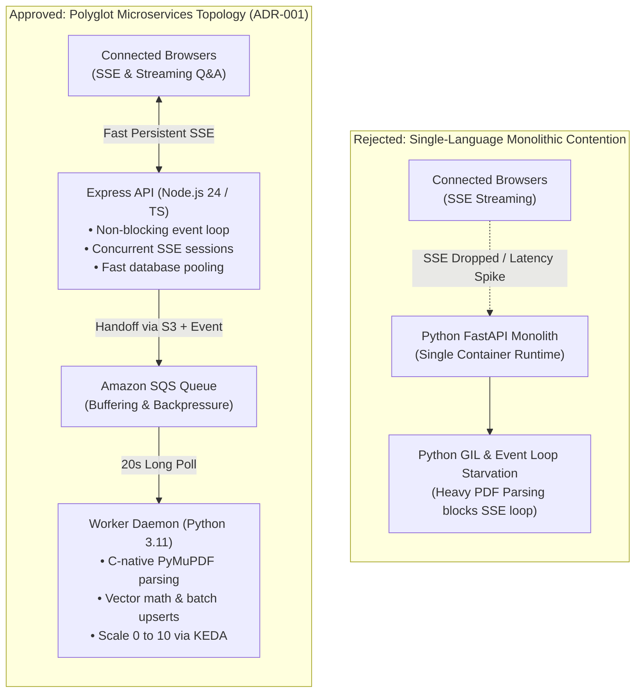
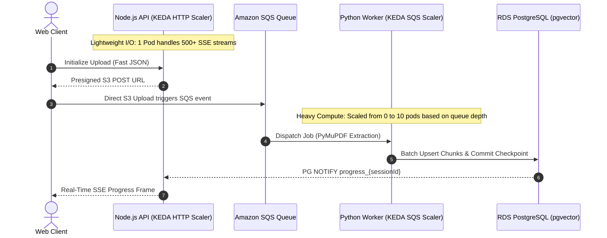

# ADR-001: Polyglot Microservices Split

- **Status**: Approved
- **Date**: 2026-10-08
- **Domain**: Compute Architecture & System Topology
- **Deciders**: Lead Cloud Architect, Backend Systems Engineer

---

## Context & Problem Statement

The platform simultaneously executes two fundamentally divergent computational workloads:

1. **High-Concurrency Real-Time Web I/O**:
   - Serving REST endpoints for batch upload initialization, session authentication, and query execution.
   - Maintaining hundreds of concurrent, long-lived **Server-Sent Events (SSE)** connections for real-time document progress updates (`GET /api/documents/progress`) and grounded LLM token streaming (`POST /api/query/search`).
   - Requires minimal memory footprint per connection and non-blocking asynchronous event dispatching.

2. **Compute-Intensive Document Ingestion**:
   - Downloading large binary PDF documents from S3.
   - Executing low-level C-bindings to sniff magic bytes, parse font glyphs, and extract structured page-by-page text.
   - Performing sliding-window text chunking, calculating cosine vectors via AWS Bedrock Titan V2 (or local CPU bi-encoders), and committing batch upserts to `pgvector`.
   - Requires high memory throughput and specialized machine learning/data extraction libraries.

### The Monolithic Single-Language Dilemma

Unifying both concerns into a single service creates severe runtime pathologies:

- **All-Python Monolith (FastAPI / Gunicorn)**: Python's Global Interpreter Lock (GIL) and synchronous file I/O operations inside PyMuPDF frequently starve the `asyncio` event loop. Active SSE client streams freeze or time out while worker threads parse multi-megabyte PDFs. Furthermore, running multi-process Gunicorn workers requires 300–500 MB base RAM per worker process, leading to pod OOMKills.
- **All-Node.js Monolith (Express / NestJS)**: The JavaScript ecosystem lacks native, production-grade PDF layout parsing tools of PyMuPDF's caliber (`pdf-parse` and `pdfjs-dist` suffer from memory leaks and poor font rendering). Running CPU-heavy string manipulation and local embeddings in Node.js blocks the single-threaded V8 event loop.

---

## Architectural Decision

We decided to partition the backend into **two polyglot microservices** decoupled asynchronously via Amazon S3 and Amazon SQS:

1. **Client-Facing API Service (`apps/api/`)**:
   - **Runtime**: Node.js 24 with TypeScript and Express.
   - **Responsibilities**: Session cookie HMAC signing, rate limits, presigned POST URL generation, Prisma ORM database transactions, Bedrock Claude SSE answer streaming, and PostgreSQL `LISTEN/NOTIFY` push distribution.
   - **Autoscaling**: Scaled horizontally by the **KEDA HTTP Add-on** based on incoming HTTP request rate and concurrent connection metrics.

2. **Background Processing Worker (`apps/worker/`)**:
   - **Runtime**: Python 3.11 with Boto3 and PyMuPDF (`fitz`).
   - **Responsibilities**: Long-polling SQS queues (`WaitTimeSeconds=20`), S3 file downloads, magic byte sniffers, page extraction, paragraph chunking, Bedrock Titan V2 embeddings, and SQLAlchemy batch upserts with checkpoint resumption.
   - **Autoscaling**: Scaled from **0 to 10 pods** by **KEDA** based strictly on SQS queue depth (`ApproximateNumberOfMessagesVisible`).

---

## Monolithic Contention vs Polyglot Decoupling

---

## Service Scaling Profiles

---

## Consequences & Trade-Offs

### Positive Consequences

- **Targeted Resource Allocation**: The API service runs on lightweight pods (128Mi RAM, 100m CPU), while the worker scales up high-memory pods (512Mi-1Gi RAM, 500m CPU) only when documents are actively queued in SQS.
- **Zero Event Loop Starvation**: Heavy PDF parsing in C-native Python libraries occurs in completely separate processes and pods; browser SSE streams in Node.js never experience frame drops or latency spikes.
- **Scale-to-Zero Worker Cost**: When no documents are being ingested, KEDA scales worker deployment replicas to **0**, eliminating idle EC2/EKS compute charges.
- **Independent Release Lifecycles**: Changes to document parsing algorithms or embedding models do not require rebuilding or redeploying the client-facing API server.

### Negative Consequences & Mitigations

- **Multi-Language Operational Overhead**: Requires maintaining two separate container packaging pipelines, Dockerfiles, and package managers (`package.json` vs `requirements.txt`).
  - *Mitigation*: Unified GitHub Actions workflow (`.github/workflows/api-worker-cicd.yml`) manages parallel matrix builds and automated promotion across both services.
- **Database Model Synchronization**: Two runtimes share the same PostgreSQL database schema.
  - *Mitigation*: ADR-009 enforces **Prisma Migrate** as the single source of truth, with mirrored SQLAlchemy declarative models in Python.
