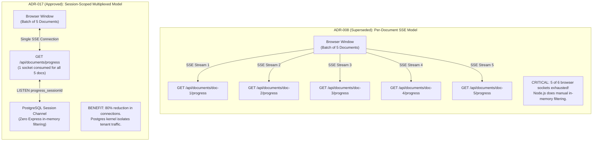
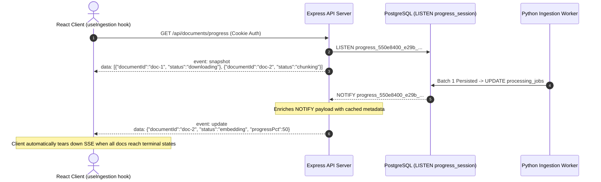

# ADR-017: Session-Scoped Real-Time SSE Architecture

- **Status**: Approved (Supersedes [ADR-008](index.md#master-architecture-decision-registry))
- **Date**: 2026-10-10
- **Domain**: Real-Time Streaming & Client Communication
- **Deciders**: Fullstack Solutions Architect, Backend Platform Lead

---

## Context & Problem Statement

Users require real-time visibility into the asynchronous document ingestion pipeline (Downloading -> Validating -> Extracting -> Chunking -> Embedding -> Completed).

In the initial architecture ([ADR-008](index.md#master-architecture-decision-registry)), this was implemented using per-document Server-Sent Events (SSE) endpoints:
- `GET /api/documents/:id/progress`
- `GET /api/documents/:id/status` (polling fallback)

### The Multi-Connection Scaling Bottleneck

Under ADR-013, users can initiate batches of up to **5 concurrent uploads**. In production, ADR-008 caused critical connection failures:

1. **Browser Socket Exhaustion**: Under HTTP/1.1 (prevalent through enterprise proxies and internal load balancers), modern browsers enforce a hard limit of **6 concurrent connections per domain origin**. Consuming 5 sockets solely for progress streams left only 1 socket for all other client requests (session heartbeats, query submission, image loading), causing browser network queuing and UI freezes.
2. **Backend Database Listener Bloat**: In Express, maintaining 5 SSE handlers per user forced the API to either create redundant database listener clients or listen globally on a single un-partitioned channel (`progress_channel`), forcing Node.js to perform CPU-intensive in-memory tenant filtering for every database update.

---

## Architectural Decision

We decided to supersede ADR-008 and consolidate all real-time progress monitoring into a **single, session-scoped static streaming architecture**:

1. **Session-Scoped Push Endpoint (`GET /api/documents/progress`)**:
    - The browser opens **one persistent SSE connection** for the entire user session.
    - On connect, the server executes a fast snapshot query and emits a typed `snapshot` event containing an array of all active documents belonging to that session.
    - Subsequent progress transitions are streamed as individual typed `update` events.

2. **Session-Scoped PostgreSQL NOTIFY Channels**:
    The PostgreSQL database trigger dynamically constructs a session-isolated channel name by prefixing the sanitized session UUID (`progress_{sessionId}`). When worker pods commit batch checkpoints, the trigger automatically publishes a lightweight JSON progress payload to that specific session channel. The Express API listens strictly to the active user's session channel using a dedicated connection pool client. Because PostgreSQL routes notifications directly to the subscribing listener, Node.js never receives or processes event traffic belonging to other sessions.

3. **Session-Scoped Polling Fallback (`GET /api/documents/status`)**:
    If an enterprise firewall blocks SSE connections, the React client automatically falls back to polling `GET /api/documents/status` every 3 seconds, returning the exact same data schema as the `snapshot` frame.

---

## Architecture Evolution Comparison

---

## Event Stream Frame Semantics

---

## Consequences & Trade-Offs

### Positive Consequences

- **80% Connection Overhead Reduction**: A user uploading 5 documents uses exactly 1 persistent connection instead of 5, completely eliminating browser socket exhaustion.
- **Hardware-Level Tenant Isolation**: Session events are partitioned into separate PostgreSQL notification channels (`progress_{sessionId}`). Express never processes or filters out messages meant for other sessions.
- **Named Event Semantics**: Using standard SSE `event: snapshot` and `event: update` provides explicit parsing contracts for the frontend client without heuristic shape guessing.
- **Clean Socket Cleanup**: When the browser disconnects, the API handler executes `UNLISTEN progress_{sessionId}` and releases the database client back to `pgPool`.

### Senior Architectural Scalability Caveat

> **Operational Guardrail**: PostgreSQL `LISTEN/NOTIFY` is well-suited for the platform's designed concurrent session volume (up to several hundred simultaneous active sessions). However, because `LISTEN` requires persistent database connections, scaling to tens of thousands of concurrent users would consume connection capacity on RDS. At hyper-scale, an external distributed message broker (such as **Redis Pub/Sub** or **AWS SQS FIFO + WebSockets**) would supersede PG NOTIFY to decouple real-time push distribution from the relational database.
