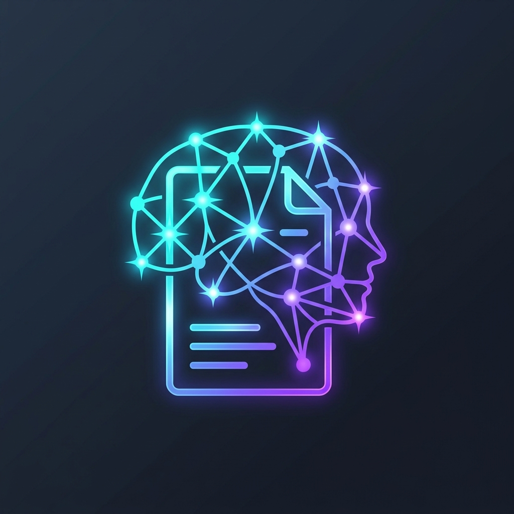
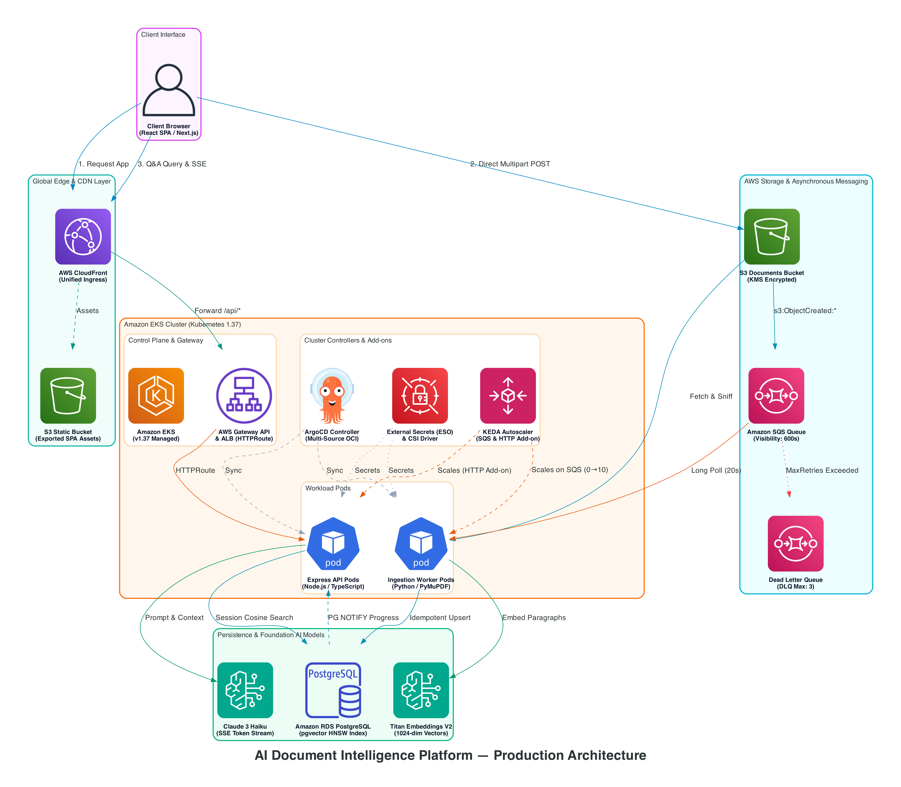

# AI Document Intelligence Platform

  

  <strong>A production-grade, multi-tenant Retrieval-Augmented Generation (RAG) platform on AWS EKS.</strong>

  
  
  
  
  
  
  
  
  
  

---

## Executive Summary

The **AI Document Intelligence Platform** is an enterprise-grade cloud-native RAG solution designed and implemented to process unstructured documents (such as PDF and text files), ingest and index them into dimensional vector embeddings, and serve grounded, streaming question-answering sessions with verified page-level citations.

The platform serves as an authoritative demonstration of senior cloud engineering competencies:
- **AWS DevOps Engineer Professional (AWS-DOP)** capabilities spanning EKS, Pod Identity Associations, RDS with pgvector, SQS/DLQ messaging, S3 direct presigned uploads, CloudFront edge delivery, AWS Secrets Manager, and ACM TLS termination.
- **Certified Kubernetes Administrator (CKA)** skills implementing modern Kubernetes Gateway API (`GatewayClass`, `Gateway`, `HTTPRoute`), KEDA event-driven autoscaling, External Secrets Operator (ESO), Secrets Store CSI Driver, and zero-trust service topologies.
- **GitOps Continuous Delivery** via ArgoCD leveraging Multi-Source ApplicationSets pinned to exact git commit SHAs and private AWS ECR OCI Helm charts.

---

## Architectural Qualities & Production Invariants

| Quality | Implementation Architecture | Production Rationale |
| :--- | :--- | :--- |
| **🔄 Event-Driven Autoscaling** | KEDA HTTP Add-on for API; KEDA SQS trigger (0→10) for Python worker daemon | Scale workloads dynamically to zero during idle periods to eliminate unnecessary cloud computing costs. |
| **🔒 Zero Static Credentials** | IAM Database Authentication, EKS Pod Identity Associations, AWS Secrets Store CSI Driver | Prevents long-lived database passwords or AWS access keys from ever being committed to source or mounted as static secrets. |
| **🌐 Modern Ingress Topology** | Kubernetes Gateway API + AWS Load Balancer Controller (`HTTPRoute`) | Replaces legacy Kubernetes Ingress controllers with modern role-oriented routing standards. |
| **🔑 Dynamic Credential Rotation** | External Secrets Operator (ESO) rotating 12-hour AWS ECR tokens hourly | Resolves private OCI Helm chart pull authentication failures in ArgoCD cleanly without human intervention. |
| **♻️ Resilient Ingestion & Idempotency** | PostgreSQL `ON CONFLICT DO UPDATE`, SQS visibility timeouts (600s), batch checkpoint resume | Guarantees that worker crashes or network interruptions can resume without duplicating chunks or re-embedding prior batches. |
| **📦 Strict Artifact Immutability** | "Build once in dev, promote identical immutable artifacts to stg/prod" across containers, Helm charts, and frontend assets | Guarantees that staging and production run identical tested binaries, eliminating environment drift. |
| **☁️ Direct S3 Upload Acceleration** | AWS SDK v3 S3 Presigned POST with embedded policy conditions (`content-length-range`, `Content-Type`) | Bypasses backend API servers during multi-megabyte file uploads, enforcing storage size and MIME restrictions directly at S3. |
| **🔌 Strategy/Plugin Providers** | Decoupled provider strategy pattern for Embeddings and LLMs with runtime environment toggle | Allows developers to switch between AWS Bedrock (Titan V2 & Claude) and local containerized offline models (Sentence-Transformers & Ollama). |
| **🚀 Commit-Pinned GitOps** | ArgoCD ApplicationSet Matrix generator combining private OCI Helm charts with Git environment values | Avoids drift caused by tracking floating git branches or mutable tags by pinning deployments to exact, audited commit SHAs. |
| **🔀 Serialized CI/CD Governance** | Concurrency groups (`git-commit-dev`, `git-commit-${env}-app`) with non-destructive selective checkouts | Prevents git ref locking collisions and protects sibling microservices on shared environment release branches. |

---

## System Architecture Overview

  

---

## Documentation Structure

Explore the documentation across dedicated engineering sections:

- **[Architecture](architecture/overview.md)**: Architectural boundaries, polyglot split rationale, end-to-end data flows, and AWS cost-optimization modeling.
- **[Design Decisions (ADRs)](design-decisions/index.md)**: Formal Architecture Decision Records detailing trade-offs, evaluated alternatives, and consequences.
- **[Challenges & Solutions](challenges/index.md)**: 14 in-depth engineering post-mortems documenting real-world challenges encountered and overcome during implementation.
- **[Database Architecture](database/schema.md)**: PostgreSQL + pgvector schema, HNSW indexing parameters, access patterns, session-scoped PG NOTIFY triggers, and dual-ORM strategy.
- **[Microservices](services/api/overview.md)**: Deep dives into the Express API, Python background worker, and Next.js frontend client.
- **[Cloud Infrastructure](infrastructure/aws/overview.md)**: Modular Terraform configurations for AWS foundational resources and Kubernetes cluster platform controllers.
- **[Security Architecture](security/overview.md)**: Multi-layer defense-in-depth model spanning HMAC session signatures, IAM DB auth, Pod Identity, and tenant isolation.
- **[Deployment & CI/CD](deployment/overview.md)**: Tag-driven multi-environment deployment pipelines, immutable artifact promotion, and serialized GitOps commit synchronization.
- **[Development & Operations](development/local-setup.md)**: Local development setup, containerized mock stacks (LocalStack / pgvector / local LLMs), standalone service guides, and global environment variables.
- **[Testing & Reliability](testing/strategy.md)**: Testing strategy, unit test suites, infrastructure parity testing, and observability instrumentation.
