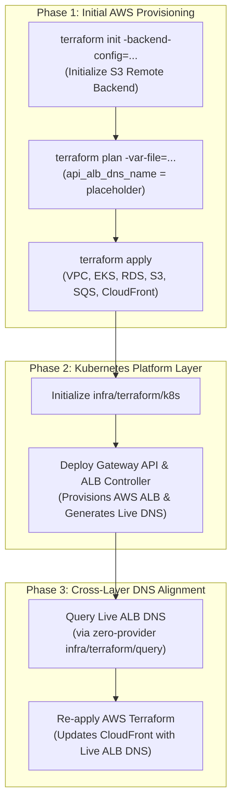

# AWS Initial Provisioning Runbook

> Operational execution guide covering state initialization, multi-environment overrides, Apple Silicon lock file invariants, and the CloudFront-ALB circular dependency resolution.

---

## Phased Infrastructure Bootstrap Flow

Provisioning the platform from zero requires an orchestrated sequence to resolve cross-layer dependencies between the AWS cloud layer and the Kubernetes platform layer:

---

## Multi-Environment Configuration Layout

Environment parameters and remote state configurations are strictly isolated under `environments/{env}/`:

- **Backend Configuration (`backend.config.hcl`)**:
  - Defines S3 state storage coordinates: `bucket`, `key`, `region`, and native S3 state locking.
  - Dedicated state keys per environment: `dev/terraform.tfstate`, `stg/terraform.tfstate`, `prod/terraform.tfstate`.
- **Variable Overrides (`{env}.tfvars`)**:
  - Declares environment-specific CIDR allocations, instance classes, and cluster names.
  - Keeps modules environment-agnostic without hardcoded identifiers.

---

## Step-by-Step CLI Runbook

### 1. Remote Backend Initialization
From `infra/terraform/aws`:
- Initialize Terraform referencing the target environment's backend config:
  Pass `-backend-config=environments/{env}/backend.config.hcl`.
- Terraform downloads required provider plugins (`hashicorp/aws` v6.67.0) and validates state connectivity.

### 2. Apple Silicon (ARM64) Lock File Invariant
When developing from macOS (Apple Silicon ARM64 machines):
- Local provider hashes must be mirrored with Linux AMD64 platform hashes so CI/CD runners can hit the provider cache without divergence.
- Run `terraform providers lock -platform=linux_amd64 -platform=darwin_arm64` and commit the updated `.terraform.lock.hcl`.

### 3. Execution Plan Generation
- Run `terraform plan` passing `-var-file=environments/{env}/{env}.tfvars`.
- During the first run, `api_alb_dns_name` defaults to a temporary placeholder, allowing CloudFront to instantiate before the Kubernetes ALB exists.
- Review planned resource creations across networking, storage, and EKS.

### 4. Infrastructure Application
- Apply the verified configuration using `terraform apply -var-file=environments/{env}/{env}.tfvars`.
- Once complete, Terraform exports outputs required by downstream workloads: EKS cluster endpoints, VPC IDs, SQS queue URLs, and ECR repository endpoints.

---

## The CloudFront-ALB Circular Dependency Resolution

### The Architectural Problem
- **CloudFront** requires the Application Load Balancer DNS name to establish the reverse-proxy origin for `/api/*` requests.
- The **ALB** is provisioned dynamically by the Kubernetes Gateway API and AWS Load Balancer Controller inside the EKS cluster.
- EKS requires the **VPC and IAM infrastructure** created by the AWS Terraform layer.
- Applying either layer in isolation without placeholder handling creates an unresolvable cyclic dependency.

### The Automated Solution
1. **Initial Deployment**: AWS Terraform provisions the CloudFront distribution with `api_alb_dns_name = "placeholder.invalid"`. CloudFront deploys successfully and begins serving static frontend assets from S3.
2. **Kubernetes Deployment**: Deploy `infra/terraform/k8s`. The AWS Load Balancer Controller provisions the public ALB and allocates a dynamic DNS name (e.g. `k8s-default-apigatew-*.elb.amazonaws.com`).
3. **Query Inspection**: The automated CI/CD pipeline runs `infra/terraform/query` to fetch the live ALB DNS name from the Kubernetes remote state in under 3 seconds.
4. **CloudFront Convergence**: Re-apply AWS Terraform with `api_alb_dns_name = <live_alb_dns>`. CloudFront updates its custom origin target without downtime, completing the end-to-end edge route.

---

## Post-Provisioning Verification Checklist

- **EKS Cluster Access**: Verify cluster status and Pod Identity agent pods running in `kube-system`.
- **RDS PostgreSQL pgvector**: Connect via bastion or cluster pod and verify the `vector` extension is active:
  Execute `SELECT * FROM pg_extension WHERE extname = 'vector';`.
- **SQS Queue Notification**: Upload a sample file to the S3 Documents bucket and verify an event message appears in the primary SQS queue.
- **CloudFront Distribution**: Verify the distribution status is `Deployed` and that accessing the CloudFront domain returns the Single Page Application index.
