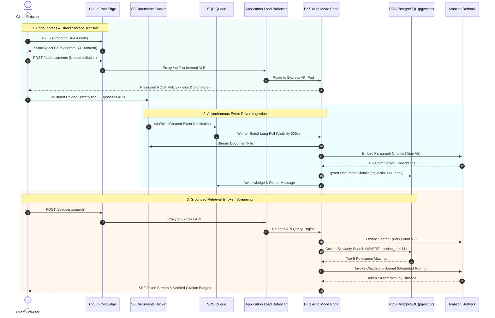

# AWS Cloud Infrastructure Overview

> Production-grade, environment-agnostic AWS infrastructure provisioned via modular Terraform, establishing zero-credential workload execution, edge-routed ingestion, and multi-AZ resilience.

---

## Architectural Role & Principles

The AWS cloud infrastructure establishes the foundational hosting, persistence, messaging, and compute platform for the AI Document Intelligence Platform.

- **EKS Auto Mode Compute (Kubernetes 1.37)**: Replaces legacy EC2 Managed Node Groups and manual launch templates with automated AWS-managed `general-purpose` and `system` node pools, delivering automated OS patching, right-sizing, and built-in EBS CSI storage integration.
- **Zero Static Credentials**: Workload pods assume IAM roles dynamically via native **EKS Pod Identity Associations**, while database connections utilize ephemeral 15-minute IAM tokens via `@aws-sdk/rds-signer`.
- **Direct S3 Multipart Ingestion**: Ingestion uploads completely bypass backend API instances; browser clients upload directly to S3 via presigned POST policies with storage-layer size and MIME validation.
- **Unified CloudFront Edge Routing**: A single CloudFront distribution routes static Single Page Application assets (`/*`) to Amazon S3 and API traffic (`/api/*`) to the internal Application Load Balancer, eliminating browser mixed-content rejections without requiring custom domain ACM certificates.
- **Strict Multi-AZ Network Isolation**: All compute pods and database instances operate exclusively in private subnets across two Availability Zones (`us-east-1a` and `us-east-1b`), accessing the internet via dedicated NAT Gateways.

---

## AWS Infrastructure Topology

The pre-rendered architecture topology below depicts the cloud primitives provisioned by the AWS Terraform layer:

  

    
  

---

## Core Cloud Services Matrix

| AWS Service                       | Architecture Domain       | Operational Role & Configuration                                                                                                                                                                                   |
| --------------------------------- | ------------------------- | ------------------------------------------------------------------------------------------------------------------------------------------------------------------------------------------------------------------ |
| **Amazon VPC**                    | Network Isolation         | Multi-AZ network across 2 AZs; 2 private subnets, 2 public subnets, 2 NAT Gateways, and DNS hostnames enabled.                                                                                                     |
| **Amazon EKS (Auto Mode)**        | Container Compute         | Managed Kubernetes 1.37 cluster with automated node pools (`general-purpose`, `system`), native managed add-ons (`eks-pod-identity-agent`, `aws-secrets-store-csi-driver-provider`), and CloudWatch audit logging. |
| **Amazon RDS PostgreSQL**         | Relational & Vector Store | Multi-AZ PostgreSQL 16 engine with native `pgvector` extension, IAM database authentication enabled, and dedicated db subnet group.                                                                                |
| **Amazon S3**                     | Storage & Static Assets   | Dual-bucket architecture: private Documents bucket (presigned multipart ingestion) and private Frontend bucket (static build hosting with OAC).                                                                    |
| **Amazon SQS & DLQ**              | Asynchronous Messaging    | S3 `ObjectCreated` event-driven queue; 20s long-polling, 600s visibility timeout, and Dead Letter Queue with 3-retry max receive count.                                                                            |
| **Amazon CloudFront**             | Global Edge Routing       | Dual-origin CDN distribution: S3 default origin for SPA assets and ALB custom origin for `/api/*` with `CachingDisabled` policy.                                                                                   |
| **Amazon ECR**                    | Container & OCI Registry  | Slash-delimited private repositories (`${project}/${env}/${app}`) hosting Docker container images and Helm OCI charts in identical namespaces.                                                                     |
| **AWS Secrets Manager & SSM**     | Configuration Management  | Dynamic storage of database credentials, HMAC session signing secrets, and environment parameters mounted into pods via CSI drivers.                                                                               |
| **AWS Certificate Manager (ACM)** | Transport Security        | TLS certificate management and automated domain validation for external load balancer listeners and CloudFront distributions.                                                                                      |

---

## Cross-Cutting Traffic & Security Flow

The sequence below illustrates the end-to-end cloud traversal across the AWS perimeter:

---

## Sub-Module Documentation

For in-depth module breakdowns and operational provisioning instructions, consult:

- [Terraform Modules Specification](terraform-modules.md): Detailed inputs, outputs, and resource mappings for all 8 AWS child modules.
- [Initial Provisioning Guide](initial-setup.md): Step-by-step CLI runbooks, backend state initialization, multi-environment isolation, and circular dependency resolution.
