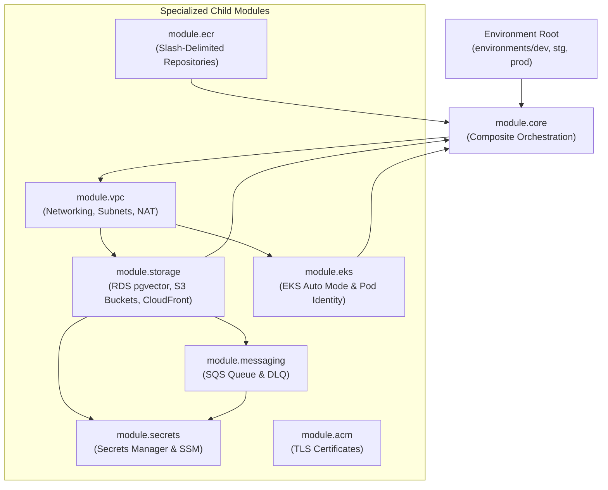

# AWS Terraform Modules Specification

> Modular, reusable, and environment-agnostic Terraform modules under `infra/terraform/aws/modules/` orchestrating cloud resources across networking, compute, persistence, and security.

---

## Module Hierarchy & Dependency Graph

The AWS infrastructure follows a clean hierarchical structure where the root environment (`environments/{env}/`) invokes the composite `core` module, which orchestrates seven specialized child modules:

---

## Child Module Specifications

### 1. Core Orchestration Module (`modules/core`)
- **Purpose**: High-level composition module that receives root environment variables, computes CIDR subnet allocations, calls child modules in dependency order, and re-exports consolidated outputs.
- **Key Resources**: Coordinates inter-module dependencies without instantiating AWS resources directly.
- **Inputs**: `project_name`, `environment`, `vpc_cidr`, `db_name`, `db_username`, `api_alb_dns_name`, `github_actions_ci_role`.
- **Outputs**: Re-exports all underlying VPC IDs, EKS cluster endpoints, RDS hostnames, S3 bucket names, SQS URLs, ECR registry URLs, and CloudFront distribution IDs.

### 2. Networking & Isolation Module (`modules/vpc`)
- **Purpose**: Provisions isolated multi-AZ networking foundation across two Availability Zones (`us-east-1a` and `us-east-1b`).
- **Key Resources**:
  - `aws_vpc`: Dedicated VPC with DNS hostnames and resolution enabled.
  - `aws_subnet` (4x): Two public subnets for ingress/egress, two private subnets for compute/data.
  - `aws_internet_gateway`: Inbound/outbound internet gateway attached to public subnets.
  - `aws_nat_gateway` (2x): Redundant NAT Gateways placed in public subnets with dedicated Elastic IPs.
  - `aws_route_table` & associations: Route tables directing private subnet egress to AZ-specific NAT gateways.
- **Inputs**: `project_name`, `environment`, `vpc_cidr`, `public_subnets`, `private_subnets`, `azs`.
- **Outputs**: `vpc_id`, `public_subnets`, `private_subnets`, `vpc_cidr_block`.

### 3. Container Compute & Identity Module (`modules/eks`)
- **Purpose**: Deploys managed Amazon EKS cluster operating in **EKS Auto Mode** with native Pod Identity Associations, managed cluster add-ons, and administrative access entries.
- **Key Resources**:
  - `aws_eks_cluster`: Managed Kubernetes 1.37 cluster with Auto Mode enabled (`general-purpose` and `system` node pools).
  - `aws_eks_pod_identity_association`: Binds IAM roles to service accounts for Express API (`api-sa`), Python Worker (`worker-sa`), and External Secrets (`external-secrets-sa`).
  - `aws_iam_role` & policies: Least-privilege IAM policies granting Bedrock invoke, S3 read/write, SQS receive/delete, RDS IAM connect, and SSM/Secrets Manager access.
  - `aws_eks_access_entry`: Cluster access entries granting `AmazonEKSClusterAdminPolicy` to administrator ARNs for AWS Console management.
- **Managed Cluster Add-ons (`addons` configuration)**:
  - `eks-pod-identity-agent`: Configured with `before_compute = true` to guarantee the Pod Identity daemonset initializes on nodes before application workloads launch, enabling non-blocking, immediate IAM credential acquisition for pods.
  - `aws-secrets-store-csi-driver-provider`: Managed add-on provisioning the Secrets Store CSI Driver and AWS provider, with custom parameters:
    - Secret rotation poll interval set to 120 seconds (`rotationPollInterval: 120s`) for automated credential refreshes.
    - Kubernetes Secret synchronization enabled (`syncSecret.enabled: true`) for environment variable binding.
    - Projected service account token audience configured for Pod Identity (`tokenRequests.audience: pods.eks.amazonaws.com`).
- **Auto Mode Managed Add-ons**: Built-in automated management of CoreDNS, kube-proxy, Amazon VPC CNI, and the EBS CSI driver, eliminating manual operational maintenance of core Kubernetes networking and storage add-ons.
- **Inputs**: `project_name`, `environment`, `vpc_id`, `private_subnet_ids`, `dbi_resource_id`, `db_credentials_arn`, `documents_sqs_arn`, `documents_dlq_arn`, `documents_bucket_arn`, `ecr_repo_arns`, `admin_user_arns`, `db_username`.
- **Outputs**: `cluster_name`, `cluster_endpoint`, `cluster_certificate_authority_data`, `api_role_arn`, `worker_role_arn`, `external_secrets_role_arn`.

### 4. Storage & Content Delivery Module (`modules/storage`)
- **Purpose**: Establishes persistent vector storage, document staging buckets, and global CDN distribution.
- **Key Resources**:
  - `aws_db_instance`: RDS PostgreSQL 16 engine pre-configured with `pgvector`, multi-AZ failover, encrypted storage, and IAM database authentication enabled.
  - `aws_db_subnet_group`: Private database subnet group binding to private VPC subnets.
  - `aws_s3_bucket` (Documents): Private bucket for multipart presigned uploads with lifecycle expiration rules.
  - `aws_s3_bucket` (Frontend): Private bucket hosting statically compiled Single Page Application assets.
  - `aws_cloudfront_distribution`: Dual-origin CDN with S3 Origin Access Control (OAC) for `/*` and ALB custom origin for `/api/*`.
- **Inputs**: `project_name`, `environment`, `vpc_id`, `private_subnets`, `db_name`, `db_user_name`, `api_alb_dns_name`.
- **Outputs**: `db_address`, `db_port`, `documents_bucket_name`, `documents_bucket_id`, `frontend_bucket_name`, `cloudfront_domain`, `cloudfront_distribution_id`.

### 5. Asynchronous Messaging Module (`modules/messaging`)
- **Purpose**: Manages event-driven handoff from S3 document uploads to background Python ingestion workers.
- **Key Resources**:
  - `aws_sqs_queue`: Standard FIFO/Standard queue with 20-second long-polling and 600-second visibility timeout.
  - `aws_sqs_queue` (DLQ): Dead Letter Queue isolating abandoned payloads after 3 failed delivery attempts.
  - `aws_sqs_queue_redrive_policy`: Redrive policy binding primary queue to the DLQ (`maxReceiveCount = 3`).
  - `aws_sqs_queue_policy`: IAM queue policy permitting `s3:ObjectCreated:*` notifications from the Documents bucket.
- **Inputs**: `project_name`, `environment`, `s3_bucket_arn`.
- **Outputs**: `sqs_queue_url`, `sqs_queue_arn`, `dlq_url`, `dlq_arn`.

### 6. Container Registry Module (`modules/ecr`)
- **Purpose**: Houses container images and Helm OCI charts within hierarchical, slash-delimited namespaces.
- **Key Resources**:
  - `aws_ecr_repository` (API): `${project_name}/${environment}/api` repository.
  - `aws_ecr_repository` (Worker): `${project_name}/${environment}/worker` repository.
  - `aws_ecr_repository_policy`: Account-wide pull permissions enabling cross-environment deployment.
  - `aws_ecr_lifecycle_policy`: Automatic pruning keeping the last 30 untagged images.
- **Inputs**: `project_name`, `environment`, `account_id`.
- **Outputs**: `ecr_registry_url`, `api_repository_url`, `worker_repository_url`.

### 7. Configuration & Secrets Module (`modules/secrets`)
- **Purpose**: Provisions central parameter management for runtime configuration and pod hydration.
- **Key Resources**:
  - `aws_secretsmanager_secret`: Holds database master passwords and HMAC session encryption signing keys.
  - `aws_ssm_parameter`: Stores service endpoints (database host/port, SQS URL, S3 bucket name, CloudFront domain).
- **Inputs**: `project_name`, `environment`, `db_name`, `db_username`, `db_host`, `db_port`, `s3_bucket`, `cloudfront_domain`, `sqs_url`, `dlq_url`.
- **Outputs**: `db_secret_arn`, `session_secret_arn`, `ssm_parameter_prefix`.

### 8. Transport Security Module (`modules/acm`)
- **Purpose**: Manages TLS/SSL public certificates for custom domains when integrated.
- **Key Resources**:
  - `aws_acm_certificate`: Wildcard TLS certificate resource with DNS validation.
  - `aws_acm_certificate_validation`: Automated validation status tracker.
- **Inputs**: `domain_name`, `environment`, `validation_method`.
- **Outputs**: `certificate_arn`.

---

## Inter-Module Parameter Coupling

| Providing Module | Output Attribute | Consuming Module | Injected Usage |
|---|---|---|---|
| `vpc` | `private_subnets` | `eks`, `storage` | Pod scheduling and database subnet group binding |
| `vpc` | `vpc_id` | `storage`, `eks` | Security group attachment and network boundary |
| `storage` | `documents_bucket_arn` | `messaging` | SQS queue policy authorization for S3 notifications |
| `storage` | `db_address`, `db_port` | `secrets` | SSM parameters for Express API & Worker DB connection |
| `messaging` | `sqs_queue_url`, `dlq_url`| `secrets` | SSM parameters for worker consumer long-polling |
| `ecr` | `ecr_registry_url` | Root Outputs | Upstream consumption by ArgoCD GitOps and CI/CD promotion |
