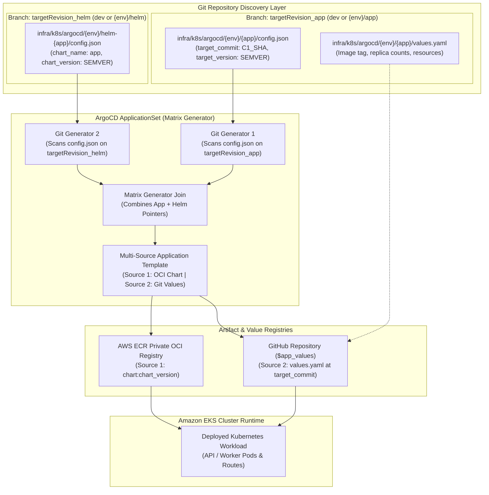
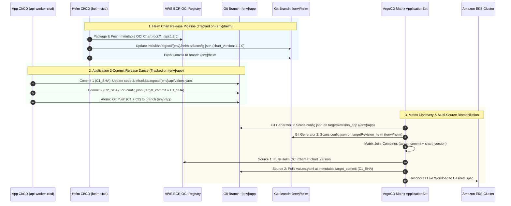

# ArgoCD Multi-Source GitOps Architecture

> Production-grade continuous delivery architecture reconciling containerized workloads from private AWS ECR Helm OCI registries and pinned Git repositories with zero configuration drift.

---

## Architectural Problem & Solution

### The Monolithic GitOps Anti-Pattern
- In conventional GitOps architectures, Helm charts and environment-specific values live in the same Git branch.
- Modifying an environment value triggers chart re-packaging, while upgrading chart templates risks overwriting environment-specific image tags.
- Tracking mutable Git branch names (e.g. `main` or `staging`) or Docker tags (e.g. `latest`) results in silent configuration drift, non-reproducible releases, and audit ambiguity.

### The Decoupled Multi-Source Solution
- The platform implements **ArgoCD Multi-Source Applications** driven by a declarative **ApplicationSet Matrix Generator**.
- Reconciles two decoupled artifact sources per microservice:
  1. **Source 1 (Immutable Helm OCI Artifact)**: The chart template package published to the private AWS ECR OCI registry (`{{chart_name}}:{{chart_version}}`).
  2. **Source 2 (Environment Values & State)**: The Git repository pinned to an immutable commit SHA (`{{target_commit}}`), injecting `$app_values/.../values.yaml`.
- **Decoupled Tracking Branches**: In staging and production, the ApplicationSet Matrix generator reads from two distinct tracking branches:
  - `${targetRevision_app}` points to `{env}/app` (managing application image tags and environment values).
  - `${targetRevision_helm}` points to `{env}/helm` (managing chart release versions).
  - Only in `dev` do both pointers track the trunk branch (`dev`). In higher environments, branch separation is what justifies and necessitates the Matrix Generator, allowing application code and Helm chart templates to release on completely independent cadences.

---

## Multi-Source Reconciliation Flow

The architecture diagram below illustrates how the ArgoCD ApplicationSet uses dual Git generators to discover parameters across separate tracking branches and merges OCI chart templates with Git values:

---

## Directory Structure & Matrix Discovery

The GitOps repository structure under `infra/k8s/argocd/{env}/` strictly isolates workload concerns across distinct tracking branches:

| Directory Path | File | Tracked Branch | Purpose & Contents |
|---|---|---|---|
| `.../{env}/api/` | `config.json` | `${targetRevision_app}` (`{env}/app`, dev: `dev`) | Application release pointer: `{"app": "api", "target_commit": "SHA", "target_version": "v1.0.0"}`. |
| `.../{env}/api/` | `values.yaml` | `${targetRevision_app}` (`{env}/app`, dev: `dev`) | Environment Helm overrides: image repository, image tag, replica counts, and ingress limits. |
| `.../{env}/worker/` | `config.json` | `${targetRevision_app}` (`{env}/app`, dev: `dev`) | Application release pointer: `{"app": "worker", "target_commit": "SHA", "target_version": "v1.0.0"}`. |
| `.../{env}/worker/` | `values.yaml` | `${targetRevision_app}` (`{env}/app`, dev: `dev`) | Worker Helm overrides: SQS queue length thresholds and pod resource limits. |
| `.../{env}/helm-api/` | `config.json` | `${targetRevision_helm}` (`{env}/helm`, dev: `dev`) | Chart release pointer: `{"app": "api", "chart_name": "api", "chart_version": "1.0.0"}`. |
| `.../{env}/helm-worker/` | `config.json` | `${targetRevision_helm}` (`{env}/helm`, dev: `dev`) | Chart release pointer: `{"app": "worker", "chart_name": "worker", "chart_version": "1.0.0"}`. |

---

## Dual Release Lifecycles & Matrix Coordination

Because application microservices and Helm charts release on independent cycles, two separate CI/CD pipelines target their respective tracking branches. The ArgoCD Matrix Generator bridges them during cluster reconciliation:

### 1. Application Release Dance (`{env}/app`)
Managed by `.github/workflows/api-worker-cicd.yml`:
- **Commit 1 (Artifact & Values Update)**: Updates the microservice code and writes the newly built container image tag to `values.yaml`, producing Git commit `C1_SHA`.
- **Commit 2 (Target Commit Pinning)**: Updates `config.json` setting `"target_commit": "C1_SHA"` and the human-readable release version.
- **Atomic Push**: Commits 1 and 2 are pushed together to `{env}/app` (or directly to `dev` trunk in dev with `target_commit: dev`), ensuring ArgoCD never reconciles an unpinned intermediate state.

### 2. Helm Chart Release Dance (`{env}/helm`)
Managed by `.github/workflows/helm-cicd.yml`:
- **Immutable OCI Packaging**: Lints and packages the Helm chart into an OCI tarball and publishes directly to the private AWS ECR OCI registry with semantic versioning.
- **Discovery Configuration Pointer**: Updates `infra/k8s/argocd/{env}/helm-{app}/config.json` with the new `chart_version`.
- **Branch Push**: Pushes the update to `{env}/helm` (or `dev` trunk in dev) through a concurrency-serialized rebase loop.

### Why Matrix + Multi-Sourcing Is Necessary
In development, both pointers track `dev` for rapid iteration. In staging and production, tracking different branches is strictly required:
- Changing application business logic or environment scaling parameters must not force an arbitrary bump or re-release of the underlying Helm packaging chart.
- Patching a Kubernetes manifest template across all services must not overwrite or roll back active application Git commit references.
- Without the ApplicationSet Matrix generator, ArgoCD cannot join discovery parameters across two distinct branch revisions to construct a unified multi-source Application.

---

## Sync Policy & Self-Healing Safeguards

The ArgoCD ApplicationSet configures automated self-healing and pruning rules:

- **Automated Pruning (`prune: true`)**: Orphaned Kubernetes resources removed from the Git repository or Helm chart are automatically deleted from the cluster.
- **Automated Self-Healing (`selfHeal: true`)**: Manual changes or configuration drifts applied directly via `kubectl` are immediately overwritten and reconciled back to the Git source of truth within 3 minutes.
- **Namespace Auto-Creation (`CreateNamespace=true`)**: Target workload namespaces (`default`, `keda`, `argocd`) are dynamically created if absent.
- **Sync Waves (`sync-wave: "10"`)**: Enforces explicit dependency ordering across database migration jobs, service accounts, and application deployments.
